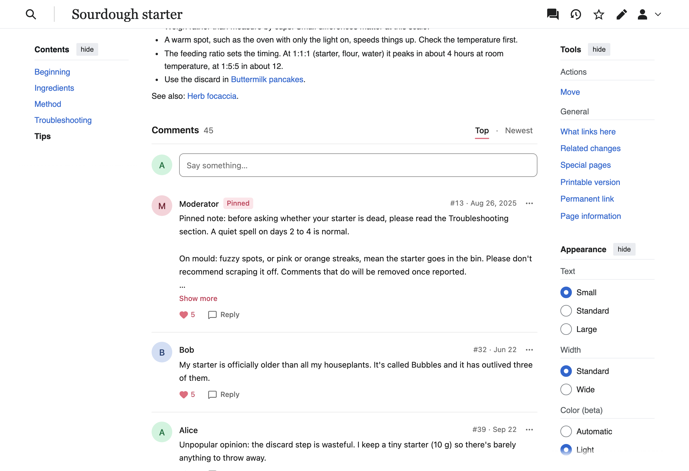
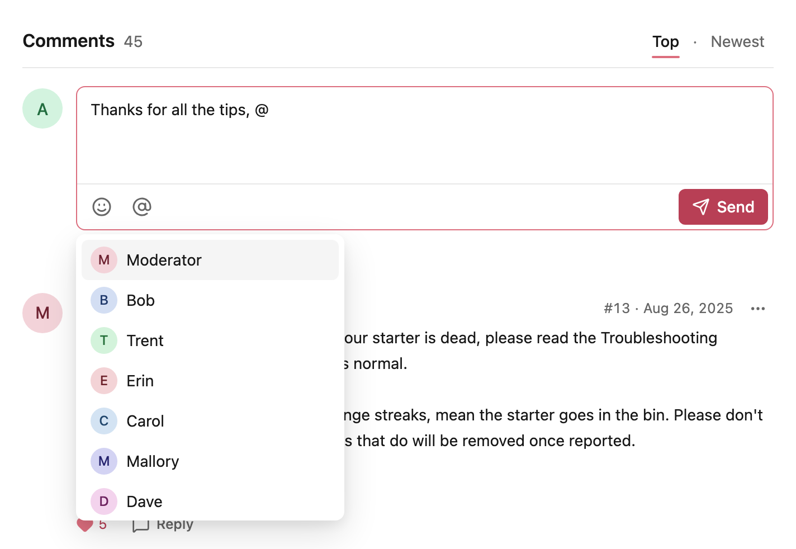
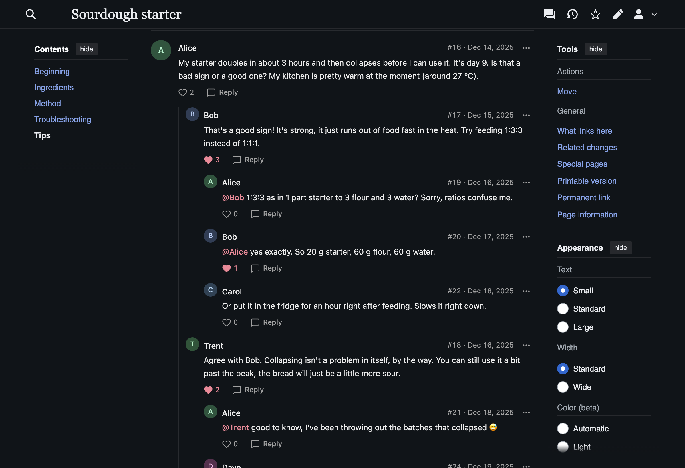
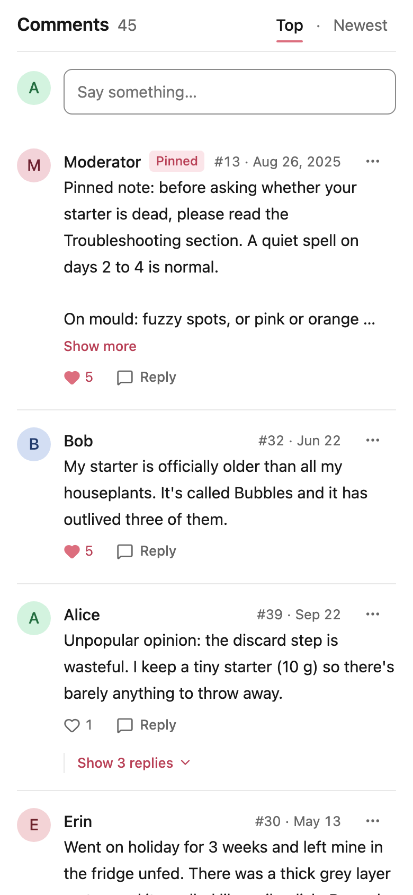
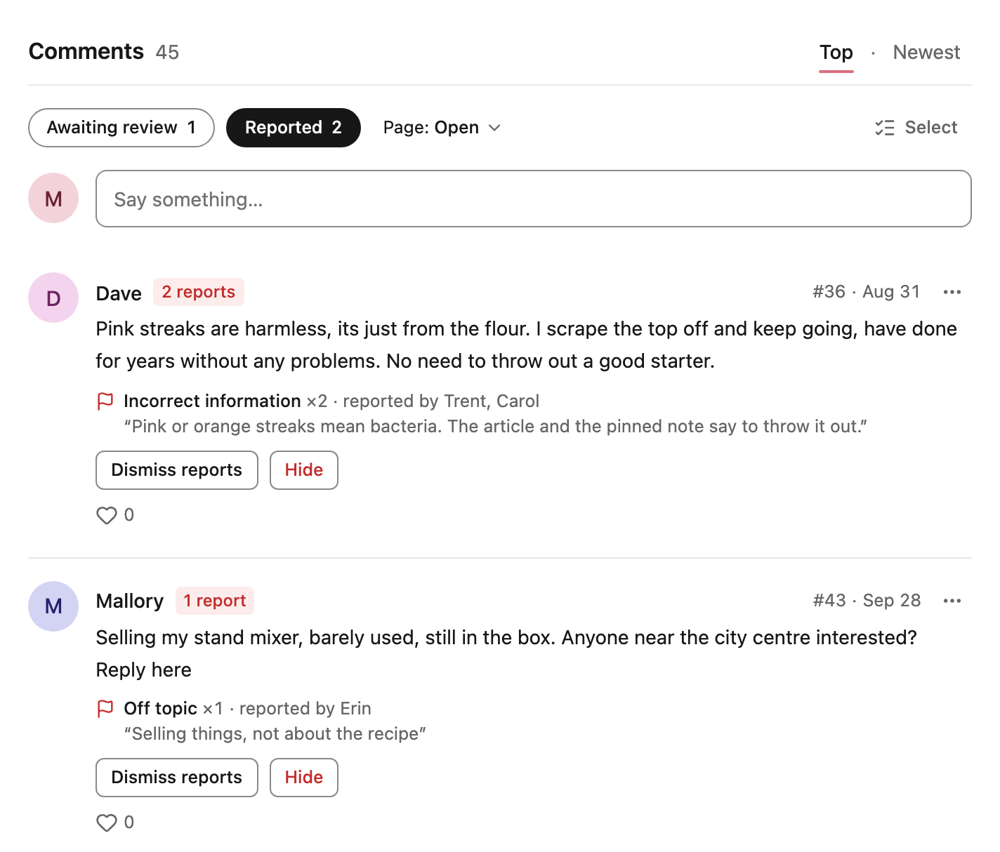
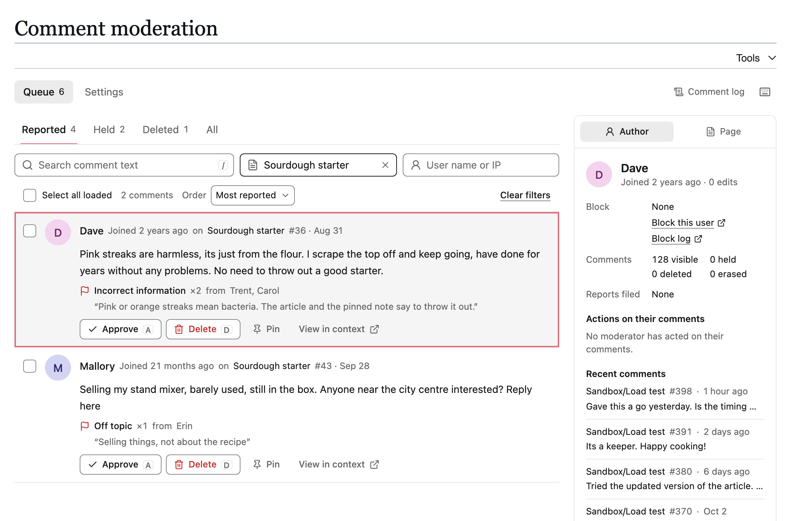
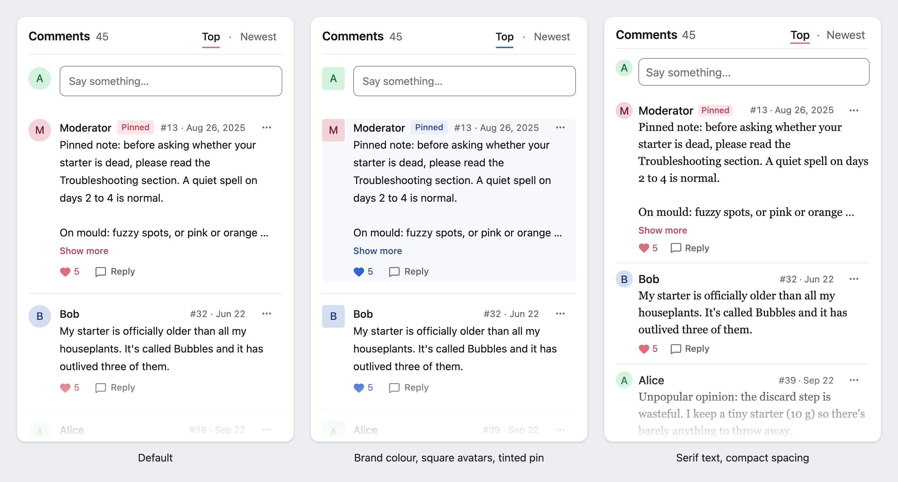

English | [简体中文](README.zh-CN.md)

# GlowThread

GlowThread is a MediaWiki extension that adds a comment section under articles. Readers post, reply, like and report comments with their wiki account. Moderators review comments in the comment section or in one queue for the whole wiki.



MediaWiki 1.43 or later · MIT License · English, Simplified Chinese and Traditional Chinese

[What it is for](#what-it-is-for) · [Features](#features) · [Install](#install) · [Change how it works and looks](#change-how-it-works-and-looks) · [Develop](#develop) · [Documentation](#documentation)

## What it is for

GlowThread is for wikis that want comments under their articles. Readers comment with their wiki account and do not need to edit wikitext. It is an alternative to talk pages, which need wikitext and signatures, and to external comment services, which need separate accounts and load code from other sites.

Comments are stored in the wiki's database and use the wiki's accounts, rights, blocks, logs, Echo notifications and CheckUser records. GlowThread loads nothing from other sites and sends nothing to them.

Wikis that use FlowThread 1.3.x can switch to GlowThread and import their comments.

## Features

### Comments and replies

Comments are plain text with links, @mentions and emoji. Each comment shows the author, an avatar drawn from the name, the time and a floor number (#42). Replies show two levels deep, and longer conversations unfold in place ("Show N more replies"). The list sorts by "Top" or "Newest", moderators can pin comments, and every comment has a permalink. Typing @ opens a list of the people in the conversation and other users of the wiki. Only a name picked from that list becomes a mention, and Echo notifies that person. Unsent text is kept as a draft in the browser.



### Skins, dark mode and phones

The section follows the skin's light or dark mode. It is tested on Vector 2022, legacy Vector, Citizen and Minerva.

<p>
  
  
</p>

### Moderation

Moderators see held and reported comments in the comment section, with the reasons, and can approve them, hide them or dismiss the reports there. They can also open, lock or close the comments of a page.



Special:GlowThread lists reported, held and deleted comments from the whole wiki, with filters, bulk actions, undo and keyboard shortcuts (`j`, `k`, `a`, `d`, `r`, and `?` lists them all). Beside the queue is the record of the comment's author or page: their comments, blocks and past moderation. Every moderation action is logged in Special:Log.



### Spam and abuse

New comments go through two kinds of checks:

- **Refused:** comments over the rate limits (per account and per IP address) or over the caps on length and mentions, the same text posted twice in a short time, and new comments from an author who already has too many waiting for review.
- **Held for review:** comments caught by the word filter (sysops edit its rules on the wiki) or by SpamBlacklist, comments from new accounts until one of theirs is approved, and comments that several established users report (accounts at least a week old that have a published comment). A comment a moderator approved is not held by reports again. Accounts still waiting for their first approved comment cannot like comments yet.

### Performance

A small loader reserves space for the section, and the comment app (about 64 kB gzip) loads when the reader scrolls near it. The ⋯ menu (about 22 kB) and, for logged-in readers, the composer and moderation tools (about 20 kB) come as separate modules when needed. A CDN such as Varnish can cache the first page of comments for logged-out readers, and MediaWiki purges it when it changes. With or without a CDN, MediaWiki's object cache keeps that first page and a summary of each page's comments, cleared on every change, so most list requests run none of the comment queries ([details](docs/caching.md#the-wikis-object-cache)). Without JavaScript, a short notice shows in place of the comments.

### Theming

Colours, fonts, sizes, spacing, corner radii and motion are CSS custom properties, with separate values for dark mode. Site CSS such as MediaWiki:Common.css can set them without `!important`. Stable class names (`ext-glowthread-<part>`) allow styling single parts, such as pinned comments.



### Languages

The interface is in English, Simplified Chinese and Traditional Chinese, through MediaWiki's message system. Layouts mirror for right-to-left languages, comment text keeps its own direction, dates follow the user's language, and Chinese, Japanese and Korean text uses the reader's system fonts. The [Chinese README](README.zh-CN.md) shows the same screens in Chinese.

### FlowThread

GlowThread can replace FlowThread 1.3.x. An importer copies comments, likes, reports and page settings, and old links keep working. See [Coming from FlowThread](#coming-from-flowthread).

## Requirements

- MediaWiki 1.43 or later. The tests run on 1.43 and 1.46.
- PHP 8.1 or later, as MediaWiki 1.43 needs.
- A database with window functions: MariaDB 10.2 or later, MySQL 8.0 or later, or SQLite 3.25 or later. The development wiki runs on MariaDB 10.11 or MySQL 8.0, and the PHP tests on SQLite. PostgreSQL supports the SQL but is not tested.
- Optional: [Echo](https://www.mediawiki.org/wiki/Extension:Echo) for notifications, [CheckUser](https://www.mediawiki.org/wiki/Extension:CheckUser) for records of who posted from where, and [SpamBlacklist](https://www.mediawiki.org/wiki/Extension:SpamBlacklist) to check links in comments. GlowThread works without them, minus those features.

No Composer packages and no Node.js are needed to install it. The built browser code is committed in `resources/dist/`.

Check [Limitations](#limitations) too. GlowThread has no comment editing, no anonymous posting and no real-time updates.

## Install

Coming from FlowThread? Do not load both. Follow [Migrating from FlowThread](docs/migrating-from-flowthread.md) instead.

1. Put the extension in `extensions/GlowThread`, for example from the wiki's root folder:

   ```sh
   git clone https://github.com/Laoweek/GlowThread.git extensions/GlowThread
   ```

   A ZIP download unpacks to a folder with another name, such as `GlowThread-main`. Rename that folder to `GlowThread`.

2. Add this line to `LocalSettings.php`:

   ```php
   wfLoadExtension( 'GlowThread' );
   ```

3. Create the tables:

   ```sh
   php maintenance/run.php update
   ```

4. Open Special:Version and check that GlowThread is listed. Open an existing article in the main namespace and scroll down: the comment section appears under the content.

5. If Echo is loaded, let readers mute one person instead of all comment notifications:

   ```php
   $wgEchoPerUserBlacklist = true;
   ```

Comments appear on existing pages in the main namespace. Talk pages, special pages and the main page never get comments. `$wgGlowThreadNamespaces` changes the namespaces ([Configuration](docs/configuration.md#localsettings-variables)).

If a CDN or the file cache keeps page HTML for logged-out readers, pages cached before the install show no comment section until they expire or are purged. See [Running behind a CDN](docs/caching.md).

<details>
<summary>Optional: block web access to the development folders</summary>

The extension folder also holds `client/`, `dev/`, `docs/`, `scripts/` and `tests/`, and `vendor/` after `composer install`. Readers need none of them: browsers get GlowThread's code through `load.php`.

Apache, in the server configuration (or in `.htaccess`, if `AllowOverride` includes `FileInfo`):

```apache
RedirectMatch 404 (?i)/extensions/GlowThread/(\.[^/]*|client|dev|docs|scripts|tests|vendor)(/|$)
```

nginx, in the `server` block, above the other `location ~` blocks. If a `location ^~` block covers the `extensions/` folder, put the rule inside that block instead:

```nginx
location ~* /extensions/GlowThread/(\.[^/]*|client|dev|docs|scripts|tests|vendor)(/|$) {
    deny all;
}
```

</details>

### Coming from FlowThread

GlowThread can replace FlowThread 1.3.x. Its importer copies comments, likes, reports and page settings, never writes to FlowThread's tables, and can run again until the wiki switches to GlowThread. Old permalinks (Special:FlowThreadLink) and links to `#flowthread` keep working. Site CSS that targets `#flowthread` must change to `#glowthread`. The setting `$wgGlowThreadLegacyCompat`, which a migrated wiki keeps on, shows FlowThread's old notifications and log entries, and answers FlowThread's API read-only for old clients.

- [Migrating from FlowThread](docs/migrating-from-flowthread.md): the runbook, with checks and stop conditions
- [FlowThread data mapping](docs/migration-data.md): what happens to each row, and the import choices

### Upgrading

Replace the files in `extensions/GlowThread`, then run `php maintenance/run.php update` at once. A new version can read columns that the update adds, and comment lists fail until it has run. Browsers get the new bundles through ResourceLoader on their own.

## First steps

### Rights and groups

| Right | Default groups | Allows |
| --- | --- | --- |
| `glowthread-post` | `user` | Post and reply, delete one's own comments |
| `glowthread-react` | `user` | Like |
| `glowthread-report` | `user` | Report |
| `glowthread-trusted` | `sysop`, `bot` | Skip the new-account gate. Comments by these users are never held by reports |
| `glowthread-moderate` | `sysop` | Special:GlowThread, moderation in the comment section, page states, seeing held and deleted comments |
| `glowthread-erase` | `sysop` | Erase deleted comments for good (with `glowthread-moderate`), read Special:Log/glowthread-private |
| `glowthread-configure` | `sysop` | Change the on-wiki settings, test the word filter |
| `glowthread-viewlog` | everyone while the `publicLog` setting is on, otherwise users with `glowthread-moderate`, `glowthread-erase` or `glowthread-configure` | Read Special:Log/glowthread, and its entries in RecentChanges and watchlists |

Anonymous posting is not supported. Keep the first three rights away from the `*` group. Give rights to other groups as usual, for example to a group of comment moderators:

```php
$wgGroupPermissions['commentmod']['glowthread-moderate'] = true;
```

Blocks work as for edits. A partial block stops reader actions only on the pages or namespaces it covers. A moderator under any block cannot moderate. More in [Configuration](docs/configuration.md#rights).

### Where moderators work

- **In the comment section.** Moderators also see held and deleted comments, with the reason they were held or reported, and a bar to filter the page's held or reported comments, select several, and open, lock or close the page's comments.
- **On Special:GlowThread.** The queue of the whole wiki: "Reported", "Held", "Deleted" and "All", with bulk actions, undo and keyboard shortcuts. Next to it, the record of the selected comment's author or page.
- **On Special:GlowThread/settings.** The new-account gate, the automatic hold, report reasons, length and mention caps, the duplicate check, whether the comment log is public, and the word filter with a test box.

The [moderation guide](docs/moderation.md) explains every action.

### Settings to look at first

Defaults are chosen to work on a small or medium wiki. Check these three with your community:

- **The new-account gate**: comments of accounts younger than 24 hours wait for review until one is approved (`$wgGlowThreadNewAccountHours`, `$wgGlowThreadNewAccountApproved`).
- **Automatic holds**: a comment is held once 3 established users report it (`$wgGlowThreadAutoHoldReporters`).
- **The word filter**: rules on the page MediaWiki:GlowThread-filter. Empty by default.

## Change how it works and looks

### Settings

GlowThread is set up in two places:

- **`LocalSettings.php`** holds every setting: namespaces, limits, rate limits, the CDN, the theme and more. [Configuration](docs/configuration.md) lists them with their defaults.
- **Special:GlowThread/settings** lets users with `glowthread-configure` (and `glowthread-moderate`, which opens Special:GlowThread) change some of them on the wiki, without a server change: the length and mention caps, the duplicate check, the new-account gate, the automatic hold, the report reasons and whether the comment log is public. Each change asks for a reason and goes into Special:Log/glowthread. A setting whose variable `LocalSettings.php` sets is locked to that value, and `$wgGlowThreadOnWikiSettings` locks others at their defaults.

### Change the look

GlowThread follows the wiki's light and dark mode and needs no setup. Site CSS can change colours, fonts, sizes, spacing, corner radii and motion with CSS custom properties, in light and dark mode, for example in MediaWiki:Common.css:

```css
:root {
	--glowthread-color-accent: #3366cc;
	--glowthread-night-color-accent: #88a3e8;
	--glowthread-radius-surface: 4px;
}
```

The section is placed in `<div id="glowthread">` after the page content. Site CSS can place and space that container, and inside the app it selects stable part hooks (`ext-glowthread-<part>` classes). On a wiki with only one mode, `$wgGlowThreadTheme` keeps the comments dark or light. [Theming](docs/theming.md) lists every property and part, example themes ready to copy, the dark-mode rules and notes per skin.

### Running behind a CDN

GlowThread works without a CDN. With Varnish in front, logged-out readers get the first page of comments from the cache, and MediaWiki purges it whenever it changes. The CDN needs an exception for `/rest.php/glowthread/v1/`, readers and purges must use the same host name, and MediaWiki must see each reader's real IP address for the per-IP rate limits. [Running behind a CDN](docs/caching.md) has the details and an example VCL.

## Develop

A complete development wiki runs in Docker, so PHP and MediaWiki need no install on your machine. Node.js 24 and pnpm are needed for the browser code, the browser tests and the screenshots.

### Start a development wiki

In a checkout of this repository:

```sh
cd dev
./setup.sh
```

The first run downloads the images, then takes about 30 seconds. Open http://localhost:8150/wiki/Main_Page. The wiki is a small made-up cookbook. Useful pages to start with:

| Page | What it holds |
| --- | --- |
| Sourdough starter | The showcase of the English screenshots: a pinned notice, long conversations, reports, a held and a deleted comment |
| 番茄炒蛋 | A recipe in Chinese with a Chinese conversation, used for the Chinese screenshots |
| Kitchen talk | 414 real public comments from the CC0 Civil Comments archive, for real lengths and thread shapes |
| Sandbox/Load test | 400 generated comments over several pages |

Log in as Admin, Moderator, Alice or another dev account. The passwords are in `dev/.env.local`. `./setup.sh --reset` starts over from the seed. [dev/README.md](dev/README.md) describes the accounts, the pages and the debugging tools.

### Make a change

| You change | Then |
| --- | --- |
| PHP in `includes/` | Reload the page. Run `scripts/php-test.sh` for PHPUnit and phpcs on MediaWiki 1.43 and 1.46 |
| The browser apps in `client/` | In `client/`: `pnpm install`, then `pnpm build` and reload the page. Run `pnpm typecheck` and `pnpm test`. Commit `resources/dist/` with the source |
| Messages in `i18n/` | Add the key to `en.json` and explain it in `qqq.json`. For `i18n/ui/`, also add it to `zh-hans.json` and `zh-hant.json` |
| Anything the screenshots show | After `./setup.sh --reset`, run `pnpm docs-shots` in `tests/e2e/`, set up as for the browser tests below. It updates `docs/images/` and `docs/zh-CN/images/` |

The browser tests (Playwright) run against the development wiki, in the skins, modes and sizes listed under [Browser support](#browser-support). In `tests/e2e/`: `pnpm install`, `pnpm exec playwright install chromium webkit`, then `pnpm test`. A full run takes about 7 minutes on a freshly reset wiki.

- [CONTRIBUTING.md](CONTRIBUTING.md): the project layout, every check, and the rules for messages and documentation.
- [docs/architecture.md](docs/architecture.md): how the parts fit together.
- [client/README.md](client/README.md): the browser apps, the design tokens and the build.

## Browser support

The comment section and the moderation hub work in Chrome and Android WebView 87 or later, Edge 88 or later, Safari and iOS 14 or later, and Firefox 78 or later. The floor is low on purpose, so that older in-app browsers on phones work. The build checks the bundles against it: the JavaScript is ES2017, and CSS that these browsers would drop fails the build, apart from a few features that only change the look slightly: Safari 14.0 shows tighter spacing, and Safari before 15.4 draws its own focus ring.

The browser tests run in Chromium on Vector 2022 (desktop, light and dark), legacy Vector (desktop), Minerva (phone) and Citizen (phone, light and dark), and in WebKit on legacy Vector (desktop). A separate check loads the comment section in Chromium 90. Firefox is not tested.

Without JavaScript the page shows a short notice in place of the comments. If the app cannot load, the reserved space is removed and the article stays as it is.

## Privacy

- **What is stored:** the text of each comment as typed, its author (the wiki account), times, status and who changed it last, likes (who liked which comment), reports (who, why, an optional note), page state changes and settings changes. GlowThread's tables hold no IP addresses, except as author names of comments imported from FlowThread.
- **Imported anonymous comments** show their IP address as the author name, as they did in FlowThread. New comments need an account.
- **Who sees what:** like counts are public, the names of likers are not shown anywhere. Reporters and their notes are visible to moderators only. Held comments are visible to their author and to moderators. Deleted comments are visible to moderators only.
- **CheckUser:** with CheckUser loaded, every new comment, visible or held, and every report is recorded with the author's or reporter's IP address, `X-Forwarded-For` and user agent, and kept as long as CheckUser keeps data (`$wgCUDMaxAge`, 90 days by default). Moderation actions reach CheckUser through RecentChanges like other log entries, or directly while the `publicLog` setting is off.
- **In the browser:** an unsent comment is kept as a draft in the browser's local storage, per wiki, account and page, on that device only. When another account, or a logged-out reader, uses the wiki in that browser, the other accounts' drafts are removed. GlowThread sets no cookies.
- **Erasing** blanks a comment and the notes of its reports for good, and hides its author in logs and on-wiki notifications. Notification emails already sent stay sent.
- **Removal requests:** open `Special:GlowThread/user/<name>`, delete each comment, then erase it (`glowthread-erase`, 30 an hour). To hide the name everywhere, block the account with `hideuser`. To fold two accounts together, use [UserMerge](https://www.mediawiki.org/wiki/Extension:UserMerge). Likes and reports have no removal tool. Comments imported from FlowThread also stay in FlowThread's tables and backups.
- **No third parties:** no external fonts, scripts, avatars or services. Avatars are drawn from the user name.

## Limitations

- **Databases.** The development wiki runs on MariaDB 10.11 or MySQL 8.0, and the PHP tests on SQLite. The PostgreSQL schema is generated but not tested.
- **MediaWiki versions.** The tests cover 1.43 and 1.46. 1.44 and 1.45 are not tested.
- **Without Echo or CheckUser.** The code checks for each one, but the PHP tests load both by default. The SpamBlacklist test runs only when SpamBlacklist is loaded.
- **Not built:** editing a comment, anonymous posting, real-time updates, a rich-text or wikitext editor, images, replies deeper than two visible levels.
- **Queue search** finds text inside comments only, not authors, page titles or report notes. It is a plain substring match without an index, so each search reads every comment in the tab. Case is ignored on MySQL, for ASCII letters only on SQLite, and as the server's locale decides on PostgreSQL.
- **No "block from commenting only".** Block editing, or use a partial block.
- **AbuseFilter and ConfirmEdit do not see comments**, because comments are not edits. The word filter, SpamBlacklist, the new-account gate and the rate limits apply instead.
- **New comments are not in RecentChanges.** Moderation actions are, while the `publicLog` setting is on. Actions taken while it is off show only in Special:Log and Special:GlowThread, to moderators and administrators, and send no watchlist emails or notifications.
- **Cached lists lag.** Behind a CDN, logged-out readers may see like counts up to `$wgGlowThreadCdnMaxAge` seconds old (300 by default). A purge that races a list being fetched can leave an old list for the same time. After a user is renamed, cached lists show the old name for the same time.
- **Temporary accounts** must stay off until a FlowThread import is done. Turning them on afterwards is fine.
- **Size.** The comment app is about 64 kB gzip with its CSS. The ⋯ menu (about 22 kB) loads when a reader points at, focuses or taps a ⋯ button or touches the section, and the composer, report form and moderation tools (about 20 kB) load for logged-in readers. The app loads only when the section nears the screen, but a reader on a slow connection then waits for all of it, and the first ⋯ menu they open can take a moment.

## Documentation

| Page | For | Contents |
| --- | --- | --- |
| [Configuration](docs/configuration.md) | Administrators | Settings, rights, rate limits, word filter, logs, notifications, CheckUser, compatibility API, page lifecycle, special pages |
| [Moderation guide](docs/moderation.md) | Moderators | The queue, inline moderation, keyboard triage, bulk actions and undo, erasing, page states, settings |
| [Running behind a CDN](docs/caching.md) | Administrators | Varnish and other caches, purges, cookies, client IP addresses |
| [Theming](docs/theming.md) | Administrators | CSS custom properties, part hooks, example themes, dark mode, placing the section |
| [Migrating from FlowThread](docs/migrating-from-flowthread.md) | Administrators | The migration runbook |
| [FlowThread data mapping](docs/migration-data.md) | Administrators, developers | How each FlowThread row is imported, and the import choices |
| [API reference](docs/api.md) | Developers | REST routes, Action API modules, hooks, log entries, the compatibility API |
| [Architecture](docs/architecture.md) | Developers | How the parts fit together |
| [CONTRIBUTING.md](CONTRIBUTING.md), [dev/README.md](dev/README.md), [client/README.md](client/README.md) | Contributors | Setting up, testing and submitting changes, the development wiki, the browser code |
| [PRODUCT.md](PRODUCT.md), [DESIGN.md](DESIGN.md) | Contributors | What GlowThread is for, and its design system |
| [SECURITY.md](SECURITY.md) | Everyone | How to report a vulnerability, and what counts |

## License

GlowThread is released under the [MIT License](LICENSE).

The built bundles in `resources/dist/` include third-party code under the MIT, ISC and Apache-2.0 licenses (Vue, Reka UI and the libraries it uses, Lucide icons, class-variance-authority, clsx, and CSS generated by Tailwind CSS). Each bundle's packages, versions and license texts are listed next to it in `resources/dist/*.licenses.txt`.
