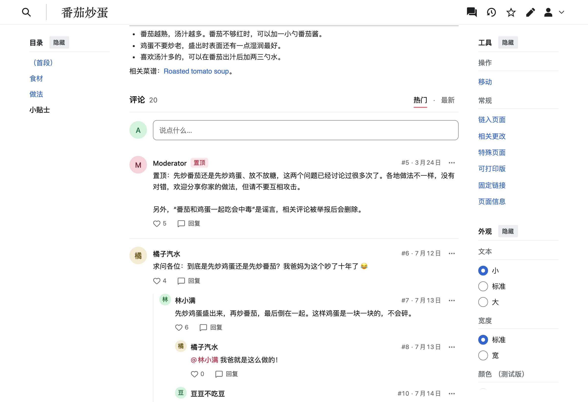
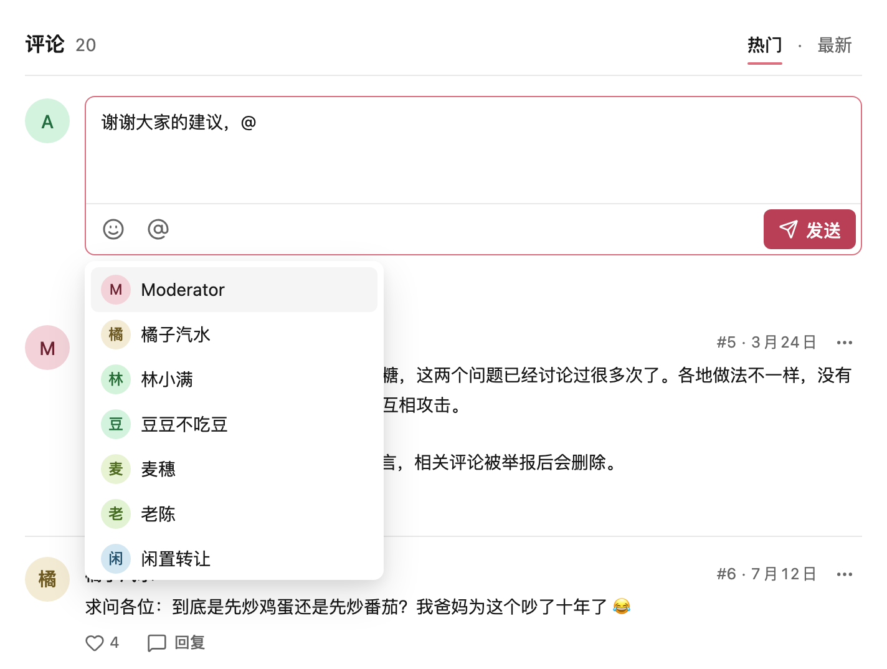
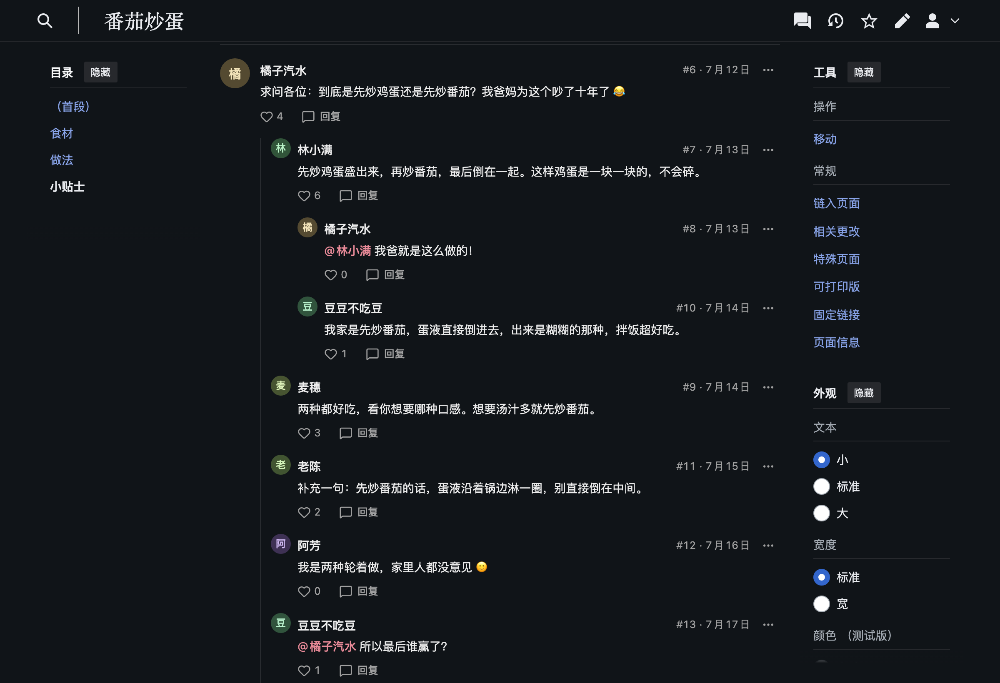
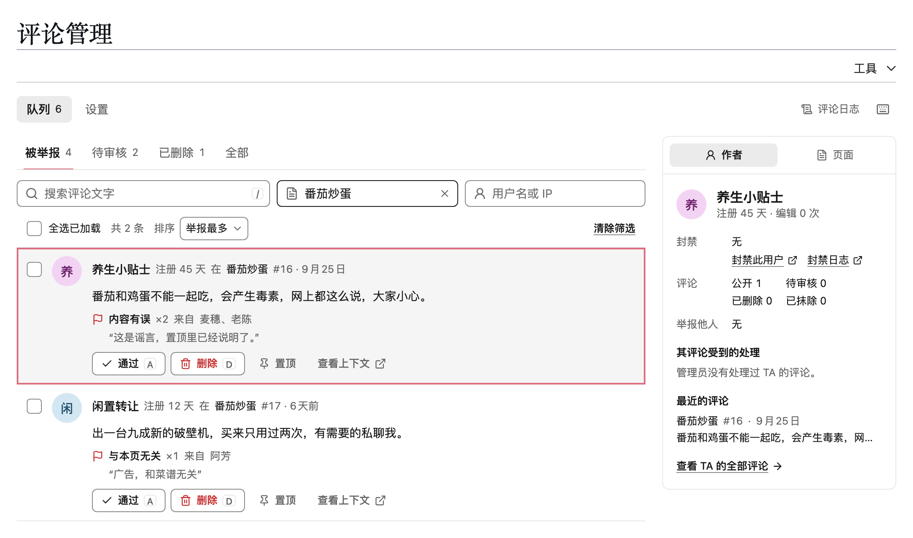

[English](README.md) | 简体中文

# GlowThread

GlowThread 是一个 MediaWiki 扩展，在文章下方添加评论区。读者用自己的维基账号发表、回复、点赞和举报评论。管理员在评论区内或在整个维基共用的一个队列中审核评论。



MediaWiki 1.43 或更高版本 · MIT 许可证 · 英文、简体中文和繁体中文

[它的用途](#它的用途) · [功能](#功能) · [安装](#安装) · [修改功能和外观](#修改功能和外观) · [开发](#开发) · [文档](#文档)

## 它的用途

GlowThread 适用于想在文章下方开放评论的维基。读者用维基账号评论，不需要编辑 wikitext。它可以代替讨论页（需要 wikitext 和签名），也可以代替外部评论服务（需要另外注册账号，并从其他网站加载代码）。

评论保存在维基自己的数据库中，使用维基的账号、权限、封禁、日志、Echo 通知和 CheckUser 记录。GlowThread 不从其他网站加载任何内容，也不向其他网站发送数据。

使用 FlowThread 1.3.x 的维基可以切换到 GlowThread，并导入原有的评论。

## 功能

### 评论和回复

评论是纯文本，支持链接、@提及和表情。每条评论显示作者、根据名字绘制的头像、时间和楼层号（#42）。回复最多显示两层，更长的对话可以就地展开（“再显示 N 条回复”）。列表可以按“热门”或“最新”排序，管理员可以置顶评论，每条评论都有固定链接。输入 @ 会弹出对话中的人和维基其他用户的列表。只有从列表中选中的名字才会成为提及，Echo 会通知被提及的人。未发送的文字会作为草稿保存在浏览器中。



### 皮肤、深色模式和手机

评论区跟随皮肤的浅色或深色模式。测试覆盖 Vector 2022、旧版 Vector、Citizen 和 Minerva。

<p>
  
  
</p>

### 管理

管理员在评论区内就能看到待审核和被举报的评论及其原因，并可以就地通过、隐藏评论或忽略举报。他们还可以开放、锁定或关闭一个页面的评论。


Special:评论管理 列出整个维基中被举报、待审核和已删除的评论，支持筛选、批量操作、撤销和键盘快捷键（`j`、`k`、`a`、`d`、`r`，按 `?` 可查看全部）。队列旁边是评论作者或页面的记录：其评论、封禁和以往的管理操作。每个管理操作都会记录在 Special:Log 中。



### 防垃圾和防滥用

新评论要经过两类检查：

- **直接拒绝：** 超过速率限制（按账号和按 IP 地址）或超过长度和提及数量上限的评论、短时间内重复发表的相同文字，以及作者已有太多评论等待审核时发表的新评论。
- **进入待审核：** 被敏感词过滤（管理员在维基上编辑其规则）或 SpamBlacklist 拦下的评论，新账号在其第一条评论通过之前发表的评论，以及被多位老用户（注册至少一周且有已发布评论的账号）举报的评论。管理员通过过的评论不会再因举报进入待审核。还没有评论通过的新账号暂时不能点赞。

### 性能

一个很小的加载器为评论区预留位置，评论应用（gzip 后约 64 kB）在读者滚动到附近时才加载。⋯ 菜单（约 22 kB）以及已登录读者使用的评论输入框和管理工具（约 20 kB）在需要时作为单独的模块加载。Varnish 等 CDN 可以为未登录读者缓存第一页评论，内容变化时 MediaWiki 会清除这份缓存。无论有没有 CDN，MediaWiki 的对象缓存都会保存这份第一页和每个页面评论的摘要，每次变化时清除，所以大多数列表请求不需要执行评论查询（[详情](docs/zh-CN/caching.md#维基的对象缓存)）。没有 JavaScript 时，页面会在评论的位置显示一条简短提示。

### 主题

颜色、字体、尺寸、间距、圆角半径和动效都是 CSS 自定义属性，深色模式有单独的值。MediaWiki:Common.css 等站点 CSS 可以直接设置它们，不需要 `!important`。稳定的类名（`ext-glowthread-<part>`）可以用来单独设置某个部件的样式，例如置顶评论。


### 语言

界面提供英文、简体中文和繁体中文，使用 MediaWiki 的消息系统。在从右到左的语言中布局会镜像，评论文字按自身方向显示，日期跟随用户语言，中文、日文和韩文使用读者的系统字体。[英文 README](README.md) 展示了同样界面的英文版。

### FlowThread

GlowThread 可以替代 FlowThread 1.3.x。导入工具会复制评论、点赞、举报和页面设置，旧链接仍然有效。见[从 FlowThread 切换](#从-flowthread-切换)。

## 环境要求

- MediaWiki 1.43 或更高版本。测试在 1.43 和 1.46 上运行。
- PHP 8.1 或更高版本，这是 MediaWiki 1.43 的要求。
- 支持窗口函数的数据库：MariaDB 10.2 或更高版本、MySQL 8.0 或更高版本，或者 SQLite 3.25 或更高版本。开发用维基运行在 MariaDB 10.11 或 MySQL 8.0 上，PHP 测试在 SQLite 上运行。PostgreSQL 支持这些 SQL，但没有经过测试。
- 可选：[Echo](https://www.mediawiki.org/wiki/Extension:Echo) 用于通知，[CheckUser](https://www.mediawiki.org/wiki/Extension:CheckUser) 用于记录谁从哪里发表了评论，[SpamBlacklist](https://www.mediawiki.org/wiki/Extension:SpamBlacklist) 用于检查评论中的链接。没有它们 GlowThread 也能工作，只是缺少相应的功能。

安装时不需要 Composer 包，也不需要 Node.js。构建好的浏览器代码已提交在 `resources/dist/` 中。

另请查看[局限](#局限)。GlowThread 不支持编辑评论、匿名发表和实时更新。

## 安装

从 FlowThread 迁移过来？不要同时加载两者，请改为按照[从 FlowThread 迁移](docs/zh-CN/migrating-from-flowthread.md)操作。

1. 把扩展放到 `extensions/GlowThread`，例如在维基的根目录中运行：

   ```sh
   git clone https://github.com/Laoweek/GlowThread.git extensions/GlowThread
   ```

   下载的 ZIP 解压后的文件夹名称不同，例如 `GlowThread-main`。请把这个文件夹重命名为 `GlowThread`。

2. 在 `LocalSettings.php` 中添加这一行：

   ```php
   wfLoadExtension( 'GlowThread' );
   ```

3. 创建数据表：

   ```sh
   php maintenance/run.php update
   ```

4. 打开 Special:Version，确认其中列出了 GlowThread。打开主命名空间中一篇已有的文章并向下滚动：评论区会出现在正文下方。

5. 如果加载了 Echo，让读者可以只屏蔽某一个人，而不必关闭所有评论通知：

   ```php
   $wgEchoPerUserBlacklist = true;
   ```

评论出现在主命名空间中已存在的页面上。讨论页、特殊页面和首页永远不会有评论。`$wgGlowThreadNamespaces` 可以修改命名空间（[配置](docs/zh-CN/configuration.md#localsettings-变量)）。

如果 CDN 或文件缓存为未登录读者保存了页面 HTML，安装前缓存的页面在过期或被清除缓存之前不会显示评论区。见[部署在 CDN 之后](docs/zh-CN/caching.md)。

<details>
<summary>可选：禁止通过网页访问开发用的文件夹</summary>

扩展文件夹中还有 `client/`、`dev/`、`docs/`、`scripts/` 和 `tests/`，运行 `composer install` 后还有 `vendor/`。读者不需要其中任何一个：浏览器通过 `load.php` 获取 GlowThread 的代码。

Apache，写在服务器配置中（如果 `AllowOverride` 包含 `FileInfo`，也可以写在 `.htaccess` 中）：

```apache
RedirectMatch 404 (?i)/extensions/GlowThread/(\.[^/]*|client|dev|docs|scripts|tests|vendor)(/|$)
```

nginx，写在 `server` 块中，放在其他 `location ~` 块之前。如果有 `location ^~` 块覆盖了 `extensions/` 文件夹，请把规则放到那个块里：

```nginx
location ~* /extensions/GlowThread/(\.[^/]*|client|dev|docs|scripts|tests|vendor)(/|$) {
    deny all;
}
```

</details>

### 从 FlowThread 切换

GlowThread 可以替代 FlowThread 1.3.x。它的导入工具会复制评论、点赞、举报和页面设置，从不写入 FlowThread 的数据表，并且在维基切换到 GlowThread 之前可以重复运行。旧的固定链接（Special:FlowThreadLink）和指向 `#flowthread` 的链接仍然有效。针对 `#flowthread` 的站点 CSS 必须改为 `#glowthread`。迁移后的维基会保持开启 `$wgGlowThreadLegacyCompat`，这个设置会显示 FlowThread 的旧通知和日志记录，并以只读方式为旧客户端响应 FlowThread 的 API。

- [从 FlowThread 迁移](docs/zh-CN/migrating-from-flowthread.md)：迁移操作手册，包含检查项和停止条件
- [FlowThread 数据映射](docs/zh-CN/migration-data.md)：每一行数据如何处理，以及导入时的选择

### 升级

替换 `extensions/GlowThread` 中的文件，然后立即运行 `php maintenance/run.php update`。新版本可能会读取由 update 添加的列，在 update 运行之前评论列表会出错。浏览器会通过 ResourceLoader 自动获取新的代码包。

## 入门

### 权限和用户组

| 权限 | 默认用户组 | 允许 |
| --- | --- | --- |
| `glowthread-post` | `user` | 发表和回复、删除自己的评论 |
| `glowthread-react` | `user` | 点赞 |
| `glowthread-report` | `user` | 举报 |
| `glowthread-trusted` | `sysop`、`bot` | 不受新账号审核限制。这些用户的评论永远不会因举报而进入待审核 |
| `glowthread-moderate` | `sysop` | Special:评论管理、评论区内的管理、页面状态、查看待审核和已删除的评论 |
| `glowthread-erase` | `sysop` | 永久抹除已删除的评论（需同时拥有 `glowthread-moderate`），查看 Special:Log/glowthread-private |
| `glowthread-configure` | `sysop` | 修改维基内设置，测试敏感词过滤 |
| `glowthread-viewlog` | `publicLog` 设置开启时为所有人，否则为拥有 `glowthread-moderate`、`glowthread-erase` 或 `glowthread-configure` 的用户 | 查看 Special:Log/glowthread，以及最近更改和监视列表中的相应记录 |

不支持匿名发表评论。不要把前三项权限授予 `*` 用户组。像往常一样把权限授予其他用户组，例如授予一个评论管理员用户组：

```php
$wgGroupPermissions['commentmod']['glowthread-moderate'] = true;
```

封禁对评论的作用与对编辑相同。部分封禁只在它覆盖的页面或命名空间上阻止读者操作。受到任何封禁的管理员都不能进行管理操作。详见[配置](docs/zh-CN/configuration.md#权限)。

### 管理员在哪里操作

- **在评论区内。** 管理员还能看到待审核和已删除的评论，以及它们进入待审核或被举报的原因，并有一个管理栏，可以筛选本页待审核或被举报的评论、选择多条评论，以及开放、锁定或关闭本页的评论。
- **在 Special:评论管理 上。** 整个维基的队列：“被举报”、“待审核”、“已删除”和“全部”，支持批量操作、撤销和键盘快捷键。旁边是所选评论的作者或页面的记录。
- **在 Special:评论管理/settings 上。** 新账号审核、自动转入待审核、举报理由、长度和提及上限、重复内容检查、评论日志是否公开，以及带测试框的敏感词过滤。

[管理指南](docs/zh-CN/moderation.md)解释了每一个操作。

### 优先检查的设置

默认值适合中小型维基。请和你的社区一起检查这三项：

- **新账号审核**：注册不满 24 小时的账号发表的评论需要等待审核，直到其中一条通过（`$wgGlowThreadNewAccountHours`、`$wgGlowThreadNewAccountApproved`）。
- **自动转入待审核**：一条评论被 3 位老用户举报后就会转入待审核（`$wgGlowThreadAutoHoldReporters`）。
- **敏感词过滤**：规则写在页面 MediaWiki:GlowThread-filter 上。默认为空。

## 修改功能和外观

### 设置

GlowThread 在两个地方设置：

- **`LocalSettings.php`** 包含所有设置：命名空间、各种上限、速率限制、CDN、主题等。[配置](docs/zh-CN/configuration.md)列出了这些设置及其默认值。
- **Special:评论管理/settings** 让拥有 `glowthread-configure`（以及用于打开 Special:评论管理 的 `glowthread-moderate`）的用户在维基上修改其中一部分，不需要改动服务器：长度和提及上限、重复内容检查、新账号审核、自动转入待审核、举报理由和评论日志是否公开。每次修改都要填写理由，并记录到 Special:Log/glowthread。在 `LocalSettings.php` 中设置了变量的设置会锁定为该值，`$wgGlowThreadOnWikiSettings` 可以把其他设置锁定为默认值。

### 修改外观

GlowThread 跟随维基的浅色和深色模式，无需设置。站点 CSS 可以用 CSS 自定义属性修改浅色和深色模式下的颜色、字体、尺寸、间距、圆角半径和动效，例如在 MediaWiki:Common.css 中：

```css
:root {
	--glowthread-color-accent: #3366cc;
	--glowthread-night-color-accent: #88a3e8;
	--glowthread-radius-surface: 4px;
}
```

评论区放在页面内容之后的 `<div id="glowthread">` 中。站点 CSS 可以设置这个容器的位置和间距，在应用内部则可以选择稳定的部件钩子（`ext-glowthread-<part>` 类）。在只有一种模式的维基上，`$wgGlowThreadTheme` 让评论始终保持深色或浅色。[主题定制](docs/zh-CN/theming.md)列出了所有属性和部件、可直接复制的示例主题、深色模式规则和各皮肤的说明。

### 部署在 CDN 之后

GlowThread 不需要 CDN 也能工作。在 MediaWiki 前面部署 Varnish 时，未登录读者从缓存获取第一页评论，每当内容变化，MediaWiki 都会清除这份缓存。CDN 需要为 `/rest.php/glowthread/v1/` 设置例外规则，读者的请求和清除请求必须使用相同的主机名，并且 MediaWiki 必须看到每个读者的真实 IP 地址，按 IP 的速率限制才能生效。[部署在 CDN 之后](docs/zh-CN/caching.md)提供了详细信息和一个 VCL 示例。

## 开发

完整的开发用维基运行在 Docker 中，所以你的电脑上不需要安装 PHP 和 MediaWiki。浏览器代码、浏览器测试和截图需要 Node.js 24 和 pnpm。

### 启动开发用维基

在本仓库的检出目录中：

```sh
cd dev
./setup.sh
```

第一次运行会下载镜像，之后约需 30 秒。打开 http://localhost:8150/wiki/Main_Page。这个维基是一个小型的虚构菜谱。可以先看这些页面：

| 页面 | 内容 |
| --- | --- |
| Sourdough starter | 英文截图使用的示例页面：一条置顶通知、长对话、举报、一条待审核和一条已删除的评论 |
| 番茄炒蛋 | 一篇中文菜谱和一段中文讨论，中文截图使用这个页面 |
| Kitchen talk | 414 条来自 CC0 许可的 Civil Comments 存档的真实公开评论，提供真实的长度和对话结构 |
| Sandbox/Load test | 400 条生成的评论，分为好几页 |

用 Admin、Moderator、Alice 或其他开发账号登录。密码在 `dev/.env.local` 中。`./setup.sh --reset` 会从种子数据重新开始。[dev/README.md](dev/README.zh-CN.md) 介绍了账号、页面和调试工具。

### 做出修改

| 你修改的内容 | 然后 |
| --- | --- |
| `includes/` 中的 PHP | 刷新页面。运行 `scripts/php-test.sh`，在 MediaWiki 1.43 和 1.46 上运行 PHPUnit 和 phpcs |
| `client/` 中的浏览器应用 | 在 `client/` 中运行 `pnpm install`，然后运行 `pnpm build` 并刷新页面。运行 `pnpm typecheck` 和 `pnpm test`。把 `resources/dist/` 和源代码一起提交 |
| `i18n/` 中的消息 | 把键添加到 `en.json`，并在 `qqq.json` 中说明它。对于 `i18n/ui/`，还要添加到 `zh-hans.json` 和 `zh-hant.json` |
| 截图中能看到的任何内容 | 运行 `./setup.sh --reset` 之后，在 `tests/e2e/` 中运行 `pnpm docs-shots`，安装步骤与下面的浏览器测试相同。它会更新 `docs/images/` 和 `docs/zh-CN/images/` |

浏览器测试（Playwright）针对开发用维基运行，覆盖的皮肤、模式和尺寸见[浏览器支持](#浏览器支持)。在 `tests/e2e/` 中依次运行 `pnpm install`、`pnpm exec playwright install chromium webkit` 和 `pnpm test`。在刚重置的维基上完整运行一次约需 7 分钟。

- [CONTRIBUTING.md](CONTRIBUTING.zh-CN.md)：项目结构、所有检查，以及消息和文档的规则。
- [docs/architecture.md](docs/zh-CN/architecture.md)：各部分如何协同工作。
- [client/README.md](client/README.zh-CN.md)：浏览器应用、设计令牌和构建。

## 浏览器支持

评论区和管理中心支持 Chrome 和 Android WebView 87 及以上、Edge 88 及以上、Safari 和 iOS 14 及以上，以及 Firefox 78 及以上。最低版本有意定得较低，以便手机上较旧的应用内浏览器也能使用。构建时会按这个最低版本检查代码包：JavaScript 为 ES2017，这些浏览器会丢弃的 CSS 会导致构建失败，只有少数只让外观略有不同的特性例外：Safari 14.0 中的间距稍紧一些，Safari 15.4 之前的版本会绘制自己的焦点框。

浏览器测试在 Chromium 中覆盖 Vector 2022（桌面，浅色和深色）、旧版 Vector（桌面）、Minerva（手机）和 Citizen（手机，浅色和深色），在 WebKit 中覆盖旧版 Vector（桌面）。另有一项检查在 Chromium 90 中加载评论区。Firefox 没有经过测试。

没有 JavaScript 时，页面会在评论的位置显示一条简短提示。如果应用无法加载，预留的空间会被移除，文章保持原样。

## 隐私

- **存储的内容：** 每条评论按输入原样保存的文字、作者（维基账号）、时间、状态和最后修改者，点赞（谁点赞了哪条评论），举报（谁、理由、可选的说明），页面状态更改和设置更改。GlowThread 的数据表不保存 IP 地址，只有从 FlowThread 导入的评论以 IP 地址作为作者名时例外。
- **导入的匿名评论**与在 FlowThread 中一样，以 IP 地址作为作者名显示。新评论需要账号。
- **谁能看到什么：** 点赞数是公开的，点赞者的名字在任何地方都不显示。举报人及其说明只有管理员可见。待审核的评论只有作者和管理员可见。已删除的评论只有管理员可见。
- **CheckUser：** 加载 CheckUser 后，每条新评论（无论公开还是待审核）和每次举报，都会连同作者或举报者的 IP 地址、`X-Forwarded-For` 和用户代理一起记录，保存时间与 CheckUser 保存数据的时间相同（`$wgCUDMaxAge`，默认 90 天）。管理操作与其他日志记录一样，通过最近更改进入 CheckUser，在 `publicLog` 设置关闭期间则直接进入 CheckUser。
- **在浏览器中：** 未发送的评论会作为草稿保存在浏览器的本地存储中，按维基、账号和页面保存，并且只在该设备上。当其他账号或未登录的读者在该浏览器中使用这个维基时，其他账号的草稿会被删除。GlowThread 不设置 Cookie。
- **抹除**会永久清空一条评论及其举报的备注，并在日志和站内通知中隐藏其作者。已经发出的通知邮件无法收回。
- **删除请求：** 打开 `Special:GlowThread/user/<name>`，删除每条评论，然后抹除（需要 `glowthread-erase`，每小时 30 条）。要在所有地方隐藏用户名，请用 `hideuser` 封禁该账号。要合并两个账号，请使用 [UserMerge](https://www.mediawiki.org/wiki/Extension:UserMerge)。点赞和举报没有删除工具。从 FlowThread 导入的评论也仍保存在 FlowThread 的表和备份中。
- **没有第三方：** 不使用外部字体、脚本、头像或服务。头像根据用户名绘制。

## 局限

- **数据库。** 开发用维基运行在 MariaDB 10.11 或 MySQL 8.0 上，PHP 测试在 SQLite 上运行。PostgreSQL 表结构是生成的，但没有经过测试。
- **MediaWiki 版本。** 测试覆盖 1.43 和 1.46。1.44 和 1.45 没有经过测试。
- **没有 Echo 或 CheckUser 时。** 代码会分别检查它们是否存在，但 PHP 测试默认同时加载两者。SpamBlacklist 测试只在加载了 SpamBlacklist 时运行。
- **未实现：** 编辑评论、匿名发表、实时更新、富文本或 wikitext 编辑器、图片、可见层级超过两层的回复。
- **队列搜索**只查找评论内的文字，不搜索作者、页面标题或举报说明。它是不使用索引的普通子串匹配，所以每次搜索都会读取当前队列分类中的所有评论。在 MySQL 上忽略大小写，在 SQLite 上只对 ASCII 字母忽略大小写，在 PostgreSQL 上由服务器的区域设置决定。
- **没有“只禁止评论”的封禁。** 请禁止该用户编辑，或者使用部分封禁。
- **AbuseFilter 和 ConfirmEdit 看不到评论**，因为评论不是编辑。取而代之的是敏感词过滤、SpamBlacklist、新账号审核和速率限制。
- **新评论不会出现在最近更改中。** 管理操作在 `publicLog` 设置开启时会出现。设置关闭期间执行的操作只显示在 Special:Log 和 Special:评论管理 中，只有管理员和版主能看到，也不会发送监视列表邮件或通知。
- **缓存的列表会滞后。** 在 CDN 后面，未登录读者看到的点赞数最多可能滞后 `$wgGlowThreadCdnMaxAge` 秒（默认 300）。与列表获取发生竞态的清除请求可能让旧列表保留同样长的时间。用户改名后，缓存的列表在同样长的时间内显示旧名称。
- **临时账号**在 FlowThread 导入完成之前必须保持关闭。导入完成后再开启没有问题。
- **大小。** 评论应用连同 CSS 在 gzip 后约 64 kB。读者指向、聚焦或点按 ⋯ 按钮，或者触摸评论区时，会加载 ⋯ 菜单（约 22 kB）。已登录读者还会加载评论输入框、举报表单和管理工具（约 20 kB）。应用只在评论区接近屏幕时加载，但网速慢的读者这时需要等它全部加载完，而且他们第一次打开 ⋯ 菜单时可能要稍等片刻。

## 文档

| 页面 | 读者 | 内容 |
| --- | --- | --- |
| [配置](docs/zh-CN/configuration.md) | 站点管理员 | 设置、权限、速率限制、敏感词过滤、日志、通知、CheckUser、兼容 API、页面生命周期、特殊页面 |
| [管理指南](docs/zh-CN/moderation.md) | 管理员 | 队列、在评论区内管理、键盘快速处理、批量操作和撤销、抹除、页面状态、设置 |
| [部署在 CDN 之后](docs/zh-CN/caching.md) | 站点管理员 | Varnish 和其他缓存、清除缓存、Cookie、客户端 IP 地址 |
| [主题定制](docs/zh-CN/theming.md) | 站点管理员 | CSS 自定义属性、部件钩子、示例主题、深色模式、评论区的位置 |
| [从 FlowThread 迁移](docs/zh-CN/migrating-from-flowthread.md) | 站点管理员 | 迁移操作手册 |
| [FlowThread 数据映射](docs/zh-CN/migration-data.md) | 站点管理员、开发者 | 每一行 FlowThread 数据如何导入，以及导入时的选择 |
| [API 参考](docs/zh-CN/api.md) | 开发者 | REST 路由、Action API 模块、钩子、日志记录、兼容 API |
| [架构](docs/zh-CN/architecture.md) | 开发者 | 各部分如何协同工作 |
| [CONTRIBUTING.md](CONTRIBUTING.zh-CN.md)、[dev/README.md](dev/README.zh-CN.md)、[client/README.md](client/README.zh-CN.md) | 贡献者 | 搭建环境、测试和提交更改，开发用维基，浏览器代码 |
| [PRODUCT.md](PRODUCT.zh-CN.md)、[DESIGN.md](DESIGN.zh-CN.md) | 贡献者 | GlowThread 的用途，以及它的设计系统 |
| [SECURITY.md](SECURITY.zh-CN.md) | 所有人 | 如何报告漏洞，以及适用范围 |

## 许可证

GlowThread 以 [MIT 许可证](LICENSE)发布。

`resources/dist/` 中构建好的代码包包含采用 MIT、ISC 和 Apache-2.0 许可证的第三方代码（Vue、Reka UI 及其使用的库、Lucide 图标、class-variance-authority、clsx，以及由 Tailwind CSS 生成的 CSS）。每个代码包的依赖包、版本和许可证文本列在它旁边的 `resources/dist/*.licenses.txt` 中。
