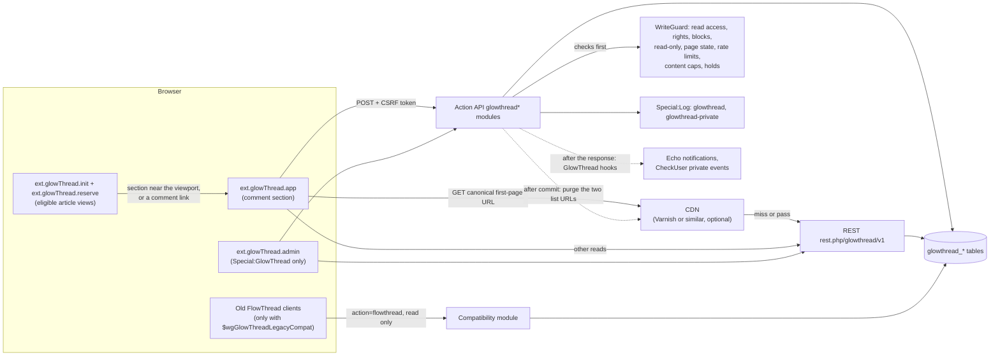
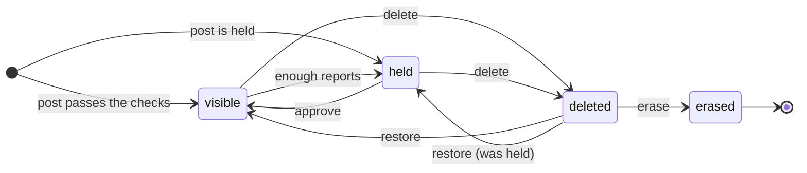
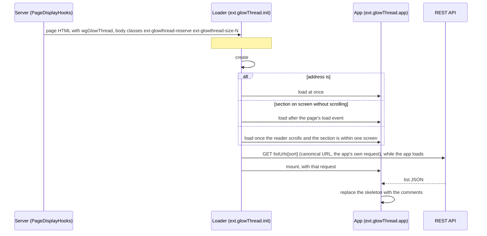

English | [简体中文](zh-CN/architecture.md)

# GlowThread architecture

GlowThread is a MediaWiki extension for comments under wiki articles. It can replace FlowThread, and it imports FlowThread's data. This page describes how the parts fit: the PHP side, the browser apps, the CDN and the importer. Request and response shapes are in [api.md](api.md), settings in [configuration.md](configuration.md), CDN setup in [caching.md](caching.md), the product's purpose and principles in [PRODUCT.md](../PRODUCT.md).

Targets: MediaWiki 1.43 LTS and later versions without code changes. CI runs the PHP tests on MediaWiki 1.43 and 1.46. PHP namespace `MediaWiki\Extension\GlowThread`.

Reads go through the REST API and return plain data. Writes go through Action API modules, which check everything in one place (`WriteGuard`) before a service writes the rows and the log entry in one transaction. After the commit, GlowThread purges the cached list, and after the response it runs its hooks for notifications and CheckUser.

## Storage

The abstract schema is `sql/tables.json`, with generated SQL in `sql/{mysql,sqlite,postgres}/tables-generated.sql`. `update.php` creates the tables (`includes/Hooks/SchemaHooks.php`). Text lives in `blob` and `binary` columns, as in core, so 4-byte characters (emoji) survive `utf8mb3` table defaults. Timestamps are `mwtimestamp`. People are actor IDs. Enumerations are stored as short strings (constants in `includes/Model/`).

| Table | Purpose | Columns (prefix left out) |
|---|---|---|
| `glowthread_post` (`gtp_`) | One row per comment. Never hard-deleted | `id`, `page`, `actor`, `parent` (display parent, null for top level), `reply_to` (the comment the author answered: equals `parent` except for replies to depth-2 comments, which are shown at depth 2), `thread` (top-level ancestor, null for top level), `depth` (0, 1 or 2), `seq` (per-page floor number, never reused), `text` (plain-text source), `created`, `edited` (always null so far, editing is not built), `status`, `hold_reason` (comma-separated), `hold_detail` (JSON of the word-filter lines that matched), `status_actor` and `status_timestamp` (who changed the status last, and when), `like_count`, `reply_count`, `open_report_count`, `pinned` (timestamp or null), `legacy_id` (FlowThread ID, 22 hex digits, unique) |
| `glowthread_reaction` (`gtr_`) | Likes now, other reaction types later | `post`, `actor`, `type` (`like`), `timestamp` (null for imported likes). Primary key (post, actor, type) |
| `glowthread_report` (`gtrp_`) | Reports, one per user and comment | `id`, `post`, `actor`, `reason`, `note`, `created` (null for imported), `resolved_actor`, `resolved_at`, `outcome` (`upheld`, `dismissed`, null while open) |
| `glowthread_page` (`gtpg_`) | Per-page state and floor counter | `page`, `state` (`open`, `locked`, `disabled`), `actor`, `timestamp`, `seq` (last floor handed out) |
| `glowthread_setting` (`gts_`) | On-wiki overrides of policy settings | `name`, `value` (JSON), `actor`, `timestamp` |

Values:

- `gtp_status`: `visible`, `held`, `deleted`, `erased`.
- `gtp_hold_reason`: `filter`, `filter-error` (a rule failed at run time), `spamblacklist`, `newaccount`, `reports`, `parentheld`.
- `gtrp_reason`: `spam`, `abuse`, `offtopic`, `spoiler`, `misinfo`, `other`, and `legacy` for imported reports.

Counters (`like_count`, `reply_count`, `open_report_count`, `gtpg_seq`) are updated with relative SQL inside the write transaction, never read-modify-write. Anonymous comments imported from FlowThread are stored under IP actors, so they keep showing the IP address as the author.

### Comment status

- `visible`: shown to everyone.
- `held`: shown only to its author (with a "waiting for review" note) and moderators. Holds come from the word filter, SpamBlacklist, the new-account gate, a held parent, or enough distinct eligible reporters. A hold never rejects. An author may have at most `$wgGlowThreadMaxHeldPerUser` comments waiting. Only posting checks this cap, so a moderator's restore of a comment deleted while held can put an author above it (as can undoing an approval or a deletion, or a hold by reports).
- `deleted`: hidden from readers, shown to moderators, restorable. Authors can delete their own comments.
- `erased`: only from `deleted`. Text blanked and author hidden. The row stays as a tombstone so replies and logs still resolve. Irreversible, needs `glowthread-erase`.
- Readers see a reply only when it, its display parent and its top-level comment are all visible.
- Deleting a wiki page hides its comments, because the page is gone. Undeleting brings back the comments of the page IDs that the undeletion restores. Nothing is erased automatically.

Every moderation action on a comment except `erase` can be undone exactly from its log entry (`do=undo`, see [api.md](api.md#actionglowthreadmoderate)). Page state and settings changes are not undone this way: a moderator sets them again.

## Read path (REST)

Routes under `rest.php/glowthread/v1/`, all `GET`, all need `read`. Comment text is returned as **segments** (text, link, mention), never as HTML, so the browser renders it with text bindings and never uses `v-html` on comment content.

| Route | Who | Handler |
|---|---|---|
| `/page/{pageId}/comments?sort=hot\|new&cursor=&limit=` | readers of the page | `ListHandler` |
| `/page/{pageId}/floor/{seq}` | readers (status-aware) | `FloorHandler` |
| `/comment/{id}` | readers (status-aware) | `CommentHandler` |
| `/comment/{id}/thread` | readers, the conversation of a permalinked or popular comment (up to 500 replies) | `ThreadHandler` |
| `/comment/{id}/replies?cursor=&limit=` | readers, "Show N more replies" (50 per request) | `RepliesHandler` |
| `/moderation/queue?tab=&sort=&pageid=&user=&reporter=&q=&cursor=&limit=` | `glowthread-moderate` | `QueueHandler` |
| `/moderation/user/{name}`, `/moderation/page/{pageId}` | `glowthread-moderate` | `UserHistoryHandler`, `PageHistoryHandler` |
| `/settings` | `glowthread-moderate` or `glowthread-configure` | `SettingsHandler` |

The list carries the page state, the viewer's permissions (computed from rights only for anonymous readers, so the cached copy is the same for everyone), the visible count, pinned comments, a popular block (time-decayed like score), top-level comments with two visible reply levels and a reply preview, and a `next` cursor. Hot sort ranks by `(likes + 1) × 0.5^(age / half-life)`. New sort is newest first.

### Caching and purges

GlowThread works without a CDN. With one, anonymous readers of a popular page are served from the cache. The full setup is in [caching.md](caching.md).

- **Cacheable response:** only the anonymous first page at one of the two canonical URLs, `{wgRestPath}/glowthread/v1/page/{id}/comments?sort=hot` and `?sort=new`, byte for byte (`CdnPurger::getListPath`). The page config hands these URLs to the browser (`wgGlowThread.listUrls`). The response is `public, s-maxage=$wgGlowThreadCdnMaxAge, max-age=0`, with no cookies and no `Vary: Cookie`. Every other response is `private`: logged-in readers, sessions, cursors, other parameters or spellings, `$wgUseCdn` off, and `$wgGlowThreadCdnMaxAge` 0.
- **Host check:** the response is public only when the request's `Host` equals the host that purges carry (the host, and the port when the URL has one, of `$wgInternalServer`, or of `$wgServer` when no internal server is set). CDNs key objects by host, so a copy under another host name would never be purged.
- **Purges:** after the database commit, MediaWiki's `CdnCacheUpdate` purges both canonical URLs of the page whenever what anonymous readers see changes: a new visible comment, a deletion, a restore, an approval, a hold, a pin or unpin, an undo, a page state change, deleting or undeleting the wiki page, and a hideuser block placed, changed or lifted (up to 500 pages of that user). A page state change also purges the article, whose HTML carries the state. GlowThread never sends bans.
- **No CDN purge on likes:** a like and an unlike would otherwise be two purges. Like counts in the anonymous list the CDN caches lag by up to `$wgGlowThreadCdnMaxAge` seconds. The wiki's object cache (below) is purged.
- **Canonical URLs at the CDN:** a CDN can rewrite anonymous list requests to the canonical URL before the lookup, so variants share one cached object. [caching.md](caching.md#what-the-cdn-must-do) has an example for Varnish.

With or without a CDN, `ListCache` keeps the lists in the WAN object cache ([caching.md](caching.md#the-wikis-object-cache)):

- **Anonymous first pages:** the JSON body of the first page of each sort, under a key with everything else the answer depends on: page, sort, limit, eligibility, the rights of anonymous readers, the page title, the `$wgGlowThread*` settings and `$wgCacheEpoch`. A cached answer needs no query service at all (`ListHandler` gets it lazily). Hot sort's `next` cursor gets the time of the request. Readers who may moderate are not cached.
- **Page summary:** what lists show to everyone, the same for every viewer: the visible count, the visible pinned comments, the hot candidates in hot order (IDs, likes, times, packed), and the popular picks. When none is up to date, the list reads the database as before, and a logged-in reader's request makes the summary after the response is sent. Every list then uses it. A viewer's own held top-level comments come from one small query and are merged in as the database queries would rank them. Moderators read pinned and main comments from the database. If a comment read by ID no longer fits the summary (a write in between), the list does not use it (see out of date summaries below).
- **Why a cached hot order is exact:** the ratio of two hot scores does not contain the time, so the order computed once holds later. Three cases rank differently: a comment dated after the time of the order (it counts as just posted until then), a comment more than 1000 half-lives old, whose score loses precision (`HotRanker::getStableUntil()`), and two neighbours whose scores tie from different likes and times (their likes, or likes + 1, differ by a power of 2 and their times by as many half-lives), whose order depends on the rounding at each time (`HotRanker::mayTie()`). In these cases the candidates are ranked again for the time asked for, and an anonymous first page is kept only while none of them applies to it. The popular picks follow the same rules.
- **Purges:** check keys for each page (touched by `CdnPurger::purgePage()` and by likes) and for all pages (hideuser blocks, renames, merged accounts, settings changes, imports). Each touch happens when the change commits: a copy from before the commit is stored within 7 seconds of it or not at all, so inside the hold-off of the touch. Everything expires within an hour. Each answer from the cache checks with one query the users it depends on: the users it names keep those names and are not hidden, the authors it shows as hidden are still hidden, and mentions that named nobody (`CommentSerializer` reports both) still name nobody. That covers blocks written without hooks and new accounts. Nothing waits for a lock, so no reader gets a copy from before a purge.
- **Misses cost no more than without the cache:** one small `getMulti()` reads the response with the check keys. Past the hold-off of the last purge (`WANObjectCache::HOLDOFF_TTL`, 11 seconds), an anonymous miss also reads the summary and uses it if it is up to date; during the hold-off no copy is up to date, so it is not read. Otherwise the list reads the database as before. Nothing is stored during the hold-off.
- **No round trips where the cache cannot help:** each web server keeps notes in the local server cache, each for a bounded time, after which it reads nothing from the object cache and lists come from the database as before: the hold-off of a purge it has seen (at most 11 seconds from when it saw it, whatever the clock of the server that purged); a page whose summary anonymous readers found missing (a minute, until this server stores one); a page whose summary could not be stored (a minute); and an anonymous first page that cannot be kept (a minute at most, until the comment dated in the future is due). A note can only send a request to the database. The summary is made, and copies are stored, after the response is sent (`DeferredUpdates::POSTSEND`), at most once a request. A copy whose data may be more than 7 seconds behind the primary database (replication lag plus the age of the read) is not stored, so the hold-off covers every write it could miss.
- **Readers who just wrote:** a client with recent writes (ChronologyProtector) is not answered from either cache, so on a wiki with replicas it reads the replica that waited for its writes, as before.
- **Out of date summaries:** a comment read by ID that does not fit the summary, or a popular pick that does not, means a purge was missed. The list reads the database and purges the page's lists (`ListCache::purgeMissed()`), so that the summary is made again after the hold-off.
- **Article view:** the page state and the floor counter come from one cached value (`PageStateStore::getViewFacts()`), cleared by state changes and by `CdnPurger::purgePage()`.

## Write path (Action API)

Every module needs a CSRF token, must be POSTed and is a write module. The browser uses `mw.Api().postWithToken( 'csrf', ... )`. `WriteGuard` only checks. The services (`includes/Service/`) write the rows, and `ModerationLogger` writes the log entries in the same transaction.

| Module | Does | Right (rate-limit key) |
|---|---|---|
| `glowthreadpost` | New comment or reply (the parent must be on the same page) | `glowthread-post` |
| `glowthreadreact` | Set or clear a like (`value=1\|0`, idempotent, not a toggle) | `glowthread-react` |
| `glowthreadreport` | Report with a reason and an optional note, once per user and comment | `glowthread-report` |
| `glowthreaddelete` | Author deletes their own comment | author, and `glowthread-post` |
| `glowthreadmoderate` | Up to 50 IDs: `approve`, `delete`, `restore`, `erase`, `pin`, `unpin`, `dismiss` (close reports), `undo` (exactly reverse earlier log entries) | `glowthread-moderate`. `erase` also needs `glowthread-erase`, limited per erased comment |
| `glowthreadpage` | Page state `open`, `locked` or `disabled` | `glowthread-moderate` |
| `glowthreadfiltertest` | Test word-filter rules against sample text without saving | `glowthread-configure` |
| `glowthreadsettings` | Change on-wiki settings, logged with old and new values | `glowthread-configure` |

`WriteGuard` checks reader writes (`glowthreadpost`, `glowthreadreact`, `glowthreadreport`, `glowthreaddelete`) in this order. Posting checks the raw size of the text before step 1.

1. Read access, then rights and blocks. Reader writes use `Authority::authorizeWrite` on the comment's page, so partial blocks apply only to the pages they cover.
2. Read-only mode.
3. Page eligibility and page state. `locked` refuses new comments and replies only. Likes, reports and self-deletion still work. `disabled` hides the section and refuses reader writes.
4. Rate limits, through `$wgRateLimits` keys named after the rights.
5. Content: length cap, mention cap, duplicate text from the same user on the same page, the reply target.
6. Holds: the word filter on `MediaWiki:GlowThread-filter`, SpamBlacklist on URLs, the new-account gate, a held parent. Then the cap on held comments per author.

For moderation and configuration (`glowthreadmoderate`, `glowthreadpage`, `glowthreadfiltertest`) `WriteGuard` checks the right and refuses any block, partial ones included, then read-only mode, then the rate limit. `glowthread-erase` and `glowthread-configure` cannot be bypassed with `noratelimit`. These modules do not check page state, so moderators can act on locked and closed pages.

`glowthreadsettings` goes through `SettingsService::update`, which checks `glowthread-configure` (blocks and rate limit included, through `authorizeAction`) and read-only mode itself.

## Rights

| Right | Default groups | OAuth and bot password grant |
|---|---|---|
| `glowthread-post`, `glowthread-react`, `glowthread-report` | `user` | `editpage` |
| `glowthread-trusted` (skips the new-account gate, never held by reports) | `sysop`, `bot` | none |
| `glowthread-moderate` | `sysop` | `delete` |
| `glowthread-erase` (also reads `Special:Log/glowthread-private`) | `sysop` | `oversight` |
| `glowthread-configure` | `sysop` | `editsiteconfig` |
| `glowthread-viewlog` (reads the `glowthread` log, see [Logs](#logs)) | none: `LogVisibilityHooks` gives it to everyone while `publicLog` is on, otherwise to holders of `glowthread-moderate`, `glowthread-erase` or `glowthread-configure` | `basic` |

`Special:GlowThread` needs `glowthread-moderate`. How moderators use it is in [moderation.md](moderation.md).

## Logs

- `glowthread`: `delete`, `recover`, `approve`, `markchecked`, `pin`, `unpin`, `erase`, `autohold`, `enable`, `lock`, `disable`, `undo`, `settings`, `import`. Restricted to `glowthread-viewlog` (`$wgLogRestrictions`), which `LogVisibilityHooks` grants as the `publicLog` setting says. Core leaves restricted types out of RecentChanges, so `ModerationLogger` inserts their rows itself while `publicLog` is on, and CheckUser records them from there. `import` is the exception: the importer writes it to `logging` only. While `publicLog` is off an entry gets no row and goes to CheckUser's `CheckUserInsert` service directly: saving a row sends watchlist emails, moves watchlist markers and tells `RecentChange_save` listeners such as Echo, and none of them check log restrictions. `autohold` is performed by the system user "GlowThread", and CheckUser records it as done by the software (IP 127.0.0.1, no XFF or user agent), not with the IP of the reporter whose report caused it. Its RecentChanges row, when it has one, carries 127.0.0.1 too (`SoftwareLogEntry`). Hidden from "Main public logs" by default (`$wgFilterLogTypes`).
- `glowthread-private`: the author of each erased comment. Restricted to `glowthread-erase` (`$wgLogRestrictions`), never in RecentChanges.
- `comments`: FlowThread's log type. GlowThread never writes it. `LegacyLogType` registers it only while `$wgGlowThreadLegacyCompat` is on and no other extension (FlowThread itself, or Extension:Comments) uses that name, so FlowThread's old entries keep rendering in Special:Log/comments and in the page history of the moderation hub, with the same readers as `glowthread` (`glowthread-viewlog`). With the setting off, its entries are hidden (`$wgLogRestrictions`: `glowthread-legacy-log`), and RecentChanges rows show no `logparams`.
- `CommentsLogFormatter` renders all three types and hides the author of erased comments and of users hidden by a hideuser block.

## Hooks

GlowThread runs `GlowThreadPostSaved`, `GlowThreadPostApproved`, `GlowThreadPostModerated` and `GlowThreadReportFiled` (interfaces in `includes/Hook/`, runner `HookRunner`). They run **after the response is sent** (a POSTSEND deferred update, cancelled if the write rolls back), still in the request of the user who acted. None can abort. Signatures are in [api.md](api.md#hooks-for-other-extensions).

GlowThread's own handlers:

| Hook | Handler | Does |
|---|---|---|
| `GlowThreadPostSaved` | `CheckUserHooks`, `NotificationHooks` | CheckUser private event for every new comment. Echo notifications for visible comments: `glowthread-reply`, `glowthread-mention` and `glowthread-userpage` (a comment on the recipient's user page) |
| `GlowThreadReportFiled` | `CheckUserHooks` | CheckUser private event for every report |
| `GlowThreadPostApproved`, `GlowThreadPostModerated` | `NotificationHooks` | Notifications held back until approval, and moderation outcomes for the author (`glowthread-moderation`: delete, restore to visible, approve). Erasing, or the author's own deletion, hides the comment's notifications |
| `CheckUserInsertLogEventRow`, `CheckUserInsertPrivateEventRow` | `CheckUserHooks` | Record automatic holds as done by the software (IP 127.0.0.1, no XFF or user agent), not with the IP of the reporter |
| `BeforeCreateEchoEvent`, `EchoGetBundleRules` | `EchoSetupHooks` | Register the `glowthread` category and types, bundle replies per page, and, with `$wgGlowThreadLegacyCompat`, keep FlowThread's old types rendering |
| `BeforePageDisplay` | `PageDisplayHooks` | Loader, reservation styles, `wgGlowThread` config and a `<noscript>` notice on eligible views |
| `PageDeleteComplete`, `PageUndelete`, `PageUndeleteComplete` | `PageLifecycleHooks` | Hide and restore comments with their page. After an undeletion, hide the Echo notifications of erased comments again (when the undeletion creates the page, Echo shows all notifications of its restored page ID again) |
| `PageMoveComplete` | `PageLifecycleHooks` | Purge the page's lists |
| `BlockIpComplete`, `UnblockUserComplete` | `PageLifecycleHooks` | Purge the lists of a user hidden or unhidden by a hideuser block |
| `RenameUserComplete` | `PageLifecycleHooks` | Purge the lists in the object cache, which show current names |
| `UserMergeAccountFields`, `MergeAccountFromTo` | `UserMergeHooks` | Move actor columns, keep one of duplicate likes and reports, rewrite mentions, purge the lists |
| `UserGetRights`, `ChangesListSpecialPageQuery`, `ApiQueryBaseBeforeQuery`, `WatchedItemQueryServiceExtensions` | `LogVisibilityHooks` | Give `glowthread-viewlog` to everyone while the `publicLog` setting is on, otherwise to holders of `glowthread-moderate`, `glowthread-erase` or `glowthread-configure`. Hide the RecentChanges rows of the log types restricted to it from users without it, in Special:RecentChanges, Special:RecentChangesLinked, Special:Watchlist, `list=recentchanges` and `list=watchlist` |
| `UserGetReservedNames` | `ReservedNamesHooks` | Reserve the name of the system user "GlowThread", which logs automatic holds |
| `ApiMain::moduleManager` | `CompatHooks` | Add the compatibility module when `$wgGlowThreadLegacyCompat` is on |
| `SpecialPage_initList` | `CompatHooks` | Register `Special:FlowThreadManage` as a redirect to the moderation queue, unless another extension (FlowThread) already registered that name |
| `LoadExtensionSchemaUpdates` | `SchemaHooks` | Tables, and the system user of automatic holds |

Echo, CheckUser and SpamBlacklist are optional. Each is used only when loaded.

## Browser

An eligible view is one where the page exists, is in `$wgGlowThreadNamespaces`, is not a talk page or the main page, and is a current-revision `action=view`. On such views `PageDisplayHooks` adds the loader, the reservation styles, the page config `wgGlowThread` ([api.md](api.md#page-config-wgglowthread)) and, unless comments are turned off on the page, a `<noscript>` notice.

| Module | Files | Loaded |
|---|---|---|
| `ext.glowThread.reserve` | `resources/init/reserve.css` (styles only, about 1 kB) | Every eligible view, before the first paint |
| `ext.glowThread.init` | `resources/init/index.js` (hand-written ES2017, no build step) | Every eligible view |
| `ext.glowThread.app` | `resources/dist/app.js`, `app.css` | When the comment section is needed (below) |
| `ext.glowThread.app.menu` | `resources/dist/app-menu.js` | When a reader points at, focuses or opens a ⋯ menu, or touches the section on a phone, and with the extras |
| `ext.glowThread.app.extras` | `resources/dist/app-extras.js` | For logged-in readers, requested next to the app. Otherwise when a reader who may post or report needs it |
| `ext.glowThread.admin` | `resources/dist/admin.js`, `admin.css` | Only on Special:GlowThread, so readers never download it |

How a page view loads the comments:

- **Reservation.** `PageDisplayHooks` adds the body classes `ext-glowthread-reserve` and `ext-glowthread-size-N`, where N steps with the page's floor counter (0, 1, 2, 3, 5, 8, 13, 21), or `off` on a page whose comments are turned off (the height of its one-line note). The styles give `#bodyContent::after` that height, only with `.client-js`. So nothing below the article moves when the comments arrive.
- **Container.** The loader finds the skin's `#bodyContent` (or `#mw-content-text`), ignoring elements with those IDs inside page text, the heading or indicators. It creates `
` right after it, or as its last child on Minerva, on Vector 2022 and where the anchor's parent is a grid with no row for the container (Citizen, whose page grid has a content row and then the footer), so the section stays below the article and above the footer. Site CSS that gives `#glowthread` a grid row keeps it after the anchor, as a grid item. It adopts an existing `#glowthread` only where it would put one, so page text cannot capture or hide the section. Site CSS can place `#glowthread` elsewhere ([theming.md](theming.md#placing-the-section)).
- **Skeleton.** In the same frame the loader fills the container with a static skeleton exactly as tall as the reservation and removes the reservation class. The app keeps that height (`data-gt-reserve`) until the list is drawn. If the app fails to load, the loader removes the skeleton.
- **Lazy loading.** The app loads at once when the address is `#gt-<id>`, `#glowthread` or `#flowthread` (links made before a wiki moved from FlowThread). It loads after the page's `load` event when the section is on screen without scrolling. Otherwise it loads only after the reader scrolls and the section comes within one screen of the viewport. On phones MobileFrontend collapses the article, so the section often sits just below the first screen on views where nobody reads comments, and those views do not pay for the app.
- **App.** `ext.glowThread.app` is the comment section: Vue 3.5 bundled with its own runtime (MediaWiki 1.43 ships Vue 3.4), Reka UI with components ported from shadcn-vue, and Tailwind CSS with the `gt:` prefix, built by Vite from `client/` and committed to `resources/dist/`. It mounts into a child of `#glowthread` (`div.gt-scope.gt-root`), so the container keeps the placement that site CSS gives it. Every rule is scoped to `.gt-scope` after an `all: revert` reset, so skins and site CSS do not reach in and the app does not style the page. Overlays (menus, sheets, toasts) render into `#glowthread-portal` at the end of `<body>`. Permalinks `#gt-<id>` scroll to and highlight the comment. When it is not in the list, its conversation is shown in place: unfolded in the list when its thread is there, otherwise in a "Conversation" box above the list. Conversations never open in a sheet. The app is split in three modules. `ext.glowThread.app` draws the section, `ext.glowThread.app.menu` has the ⋯ menu's items with Reka UI's menu and Floating UI, and `ext.glowThread.app.extras` has the composer, report form and moderation tools. The app loads them with `mw.loader.using()`, so a logged-out reader downloads the menu only after pointing at, focusing or tapping a ⋯ button or touching the section, and the extras only when they may post or report. For readers who are logged in or may post, the list waits for the extras (at most 5 seconds after it arrives), so the composer is drawn with the first comment. The menu and extras modules check the app's build ID and refuse to run next to an app from another build.
- **Moderation hub.** `ext.glowThread.admin` mounts into `#ext-glowthread-admin` on Special:GlowThread and replaces the server's no-JavaScript notice. It is a separate bundle with the same design system.
- **Right-to-left.** For a right-to-left interface language, ResourceLoader flips both app stylesheets with CSSJanus (the modules do not set `noflip`), so left and right swap and the side sheet opens from the left. Icons that point along the reading direction carry `gt-flip-rtl`, because CSSJanus cannot reach inside an SVG. Reka UI and the app's own arrow-key handling take the direction from `<html dir>`. Comment bodies, names and notes are `dir="auto"`, and a comment body is only as wide as its text. `pnpm check` runs CSSJanus on the bundles and fails when a selector or an animation name would change.
- **Messages.** UI messages are in `i18n/ui/` (`glowthread-ui-*`) and ship with the bundles through `UiMessagesModule`. The comment section leaves out the `glowthread-ui-admin-*` keys. Server messages are in `i18n/` and `i18n/api/`. GlowThread ships English, Simplified Chinese and Traditional Chinese. A message takes its variable part as a parameter (`Held for review: $1`) instead of being joined with other text in a template, and a unit test rejects UI messages (`i18n/ui/`) that start or end with a space or end with a colon, with one listed exception for a message that a list follows. Times under a week are relative ("3 days ago"). Older dates are short dates in the user language, in the Gregorian calendar, with MediaWiki's digits for that language.
- **Browser floor.** Chrome and Android WebView 87, Safari and iOS 14, Firefox 78. `pnpm check` enforces it on the bundles ([client/README.md](../client/README.md#browser-floor)).
- **Design.** Tokens, components and rules are in [DESIGN.md](../DESIGN.md). The font stack puts the system UI faces first, then CJK faces chosen by `<html lang>` (`--glowthread-font-cjk`: Japanese, Korean, Traditional Chinese including Hong Kong, otherwise Simplified Chinese). Site administrators restyle the section through public custom properties ([theming.md](theming.md)).

## Compatibility and migration

These parts matter only to wikis that move from FlowThread. The steps are in [migrating-from-flowthread.md](migrating-from-flowthread.md).

- `maintenance/importFlowThread.php` (run as `GlowThread:importFlowThread`) reads FlowThread's three tables with SELECTs only and writes GlowThread's rows. It is idempotent by `gtp_legacy_id`, with `--dry-run` and `--verify`. It decodes the time from each FlowThread ID, turns stored HTML into plain text (keeping link targets, turning user links into `@Name`), maps users to actors and anonymous authors to IP actors, and carries likes, reports, statuses and page states. It runs no hooks, purges nothing from the CDN and writes one `glowthread/import` log entry. A run that writes purges the lists in the wiki's object cache (`ListCache`) after each write batch and at its end. Details in [migration-data.md](migration-data.md).
- With `$wgGlowThreadLegacyCompat` (default `false`), `api.php?action=flowthread` answers `type=list` (readers) and `type=listall` (moderators) read only, in FlowThread's response shape, from GlowThread's data (`includes/Compat/`). Write types answer the error `glowthread-legacy-readonly`. The module is added only while FlowThread itself is not loaded. Its responses are always private, because these URLs cannot be purged. The same setting keeps FlowThread's stored Echo notifications and its old log entries rendering.
- `Special:GlowThreadLink/<id>` accepts GlowThread IDs, FlowThread hex IDs and `<title>/<floor>`. FlowThread's link page name `Special:FlowThreadLink` still works, and `Special:FlowThreadManage` redirects to `Special:GlowThread/queue`.
- FlowThread's log entries keep rendering in Special:Log/comments while `$wgGlowThreadLegacyCompat` is on, unless another extension uses the log type `comments` (see [Logs](#logs)).
- The container is `#glowthread`. Site CSS written for FlowThread's `#flowthread` must change to `#glowthread`. Old links that end in `#flowthread` still open the comments.
