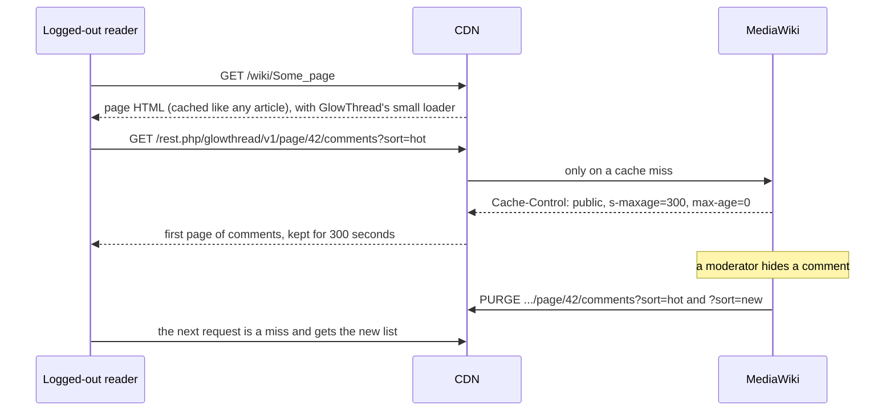

English | [简体中文](zh-CN/caching.md)

# Running behind a CDN

GlowThread works without a CDN. With Varnish, or another cache that accepts MediaWiki's `PURGE` requests, logged-out readers can get the first page of comments from the cache. MediaWiki purges it whenever what logged-out readers see changes.

This page explains what GlowThread caches and purges, what the CDN must do, an example for Varnish, and what else matters behind a proxy: cookies, client IP addresses, the job queue and Echo. With or without a CDN, GlowThread also keeps the comment lists in the wiki's object cache: see [The wiki's object cache](#the-wikis-object-cache).

## Checklist

| What | Why | Section |
|---|---|---|
| The CDN looks up the comment list for logged-out readers, under one canonical URL per page and sort order | Otherwise every comment list runs in PHP | [What the CDN must do](#what-the-cdn-must-do) |
| Readers' requests and MediaWiki's purges use the same host name | GlowThread caches a list only under the host that purges reach | [Host name](#host-name) |
| MediaWiki sees each reader's real IP address | The per-IP rate limits, IP blocks and CheckUser depend on it | [Client IP addresses](#client-ip-addresses) |
| No other shared cache stores `/rest.php/glowthread/` | Purges reach only the CDN in `$wgCdnServers` | [Caches in front of the CDN](#caches-in-front-of-the-cdn) |
| Cookies from other software do not look like a login | Otherwise those readers bypass the cache | [Cookies](#cookies) |

## How it works



The article HTML holds no comments. It carries a small loader and a few page facts (whether comments are open, how much space to reserve). The loader fetches the comments when the section comes near the screen.

## What GlowThread caches

Each page has exactly two cacheable URLs, the first page of each sort order:

```text
{$wgRestPath}/glowthread/v1/page/{page ID}/comments?sort=hot
{$wgRestPath}/glowthread/v1/page/{page ID}/comments?sort=new
```

`$wgRestPath` is `$wgScriptPath/rest.php` by default, for example `/w/rest.php`. The examples on this page use `/rest.php`. Adjust the patterns to your path.

A list response is `Cache-Control: public, s-maxage=$wgGlowThreadCdnMaxAge, max-age=0` only when **all** of these are true:

- the reader is logged out and has no session,
- the request is for the first page (no `cursor` parameter),
- the URL is byte for byte one of the two canonical URLs (`?sort=hot` or `?sort=new`, nothing else),
- the `Host` header is exactly the host that purges carry (see [Host name](#host-name)),
- `$wgUseCdn` is `true`, as for MediaWiki's own `s-maxage` headers,
- `$wgGlowThreadCdnMaxAge` is above 0 (default 300 seconds).

Every other response of GlowThread's routes is `private, must-revalidate, max-age=0, s-maxage=0`: later pages, single comments, threads, logged-in readers, moderation and settings routes, GlowThread's own errors. MediaWiki's own REST errors carry no `Cache-Control`: a parameter that fails validation, a path that matches no route, `rest-read-denied` on a private wiki. The CDN must not store them either, which step 6 below ensures. `max-age=0` means browsers do not keep the list, so readers always ask the CDN.

`api.php?action=flowthread` always answers `private`: its URLs cannot be purged.

## What GlowThread purges

| Event | Purged from the CDN | Purged from the wiki's object cache |
|---|---|---|
| A change in what logged-out readers see: a new visible comment, an approval, a visible comment hidden by a moderator or deleted by its author, a restore that makes a comment visible, a pin or unpin, an undo of those, an automatic hold by reports | Both list URLs of the page | The page's lists |
| Changes to comments readers do not see: a held comment posted, a deleted comment erased, reports dismissed | Nothing | Nothing |
| A page's comments opened, locked or closed | Both list URLs and the article itself (its HTML says whether comments are open) | The page's lists |
| A page deleted, undeleted or merged | Both list URLs of the pages concerned | The lists of the pages concerned |
| A page moved | Both list URLs of the page | The page's lists |
| A `hideuser` block placed, changed or lifted through Special:Block, Special:Unblock or the API | Both list URLs of up to 500 pages where the user commented most recently | All lists |
| Two accounts merged with Extension:UserMerge | As for a `hideuser` block, for the account that stays | All lists |
| A user renamed | Nothing | All lists |
| A like or unlike | Nothing | The page's lists |
| An on-wiki settings change | Nothing | All lists |
| A FlowThread import that writes (not `--dry-run` or `--verify`) | Nothing | All lists, after each write batch and when the run ends |

Likes send no purge to the CDN on purpose. Otherwise every like and unlike would be two purges, and one account at the like rate limit could send hundreds of purges a minute. So like counts, and the top comments block that ranks by likes, can be up to `$wgGlowThreadCdnMaxAge` seconds old for logged-out readers served by the CDN. Settings changes, and the slow change of the hot order over time, show within the same time. Logged-in readers, and every reader on a wiki without a CDN, always get fresh data.

How purges are sent:

- MediaWiki core sends them (`HTMLCacheUpdater` and `CdnCacheUpdate`) to every server in `$wgCdnServers`, as HTTP `PURGE` requests for the exact URLs. GlowThread never sends bans.
- They run after the database transaction commits, in the same PHP process, before the response goes back. They do not wait for the job queue.
- A purge that fails (the CDN is down or slow) is not retried. Readers then see the old list until it expires, at most `$wgGlowThreadCdnMaxAge` seconds after it was cached.
- URLs are expanded with `$wgInternalServer` when it is set, otherwise with `$wgServer`.
- Each purge asks for a rebound purge, as core does after edits. With `$wgCdnReboundPurgeDelay` above 0, MediaWiki purges the URLs again after that delay, through one delayed job per request. This corrects a list that a lagging replica answered just after the change. With the default 0 there is no second purge and no job.

## The wiki's object cache

GlowThread keeps two things about each page's comments in MediaWiki's main object cache (`$wgMainCacheType`: memcached, Redis or APCu, as the wiki is set up). This works with and without a CDN.

- **The first page for logged-out readers**, of each sort order, as the exact response. Unlike the CDN, it serves every URL and host name: also `?limit=`, other spellings, and readers with a session. A cached response needs none of the comment queries.
- **A summary of the page** that is the same for every reader: the comment count, the pinned comments, the hot order of the top-level comments and the top comments block. After a change, the next logged-in reader's request makes it again, after the response is sent. Every list then uses it. Each reader's own held comments are added with one small query. Moderators get their lists from the database.

Both are purged when a change of what readers see (the last column of the table above) is committed. A copy computed from the data before the commit is stored within 7 seconds of the purge or not at all, so it falls in the 11 seconds after the purge in which MediaWiki counts every copy as out of date, and is never used. Every copy expires after an hour at most. This bounds changes made around MediaWiki's hooks, such as edits straight in the database. Each answer from the cache also checks, with one small query, the users it depends on: the users it names still exist under those names and are not hidden, the authors it shows as hidden are still hidden, and the mentions that named nobody still name nobody. So a block written or removed without hooks (CentralAuth's global suppression, a script), or a new account that an older mention names, shows in the cached lists at once too.

What this means:

- Readers see a change as soon as it is committed, as without the cache. Nothing waits for a lock: after a change, every request that arrives while the list is computed again computes it too. So a CDN that fetches a list again after its purge always gets the new one.
- A list that the cache does not answer costs no more than without the cache. A miss reads the object cache once, and past the hold-off of the last purge once more for the summary; the summary is made, and copies are stored, after the response is sent. Logged-out readers never make the summary.
- Where the cache cannot help for a while, a web server stops reading it, and serves the list from the database as before. It notes this in its local cache (APCu when installed): during the 11 seconds after a purge it has seen, when MediaWiki counts every copy as out of date and nothing is stored; for a minute after logged-out readers found no summary of a page, or a summary could not be stored; and for up to a minute after a first page could not be kept (its order holds for that moment only). These notes only ever cost speed, never freshness.
- On a wiki with database replicas, a list read from a replica more than 7 seconds behind the primary database is not stored.
- A reader who wrote in the last seconds is not answered from the cache. On a wiki with database replicas, MediaWiki then reads from a replica that has that reader's writes (ChronologyProtector), so they see their own comment as before.
- Comments more than 1000 half-lives old (`$wgGlowThreadHotHalfLife`, 90 days by default) are ranked for the time of each request, as before: their scores lose precision, so their order changes with the time. A cached list lasts only until its oldest comment reaches that age.
- Two comments whose scores are exactly equal from different likes and times are also ranked for the time of each request, as before: rounding orders them differently at different times. A list where they meet is not kept.
- A changed `$wgGlowThread*` setting in `LocalSettings.php` takes effect at once, because the settings are part of the cache key. To discard every cached list after other changes, such as new namespace names, raise `$wgCacheEpoch`.
- Logged-out readers who have the `glowthread-moderate` right (only when you give it to everyone) are not served from the cache.
- Without an object cache (`$wgMainCacheType = CACHE_NONE`), nothing is kept and every list is computed, as before.

Article views read the page's comment state and floor count from one cached value, which the same events clear.

## MediaWiki settings

```php
// Page views get s-maxage, so the CDN may cache article HTML for logged-out readers.
// GlowThread's lists are cacheable only while this is on.
$wgUseCdn = true;
// Where purges go. One entry per CDN server, as an address or host name, with a port if needed.
$wgCdnServers = [ '10.0.0.5:80' ];
// Proxies in front of MediaWiki whose X-Forwarded-For MediaWiki should trust, as addresses
// or CIDR ranges. See "Client IP addresses".
$wgCdnServersNoPurge = [ '10.0.0.0/24' ];
```

- `$wgGlowThreadCdnMaxAge` (default 300) sets how long the CDN may keep a list. A shorter time shortens the delay for like counts and for the purge race described under [Known limits](#known-limits). `0` turns list caching off. Everything else keeps working.
- `$wgCdnMaxAge` (MediaWiki's default is 18000 seconds, five hours) is how long the CDN keeps article HTML. GlowThread's loader is in that HTML. After you install GlowThread, articles cached before keep showing no comment section until they expire or are purged. To show it at once, purge the pages in the comment namespaces, for example `php maintenance/run.php purgeList --namespace 0`.
- Without `$wgCdnServers`, purges go nowhere. If `$wgUseCdn` is on in that case, set `$wgGlowThreadCdnMaxAge = 0;` or make every shared cache pass `/rest.php/glowthread/`.

### Host name

Varnish and most CDNs store objects by `Host` and URL. A purge clears only the copy stored under the purge's own `Host`. So GlowThread answers `public` only when the request's `Host` header is exactly the host of `$wgInternalServer`, or of `$wgServer` when no internal server is set. A copy stored under any other host name (an IP address, a second domain, `www.` and no `www.`) would never be purged, so it is never made public.

- `$wgServer` must be a fixed URL in `LocalSettings.php`, or `$wgInternalServer` must be set. A wiki that computes `$wgServer` from each request (for example with `WebRequest::detectServer()` for several domains) matches every `Host`, so a list cached under another host name would be public and never purged. Set `$wgInternalServer` to the one canonical URL in that case.
- If you set `$wgInternalServer`, it must use the public host name, for example `http://wiki.example.org`, not an IP address.
- The `Host` that readers' requests carry when they reach the CDN must be that same name. A front proxy that rewrites `Host` must rewrite it to that name.
- Let the CDN pass list requests with any other `Host`. GlowThread answers them `private` anyway.

To see both, watch the CDN's log while you edit a page and open an article. With Varnish:

```sh
varnishlog -g request -q 'ReqMethod eq "PURGE" or ReqURL ~ "^/wiki/"' -i ReqMethod,ReqURL,RespStatus -I 'ReqHeader:^Host:'
```

The `PURGE` requests must be answered `200`, not `405`, and their `Host` must equal the `Host` of the page views. If they differ, fix that first. Otherwise nothing is cached.

## What the CDN must do

A typical MediaWiki VCL passes everything under `/rest.php` and `/api.php`. GlowThread needs a carve-out above that rule. For anonymous `GET` and `HEAD` requests under `/rest.php/glowthread/v1/`:

1. **Only the list route is looked up.** The path must be `/rest.php/glowthread/v1/page/<page ID>/comments`, with the page ID in plain decimal without leading zeros. Pass every other path: other routes, and other spellings of the list path (leading zeros, a trailing slash, dot segments, percent-encoding).
2. **Only the canonical host is cached.** Pass other `Host` values.
3. **Logged-in readers pass.** Pass requests with an `Authorization` header or a MediaWiki session or token cookie, with the URL as sent.
4. **Later pages pass.** Pass requests whose last `cursor` parameter has a value. An empty or bare `cursor` names no later page (MediaWiki answers it 400 `bad-cursor`), so treat it like no cursor and rewrite it in step 5.
5. **The URL is rewritten to the canonical one before the lookup.** Keep only `sort`: `new` stays `new`, any other value (missing, empty, unknown) becomes `hot`, MediaWiki's default. Drop every other parameter. Then junk parameters and cache busters hit the cached object instead of running the list query in PHP.
6. **Only responses with `s-maxage` are stored.** Store nothing else from this route, and keep a short hit-for-miss object, so concurrent requests for a private answer do not queue behind each other.
7. **Responses reach clients marked private.** Purges reach only this CDN. A URL that step 5 rewrote is never purged, and a shared cache in front would keep even the canonical URL for its `s-maxage`. Answer every looked-up request with `Cache-Control: private` so that no cache or browser in front keeps a copy.
8. **`PURGE` is accepted from the application servers only.** List their addresses, never a whole private range or `localhost`: a TLS proxy, load balancer or ingress in front of the CDN connects from such an address for every reader, and every reader could then empty the cache. Handle `PURGE` before the carve-out. Do not rewrite purges: MediaWiki purges the canonical URLs, the only ones stored.
9. **Very long URLs pass.** Pass list URLs over 2000 characters. A regular expression over a very long URL can exceed Varnish's PCRE limits and answer 503. List URLs that clients use are under 100 characters.

If your VCL adds a mobile flag or anything else to the hash for page views, clear it for this route. The list is the same for every skin and device, so each canonical URL needs one cached object. MediaWiki also adds `Vary: x-restbase-compat` to every REST response, so clear that request header too. Otherwise each new value of the header stores another copy of the list. With `$wgAllowCrossOrigin` and `$wgRestAllowCrossOriginCookieAuth` both on (both are off by default), MediaWiki adds `Vary: Origin` too. Then clear `Origin` in the carve-out as well, unless scripts on other sites read the lists.

### Grace

If your VCL sets a long `beresp.grace` for every object, an expired list can be served once more while Varnish fetches a new one. Purged lists are never served this way, because the purge removes them. But changes that send no purge (likes, settings) would then show later than `$wgGlowThreadCdnMaxAge`. Cap grace for this route, for example to 10 seconds.

## Varnish example

The development wiki's [`dev/varnish/default.vcl`](../dev/varnish/default.vcl) is a complete, commented VCL for MediaWiki with the GlowThread carve-out, and `dev/varnish/test.sh` checks it with `varnishtest` on Varnish 9.0. Its rules marked `[GlowThread]` are the parts to copy. They need `import std;` at the top of the file. Replace `wiki.example.org` with your host name in lower case, and `/rest.php` with your `$wgRestPath`.

**Top of `vcl_recv`.** Only Varnish may set the helper header:

```vcl
	# [GlowThread] Only Varnish sets this (see part 1).
	unset req.http.x-glowthread-url;
```

**In `vcl_recv`, after `PURGE` handling and after "only GET and HEAD continue", above the rule that passes `rest.php`.** This is part 1 from `dev/varnish/default.vcl`. Only the host check differs: the dev file reads its host from the environment, and its comment gives this form for other wikis.

```vcl
	# [GlowThread] carve-out, part 1 of 4: anonymous GET and HEAD of the comment list are looked
	# up in the cache under one canonical URL per page and sort order. GlowThread purges exactly
	# /rest.php/glowthread/v1/page/{id}/comments?sort=hot and ?sort=new on the Host of $wgServer,
	# so only those URLs on that Host may be cached. Only responses with an explicit s-maxage are
	# stored (part 3). Everything else under the route is passed.
	if (req.url ~ "^/rest\.php/glowthread/v1/") {
		# The list route only: a page ID in plain decimal without leading zeros, then the end
		# or a query string. Other routes (comment, thread, replies, floor, moderation,
		# settings) and other spellings of the list path (leading zeros, a trailing slash, dot
		# segments, percent-encoding) are passed. MediaWiki answers them private, and a dot
		# segment ("/." or "%2e") could make the web server run another script, such as api.php.
		if (req.url !~ "^/rest\.php/glowthread/v1/page/[1-9][0-9]{0,9}/comments(\?|$)") {
			return (pass);
		}
		# URLs over 2000 characters are passed. The sort regex below backtracks over the whole
		# URL and fails with a 503 beyond Varnish's pcre2_match_limit (about 10000 characters).
		# The list URLs that clients use are under 100 characters.
		if (req.url ~ "^.{2001}") {
			return (pass);
		}
		# CANONICAL HOST: the host of $wgServer, which is also the Host of GlowThread's purges.
		# Any other Host (127.0.0.1:8150, another name for the same site) would get its own
		# cached copy that purges never reach, so it is passed. The Host is compared in lower
		# case. In your own VCL compare it with your host as a string:
		#     std.tolower(req.http.host) != "wiki.example.org"
		if (std.tolower(req.http.host) != "wiki.example.org") {
			return (pass);
		}
		set req.http.host = std.tolower(req.http.host);
		# Requests with Authorization or a session or Token cookie are passed with the URL as
		# sent, exactly like page views.
		if (req.http.Authorization || req.http.Cookie ~ "([sS]ession|Token)=") {
			return (pass);
		}
		# A cursor asks for a later page, which is never cached. Only a parameter named exactly
		# "cursor" counts, and only with a value: an empty one names no later page (MediaWiki
		# refuses it), so "cursor=" or a bare "cursor" is dropped below like junk. When cursor
		# appears more than once, the last one decides, as for sort. Other spellings
		# (%63ursor, cursor[]) are dropped below like any unknown parameter, so such a request
		# gets the first page. Neither pattern repeats a group: on a long URL that would exhaust
		# PCRE's JIT stack and answer 503.
		if (req.url ~ "^[^?]*\?(.*&)?cursor=[^&]" &&
			regsub(req.url, "^[^?]*\?(?:.*&)?cursor(?:=|(?=&|$))([^&]*).*$", "\1") != "") {
			return (pass);
		}
		# Rewrite the URL to the canonical one before hashing, so MediaWiki receives and the
		# cache stores exactly the URL that purges reach, and junk parameters hit the cached
		# object instead of running the list query in PHP. Only sort is kept: "new" stays,
		# any other value (absent, empty, unknown, percent-encoded) becomes "hot", GlowThread's
		# default. Every other parameter is dropped (limit, cache busters, duplicates). When
		# sort appears more than once, the last one wins, which is PHP's rule for repeated keys.
		# PURGE is not rewritten: GlowThread purges the canonical URLs, the only ones stored.
		set req.http.x-glowthread-url = req.url;
		if (regsub(req.url, "^.*[?&]sort=([^&]*).*$", "\1") == "new") {
			set req.url = regsub(req.url, "\?.*$", "") + "?sort=new";
		} else {
			set req.url = regsub(req.url, "\?.*$", "") + "?sort=hot";
		}
		# The other cookies are dropped and the mobile flag is cleared, so each canonical URL
		# has one cached object. MediaWiki adds "Vary: x-restbase-compat" to every REST
		# response, but for this route the header only changes the format of errors. It is
		# dropped too, or each new value would miss and store one more copy of the list.
		unset req.http.Cookie;
		unset req.http.x-subdomain;
		unset req.http.x-restbase-compat;
		return (hash);
	}
```

**`vcl_backend_fetch`.** MediaWiki gets the canonical URL only:

```vcl
sub vcl_backend_fetch {
	# [GlowThread] MediaWiki gets the canonical URL only (see part 1).
	unset bereq.http.x-glowthread-url;
}
```

**`vcl_backend_response`, after the rule for server errors and before any rule that caches by `max-age` or a default TTL:**

```vcl
	# [GlowThread] carve-out, part 3 of 4: store a response of the read route only when it
	# has an explicit s-maxage (GlowThread sends "public, s-maxage=N" to anonymous readers).
	# Otherwise Varnish would use max-age, or its 2-minute default TTL when there is no
	# Cache-Control at all (a REST 404, for example). The response leaves a 2-minute
	# hit-for-miss object, even when MediaWiki answers private with max-age=0: part 1 sends every
	# anonymous variant of a list to one URL, and without that object concurrent requests for it
	# would wait for each other. A later response with s-maxage replaces it and is stored.
	if (bereq.url ~ "^/rest\.php/glowthread/v1/" && beresp.http.Cache-Control !~ "s-maxage=[1-9]") {
		set beresp.ttl = 120s;
		set beresp.uncacheable = true;
		return (deliver);
	}
```

**`vcl_deliver`, before any `return`:**

```vcl
	# [GlowThread] carve-out, part 4 of 4: purges reach only this Varnish, so the client gets
	# every response of part 1 marked private, as MediaWiki does for every other URL. No cache in
	# front of Varnish and no browser keeps a copy that purges cannot reach: not of a URL that
	# part 1 rewrote, which is never purged, and not of the canonical URL, which a shared cache
	# in front would otherwise keep for its s-maxage.
	if (req.http.x-glowthread-url) {
		set resp.http.Cache-Control = "private, must-revalidate, max-age=0, s-maxage=0";
	}
```

Part 2 in the dev file accepts a `BAN` request for development. GlowThread itself only sends `PURGE`, so your VCL does not need it.

**`PURGE`.** If your VCL keeps more than one copy of a URL, for example a separate copy for phones through `vcl_hash`, `return (purge)` may not clear them all. The dev file turns each `PURGE` into a ban on the exact Host and URL, which clears every copy.

Notes:

- `x-subdomain` is the dev file's mobile flag, which its `vcl_hash` adds to the cache key. Clear your own flag there instead, or drop the line if you have none.
- A repeated `sort` parameter: the last one wins, as in PHP. Either way MediaWiki only receives the rewritten URL.
- An invalid `sort` such as `HOT` becomes `hot`. MediaWiki alone would answer 400. Through Varnish the reader gets the hot list.
- A `cursor` that is spelled differently (`%63ursor`) is dropped like any unknown parameter, so the request gets the first page. An empty or bare `cursor` is dropped the same way.

### Load it safely

Varnish compiles a VCL when it loads it, and only switches to it with `vcl.use`. A compile error changes nothing.

```sh
cp -p default.vcl default.vcl.before-glowthread
# edit default.vcl
varnishadm vcl.list                      # note the active VCL name
varnishadm vcl.load glowthread_1 /etc/varnish/default.vcl
varnishadm vcl.use glowthread_1
```

No restart and no cache flush are needed. Cached page views stay cached.

To roll back, run `varnishadm vcl.use <previous name>` and copy the backup over `default.vcl`. Lists stored in the meantime are never served by the old VCL, which passes all of `/rest.php`, and they expire on their own.

Roll back if a logged-in request is ever a cache hit, if `PURGE` requests are missing or answered 405, or if 5xx responses rise.

## Check it works

Use a page with comments whose list nobody requested in the last few minutes. Send the requests to the CDN directly, with the canonical `Host`:

```sh
V=http://127.0.0.1:6081/rest.php/glowthread/v1/page/42/comments
H='Host: wiki.example.org'
c() { curl -s -o /dev/null -D - -H "$H" "$@" | grep -iE '^(HTTP|x-cache|cache-control|age)'; }
c "$V?sort=hot"; c "$V?sort=hot"
c "$V?sort=hot&junk=$RANDOM"
c "$V?sort=new"; c "$V?sort=new"
c -H 'Cookie: wikidb_session=probe' "$V?sort=hot"
c "$V?sort=hot&cursor=probe"
```

| Request | Expected |
|---|---|
| `?sort=hot`, twice | First a miss, then a hit (`Age` above 0), both with `Cache-Control: private, must-revalidate, max-age=0, s-maxage=0` |
| `?sort=hot&junk=…` | A hit, with `Cache-Control: private, must-revalidate, max-age=0, s-maxage=0` |
| `?sort=new`, twice | A miss, then a hit (its own object) |
| A session cookie | Passed every time |
| `cursor=probe` | Passed. MediaWiki answers 400 `bad-cursor` |

Then test a purge end to end: as a moderator, hide a test comment. The CDN log shows two `PURGE` requests (`?sort=hot` and `?sort=new`) with the canonical host and status 200. The next anonymous request is a miss without the comment.

Many VCLs report a pass as a miss in `X-Cache`. `varnishlog` tells them apart: a lookup shows `VCL_return hash`, a pass shows `VCL_return pass`.

```sh
varnishlog -g request -q 'ReqURL ~ "^/rest.php/glowthread/"' -i ReqURL,VCL_return,BereqURL,RespStatus
```

## Cookies

The usual VCL check for a logged-in reader is a cookie whose name ends in `session=` or `Token=`. MediaWiki's own cookies are `<prefix>_session`, `<prefix>UserID`, `<prefix>UserName` and `<prefix>Token`. GlowThread sets no cookies of its own.

Other software can set cookies that match that check, for example a web application firewall's challenge cookie or an analytics cookie with `session` in its name. Readers who carry such a cookie bypass the cache for every page, comment lists included. Remove those cookies in the VCL before the login check, both in the carve-out and for page views, or make the login check match MediaWiki's exact cookie names. For example, before the login check in the carve-out:

```vcl
        if (req.http.Cookie) {
            # Example: a firewall's cookies whose names start with "waf_"
            set req.http.Cookie = regsuball(req.http.Cookie, "(^|;\s*)waf_[^=;]*=[^;]*", "");
            set req.http.Cookie = regsub(req.http.Cookie, "^[\s;]+", "");
        }
```

## Client IP addresses

GlowThread's rate limits include `ip-all` and `subnet-all` conditions, which count everyone behind one IP address or one subnet ([configuration.md](configuration.md#rate-limits)). IP blocks and CheckUser records also need the real address. Behind a proxy, MediaWiki takes the client address from `X-Forwarded-For`, but only from proxies it trusts.

**Check:** open `api.php?action=query&meta=userinfo&format=json` while logged out, from outside your network. `query.userinfo.name` is the address MediaWiki sees for you. It must be your own public address. If it is the address of the CDN or of another proxy, every reader shares that address, and `ip-all` becomes one limit for the whole wiki: 12 comments, 120 likes a minute and 30 reports a day from everyone together.

**Fix:**

- List every proxy in front of MediaWiki as a trusted proxy: `$wgCdnServers` (also receives purges) or `$wgCdnServersNoPurge` (trusted only).
- MediaWiki compares these entries with the connecting address as IP addresses, and `$wgCdnServersNoPurge` also accepts CIDR ranges. It does not resolve host names, and an entry with a port (`10.0.0.5:80`) does not match the address `10.0.0.5`. So a host name or `address:port` in `$wgCdnServers` is fine for sending purges, but does not make the proxy trusted. Add its address or range to `$wgCdnServersNoPurge`.
- When proxies use private addresses (Docker networks, for example), `$wgUsePrivateIPs = true;` lets MediaWiki use a private address from `X-Forwarded-For` as the client address.
- The outermost proxy must **replace** a client-sent `X-Forwarded-For`, not append to it. Otherwise clients can choose their own address. Varnish appends by default. When readers connect to Varnish directly, put `set req.http.X-Forwarded-For = client.ip;` at the top of `vcl_recv`.

Carrier-grade NAT puts many readers behind one public IPv4 address. The default `ip-all` and `subnet-all` limits are set well above what a crowd of normal readers behind one address would do.

## Caches in front of the CDN

MediaWiki's purges reach only the servers in `$wgCdnServers`. A second shared cache in front of them, such as a cloud CDN, never receives them. Such a cache must not store `/rest.php/glowthread/`, or deleted comments stay visible there until its copy expires. Keep the route uncached at the edge, as most setups already do for `api.php` and `rest.php`. Step 7 of [What the CDN must do](#what-the-cdn-must-do) marks the list responses private for the same reason.

## Job queue and Echo

- GlowThread pushes no jobs of its own. Its purges are sent from the request, except the rebound purge. When core deletes a page with many revisions in a job, the purge of that page's lists runs in that job.
- A long-running job runner process (`runJobs --wait`) keeps the settings it started with. Restart it after you change `LocalSettings.php` for GlowThread.
- Echo sends notifications inside the request unless `$wgEchoUseJobQueue` is `true`. Then a job runner must run for notifications to arrive.
- `$wgCdnReboundPurgeDelay` needs a job queue with delayed jobs.

## Known limits

- **A purge can race a fetch.** If a list request starts before a moderator's change commits, and its response is stored after the purge arrives, the old list stays in the cache for the full `$wgGlowThreadCdnMaxAge`. A hidden comment can then stay visible to logged-out readers for up to that long. A shorter `$wgGlowThreadCdnMaxAge` shortens this window. The rebound purge closes it when its delay is longer than the race.
- **Clients can still reach PHP on purpose.** A session-like cookie, a non-empty `cursor`, another `Host`, another spelling of the path or a URL over 2000 characters all pass. Use per-IP rate limits at your front proxy against floods.
- **Renamed users.** After a rename, lists cached by the CDN show the old name until they expire. The wiki's object cache is purged.
- **Blocks written without block hooks.** A `hideuser` block placed by CentralAuth's global suppression or a script sends no purge. Lists cached by the CDN show the name until they expire. The wiki's object cache checks names on every answer and shows the change at once.
- **Scripts and job runners with APCu.** With `$wgMainCacheType = CACHE_ACCEL`, command-line scripts and job runners cannot reach the cache of the web servers, so their purges do not arrive there (a FlowThread import, a large page deleted in a job). Those lists can then be up to an hour old. Raise `$wgCacheEpoch` after such a run, or use memcached or Redis.
