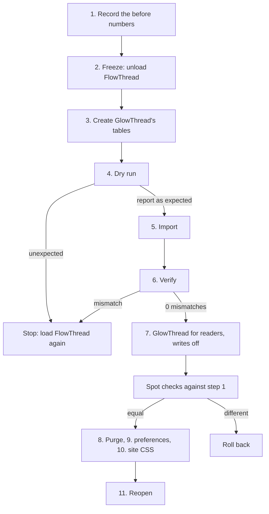

English | [简体中文](zh-CN/migrating-from-flowthread.md)

# Migrating from FlowThread

This runbook moves a wiki from FlowThread 1.3.x to GlowThread. GlowThread's importer copies FlowThread's comments, likes, reports and page settings into GlowThread's tables. It only reads FlowThread's tables and never writes to them, so you can go back to FlowThread at any point.

Comments are unavailable during a short window. Readers and editors can use the wiki as usual.

What the importer does with each row, and the choices it offers, is in [FlowThread data mapping](migration-data.md).

## Overview

| Phase | Readers see | Who can comment | How long |
|---|---|---|---|
| Before the day: install GlowThread without loading it, rehearse on a copy, back up | FlowThread | FlowThread | days before |
| The window: FlowThread off, tables created, import, verify, GlowThread on for reading, checks | no comments, then GlowThread | nobody | plan about half an hour. Your rehearsal tells you how long the import takes |
| Reopen: GlowThread writes on | GlowThread | GlowThread | a minute |
| Afterwards: FlowThread kept unloaded as long as you might roll back | GlowThread | GlowThread | weeks |



## What changes

| | FlowThread | GlowThread |
|---|---|---|
| Comment container | `<div id="flowthread">` | `<div id="glowthread">`. A link to `#flowthread` still opens the comments |
| Site CSS and scripts | `#flowthread` and FlowThread's inner classes | Change `#flowthread` to `#glowthread` ([step 10](#10-switch-site-css-and-scripts)). Restyle GlowThread with its custom properties and part hooks in [Theming](theming.md) instead of FlowThread's inner classes |
| Who can post | `comment` right, given to everyone (`*`) by default | `glowthread-post` for logged-in users. Anonymous posting is not supported |
| Moderation rights | `commentadmin`, `commentadmin-restricted` | `glowthread-moderate`, `glowthread-erase`, `glowthread-configure` ([Rights](configuration.md#rights)) |
| Text | Plain text or wikitext, stored as HTML | Plain text with links, mentions and emoji. Imported HTML is converted ([mapping](migration-data.md#text)) |
| Nesting | Up to 3 levels | 2 visible levels. Deeper replies show under their level-1 ancestor and keep their real parent |
| Namespaces | Every subject namespace except MediaWiki, Template, Category, File and Module | Only `$wgGlowThreadNamespaces`, the main namespace by default |
| Spam filter | `MediaWiki:Flowthread-blacklist` marks matches as spam | `MediaWiki:GlowThread-filter` holds matches for review ([word filter](configuration.md#the-word-filter)) |
| Deleting a page | Erases its comments | Hides its comments. Undeleting brings them back |
| Log | Special:Log/comments | Special:Log/glowthread ("Comment log") and Special:Log/glowthread-private ("Comment erasure log"). FlowThread's old entries stay in Special:Log/comments, shown while `$wgGlowThreadLegacyCompat` is on and no other extension uses that log name |
| Notifications | Echo category `flowthread` | Echo category `glowthread` ("Comments"). Old notifications keep showing while `$wgGlowThreadLegacyCompat` is on |
| Permalinks | Special:FlowThreadLink | Special:GlowThreadLink. Old Special:FlowThreadLink links keep working |
| Moderation page | Special:FlowThreadManage | Special:GlowThread. Special:FlowThreadManage leads there |
| Page switch | Special:FlowThreadControl | The "Page:" menu in the comment section ([moderation guide](moderation.md#page-states)) |
| Pages where comments were turned off | Existing comments still showed, only posting stopped | Imported as "Locked" by default: the comments stay readable, and nobody can post or reply. `--disabled-pages` and `--opted-out` change this ([import choices](migration-data.md#import-choices)) |
| Export and import pages | Special:FlowThreadExport, Special:FlowThreadImport | None |
| API | `api.php?action=flowthread` | REST and API modules ([api.md](api.md)). A read-only stand-in for `action=flowthread` while `$wgGlowThreadLegacyCompat` is on |

FlowThread's `$wgFlowThreadConfig` has two settings with a GlowThread counterpart: `PopularPostCount` is `$wgGlowThreadPopularCount`, and `PopularPostThreshold` is `$wgGlowThreadPopularMinLikes`. `Avatar` and `AnonymousAvatar` have none: GlowThread draws avatars from the user name and loads nothing from other sites. `MaxNestLevel` has none: GlowThread always shows 2 levels.

## Before the day

### Check the requirements

- GlowThread's [requirements](../README.md#requirements): MediaWiki 1.43 or later, and a database with window functions (MariaDB 10.2 or later, MySQL 8.0 or later, SQLite 3.25 or later, or PostgreSQL).
- FlowThread's three tables are in the wiki's own database, with the wiki's table prefix. FlowThread creates them as `FlowThread`, `FlowThreadAttitude` and `FlowThreadControl`. On servers that store table names in lower case (`lower_case_table_names=1`), they are `flowthread`, `flowthreadattitude` and `flowthreadcontrol`. The importer finds either spelling. The SQL examples below use FlowThread's spelling: use the one your server shows (`SHOW TABLES LIKE '%hread%';`).

### Temporary accounts must be off

The importer stores old anonymous comments under IP actors (the IP address as author name, as FlowThread showed it). MediaWiki cannot create IP actors while temporary accounts (`$wgAutoCreateTempUser`) are enabled. If they are enabled and an IP actor is missing, the importer reports a mismatch and writes nothing.

Check:

```sh
echo 'var_dump( MediaWiki\MediaWikiServices::getInstance()->getTempUserConfig()->isEnabled() );' \
  | php maintenance/run.php eval
```

Expected: `bool(false)`. Temporary accounts are off by default in MediaWiki 1.43. Turning them on after the import is fine.

### Decide the namespaces

FlowThread showed comments in more namespaces than GlowThread does by default. Comments in other namespaces are imported either way, but readers see them only if you turn those namespaces on. Count them (MySQL or MariaDB, add your `$wgDBprefix` to the table names):

```sql
SELECT page_namespace, COUNT(DISTINCT flowthread_pageid) AS pages,
       SUM(flowthread_status = 0) AS visible
  FROM FlowThread JOIN page ON page_id = flowthread_pageid
  GROUP BY page_namespace;
```

To keep comments on user pages, for example, add `$wgGlowThreadNamespaces[NS_USER] = true;` in [step 7](#7-load-glowthread-for-readers-writes-still-off).

### Decide the import choices

The importer applies a recommended default for each choice, for example what to do with FlowThread's "spam" status or with images in comments. The options and their defaults are in [Import choices](migration-data.md#import-choices).

Write the options you agree on into one shell variable, and use it unchanged for the dry run, the import and the verification:

```sh
OPTS=''                                      # the defaults
# OPTS='--spoilers hold --images link'       # an example with two options changed
```

The import records its choices in its log entry. `--verify` with other choices reports that as a mismatch.

The commands below expand `$OPTS` without quotes, which splits it into options in bash and sh. zsh does not split it: there, write `${=OPTS}`.

The importer writes absolute links to wiki pages into converted comments. It uses `$wgCanonicalServer`. Give `--server https://wiki.example.org` when that is not the address readers use.

### Install GlowThread without loading it

Put GlowThread in `extensions/GlowThread`. Do not add `wfLoadExtension( 'GlowThread' );` yet. Check that every PHP file parses (prints nothing when they all do):

```sh
find extensions/GlowThread/includes extensions/GlowThread/maintenance -name '*.php' \
  -exec php -l {} \; | grep -v '^No syntax errors'
```

### Rehearse on a copy

Run the whole runbook on a copy of the wiki's database, on hardware like production's, with the same GlowThread version and the same `$OPTS`. This shows:

- what the report looks like for your data, and which warnings to expect,
- how long each step takes. The report ends with a `Timings` section per phase,
- that `--verify` finds no mismatch, and that a second import changes nothing.

The importer writes comments in batches of 200 (`--batch-size`) and waits for database replication after each batch. Most rows are written with their own statement, so the import time grows with the number of rows and with the round trip to the database server. A copy on a laptop is faster than a database across a network.

### Back up FlowThread's tables

For the rollback, and as the record of what was imported (MySQL or MariaDB example, add your table prefix):

```sh
mysqldump --single-transaction --no-tablespaces -h DBHOST -u DBUSER -p DBNAME \
  FlowThread FlowThreadAttitude FlowThreadControl \
  | gzip > flowthread-$(date +%Y%m%d).sql.gz
```

Keep the file with your other backups: it holds IP addresses and comment text. Comments erased in GlowThread later stay in it, see [Afterwards](#afterwards). The dump starts each table with `DROP TABLE IF EXISTS`, so loading it into the wiki's database replaces the live tables. To read it, load it into a separate database. If your server uses GTIDs, add `--set-gtid-purged=OFF`, so that a restore into the same server does not fail.

### Prepare the rest

- **Site CSS and scripts.** Find every use of `flowthread` in the MediaWiki namespace: MediaWiki:Common.css, skin CSS such as MediaWiki:Vector.css or MediaWiki:Mobile.css, and gadgets. Special:Search with the MediaWiki namespace selected finds them. Prepare the new text for [step 10](#10-switch-site-css-and-scripts).
- **Word filter.** If you used `MediaWiki:Flowthread-blacklist`, prepare its rules for `MediaWiki:GlowThread-filter`. FlowThread's lines are regular expressions without delimiters, matched without case. Write each one as `/regex/i`. Drop the `<...>` options at the end of a line: GlowThread has no replacement and no exemption by group. A match holds the comment for review. See [the word filter](configuration.md#the-word-filter).
- **Rights.** If you changed FlowThread's rights in `LocalSettings.php`, plan the GlowThread equivalents. Groups that had `commentadmin` need `glowthread-moderate`, and `glowthread-erase` if they should erase. Remove the lines for `comment`, `commentadmin` and `commentadmin-restricted`.
- **Echo.** If Echo is loaded, plan to set `$wgEchoPerUserBlacklist = true;` with step 7, so readers can mute one person.
- **CDN.** If a CDN caches your pages, read [Running behind a CDN](caching.md). The cache rule it describes for GlowThread's comment lists ([What the CDN must do](caching.md#what-the-cdn-must-do)) can be loaded before the switch: until GlowThread is loaded, the route does not exist, and its errors are not cached.
- **Announce** the window on the wiki.

### How to change LocalSettings.php during the window

- PHP's opcache may keep using the old file for up to `opcache.revalidate_freq` seconds. With `opcache.validate_timestamps=0`, it never rereads the file: reload PHP-FPM after each change.
- If `LocalSettings.php` is a single file bind-mounted into a Docker container, write over the existing file (`cat new.php > LocalSettings.php`). An editor or `sed -i` that saves by rename leaves the container on the old file.
- A long-running job runner (`runJobs --wait`) keeps the settings it started with. Restart it after each change below.

## The window

### 1. Record the "before" numbers

While FlowThread is still loaded, save the output of (add your table prefix):

```sql
SELECT COUNT(*) FROM FlowThread;
SELECT flowthread_status, COUNT(*) FROM FlowThread GROUP BY flowthread_status;
SELECT flowthread_att_type, COUNT(*) FROM FlowThreadAttitude GROUP BY flowthread_att_type;
SELECT COUNT(*) FROM FlowThreadControl;
```

Status 0 is normal, 1 deleted, 2 spam. Attitude type 1 is a like, 2 a report.

Pick a few pages to spot-check later: your busiest pages, and a page with a recently deleted comment. Count their visible comments as FlowThread shows them:

```sh
for p in 101 202; do   # page IDs
  curl -s "https://wiki.example.org/api.php?action=flowthread&type=list&pageid=$p&limit=500&format=json" \
    | jq '.flowthread.posts | length'
done
```

### 2. Freeze FlowThread

In `LocalSettings.php`, replace `wfLoadExtension( 'FlowThread' );` with:

```php
// Migration window: FlowThread off for everyone, GlowThread for maintenance scripts only
if ( PHP_SAPI === 'cli' ) {
	wfLoadExtension( 'GlowThread' );
}
```

Then restart the job runner. Unload FlowThread rather than only taking away its rights, so that nothing can change its tables during the import. FlowThread's page-delete hook erases comments, so a job runner that still has FlowThread loaded can erase comments when it finishes a page deletion.

Check: `api.php?action=flowthread&type=list&pageid=101&format=json` answers the error `badvalue` (unrecognized value for `action`). From then on, nothing can write to FlowThread's tables. Run step 1's SQL again and use these numbers from now on, so a comment posted in the last seconds does not show up as a difference.

Stop if the site shows errors. Undo by restoring the FlowThread line.

### 3. Create GlowThread's tables

```sh
php maintenance/run.php sql extensions/GlowThread/sql/mysql/tables-generated.sql
```

Use the folder for your database type: `mysql`, `sqlite` or `postgres`. This creates the six `glowthread_*` tables with your table prefix and nothing else. `php maintenance/run.php update` creates them too, but it also applies every other pending update of core and other extensions, which does not belong in a short window. A later `update` sees the tables and skips them.

If the tables exist from an earlier attempt, this step fails with "table already exists". Skip it then, and read [Trying again after a rollback](#trying-again-after-a-rollback).

Stop on any other error.

### 4. Dry run

```sh
php maintenance/run.php GlowThread:importFlowThread --dry-run $OPTS --report-file dry-run.json
```

The dry run reads and converts everything, writes nothing, and prints the report. Compare it with step 1 (the numbers taken after the freeze):

- `comments`: `read` equals the comment count, and `would insert` equals it too. The `FlowThread status` lines match the status counts.
- `likes` and `reports`: `rows read` match the attitude counts.
- `visibility`: with the default choices, `comments readers see in FlowThread` equals `comments readers see in GlowThread (planned)`. `--spoilers hold`, `--empty delete` and `--hidden visible` change the planned number on purpose: the difference must equal the number of comments those choices affect, as the report counts them. `--disabled-pages disabled` and `--opted-out disabled` lower it by the comments on the pages they close.
- The header shows your choices and the `server` used for links to wiki pages.
- `Mismatches: 0`.
- Warnings: `question-marks`, `truncated`, `empty`, `image-dropped`, `spoiler-revealed`, `formatting-dropped`, `literal-markup` and `link-changed` are known kinds. If `unparseable`, `invalid-utf8` or `element-dropped` appear, look at the listed comments first. [Warnings](migration-data.md#warnings) explains each.

`--report-file` writes the full report with every listed FlowThread ID as JSON. It holds no comment text, user names or IP addresses, but it can hold URLs from comments. Keep it with the backup.

Stop if any of these differ. Undo step 2.

### 5. Import

```sh
php maintenance/run.php GlowThread:importFlowThread $OPTS --report-file import.json
```

Stop on an exception, or on a mismatch such as "Temporary accounts are enabled", which is checked before anything is written. The rows written so far are complete batches. A second run with the same `$OPTS` continues where the first stopped. Fix the cause and run step 5 again, or roll back. Afterwards, check that the report's `run` section shows `glowthread/import log entries written`. Special:Log/glowthread shows the entry only from step 7, when the web wiki loads GlowThread.

### 6. Verify

```sh
php maintenance/run.php GlowThread:importFlowThread --verify $OPTS
echo $?
```

Expected: `Mismatches: 0`, exit status 0, and `already imported, unchanged` equals the comment count. The two GlowThread lines under `comments readers see` are equal, and the FlowThread line differs from them only as in step 4.

Optional cross-checks in SQL (add your table prefix):

```sql
SELECT COUNT(*) FROM glowthread_post WHERE gtp_legacy_id IS NOT NULL;    -- = comments in step 1
SELECT gtp_status, COUNT(*) FROM glowthread_post GROUP BY gtp_status;
SELECT COUNT(*) FROM glowthread_reaction WHERE gtr_timestamp IS NULL;     -- imported likes
SELECT COUNT(*), SUM(gtrp_resolved_at IS NULL) FROM glowthread_report;    -- reports, open ones
SELECT gtpg_state, COUNT(*) FROM glowthread_page GROUP BY gtpg_state;
```

Stop on a mismatch. Roll back (undo step 2), then look at the report file.

### 7. Load GlowThread for readers, writes still off

Replace the block from step 2 with:

```php
wfLoadExtension( 'GlowThread' );
// FlowThread compatibility: old notifications, old log entries, FlowThread's API read-only. Keep it on.
$wgGlowThreadLegacyCompat = true;
// Migration window: reading only until the checks pass
$wgGroupPermissions['user']['glowthread-post'] = false;
$wgGroupPermissions['user']['glowthread-react'] = false;
$wgGroupPermissions['user']['glowthread-report'] = false;
```

Add your namespace, rights and Echo lines from [Before the day](#before-the-day) here too. Restart the job runner.

When PHP uses the new file, the list route answers 200 instead of 404. Then compare the pages from step 1 (a request to `rest.php` is not a page view, so it shows the new state at once):

```sh
for p in 101 202; do
  curl -s "https://wiki.example.org/rest.php/glowthread/v1/page/$p/comments?sort=hot" | jq .count
done
```

Expected: the numbers from step 1. If you chose `--disabled-pages disabled` or `--opted-out disabled`, those pages are "Closed" and answer `0`, so pick other pages for this check. Also open these pages **logged in**, on a desktop and on a phone. Check that comments, like counts and floor numbers show, and that Special:Log/glowthread shows the import entry.

Logged out, pages cached before this step still show no comments until step 8. That is not a reason to roll back.

Stop if a count differs, or if the comment section fails to load for a logged-in reader. Roll back.

### 8. Purge cached pages

Only if a CDN or file cache keeps page HTML for logged-out readers (`$wgUseCdn`, `$wgUseFileCache`). Pages cached before step 7 load FlowThread's script, which no longer exists, and not GlowThread's loader. Logged-out readers see no comments on them until the copy expires (`$wgCdnMaxAge`, five hours by default).

On a small wiki, purge every page in the comment namespaces:

```sh
php maintenance/run.php purgeList --namespace 0
```

On a large wiki, purge only the pages that have comments. List their titles, then purge them:

```sh
php maintenance/run.php eval > glowthread-pages.txt <<'PHP'
$s = MediaWiki\MediaWikiServices::getInstance();
$ids = $s->getConnectionProvider()->getReplicaDatabase()->newSelectQueryBuilder()->select( 'gtp_page' )->distinct()->from( 'glowthread_post' )->caller( 'migration' )->fetchFieldValues();
foreach ( $s->getPageStore()->newSelectQueryBuilder()->wherePageIds( $ids )->fetchPageRecords() as $p ) { echo MediaWiki\Title\Title::newFromPageIdentity( $p )->getPrefixedText(), "\n"; }
PHP
grep -c . glowthread-pages.txt
php maintenance/run.php purgeList < glowthread-pages.txt > glowthread-purge.txt
tail -2 glowthread-purge.txt
```

`eval` runs its input line by line, so each statement stays on one line. Keep `glowthread-pages.txt` for a rollback. `purgeList` prints every URL, hence the file. Do not add `--delay`: it takes whole seconds only and sleeps after every URL.

Then open a purged page logged out: it must show GlowThread's comment section. With the second method, pages without comments show the section to logged-out readers once their cached copy expires. Logged-in readers are never served from the cache.

### 9. Carry over notification preferences

Only if Echo is loaded. GlowThread notifies in its own Echo category, `glowthread`. Users who changed FlowThread's category (`flowthread`, web or email) keep that choice only for FlowThread's old notifications. Copy it once, before writes reopen and the first GlowThread notification is sent. Count first, copy, count again (MySQL or MariaDB, add your table prefix):

```sql
SELECT up_property, COUNT(*) FROM user_properties
  WHERE up_property IN ('echo-subscriptions-web-flowthread', 'echo-subscriptions-email-flowthread')
  GROUP BY up_property;
INSERT IGNORE INTO user_properties (up_user, up_property, up_value)
  SELECT up_user, REPLACE(up_property, 'flowthread', 'glowthread'), up_value
  FROM user_properties
  WHERE up_property IN ('echo-subscriptions-web-flowthread', 'echo-subscriptions-email-flowthread');
SELECT up_property, COUNT(*) FROM user_properties
  WHERE up_property IN ('echo-subscriptions-web-glowthread', 'echo-subscriptions-email-glowthread')
  GROUP BY up_property;
```

On SQLite write `INSERT OR IGNORE`. On PostgreSQL write `INSERT ... ON CONFLICT DO NOTHING`. The ignore keeps any GlowThread preference a user already set, so the step can run again.

The counts before and after must be equal. If they differ, find out why before you reopen. The copy changes only how notifications are delivered, not comments.

Moderators keep their rights during step 7, and their actions already notify authors. If moderators may act in the window, run this step right after step 6.

### 10. Switch site CSS and scripts

Edit the pages you found before the day and replace `#flowthread` with `#glowthread`. For example:

```css
/* before */
#flowthread { margin-top: 2em; }
/* after */
#glowthread { margin-top: 2em; }
```

GlowThread puts its container where FlowThread put it, right after the page content, so rules that place or space the container keep working. Rules for FlowThread's inner classes (`.comment-container`, `.post-content` and so on) have no effect any more and can be removed. Change the look of the comments with the custom properties in [Theming](theming.md).

ResourceLoader serves the new site CSS to readers within a few minutes.

### 11. Reopen

Remove the three `$wgGroupPermissions` lines from step 7. When PHP uses the new file, test:

1. As an administrator, post a test comment on a test page.
2. With a second account, like it and take the like back. Nobody can like their own comment.
3. Delete the test comment.

Logged out, the page's comment list shows the new comment at once and loses it after the deletion, because both writes purge the list. Announce that comments are back.

## Rollback

The importer never writes to FlowThread's tables, so FlowThread can come back at any time.

1. In `LocalSettings.php`, put `wfLoadExtension( 'FlowThread' );` back in place of the GlowThread lines, and restart the job runner.
2. If you purged pages in step 8: wait until every PHP worker has the new settings, then run the same purge again with the same title list. GlowThread's list route answers 404 once GlowThread is unloaded: `rest.php/glowthread/v1/page/101/comments?sort=hot`. (FlowThread's API is not a good check here: GlowThread's compatibility API answers under the same name.) A purge before that point lets PHP workers that still have the old settings cache GlowThread pages again.
3. Change site CSS back to `#flowthread`, if you did step 10.

| When | What is lost |
|---|---|
| Before step 11 | Nothing |
| After step 11 | Comments, likes and reports made in GlowThread. Count them first: `SELECT gtp_status, COUNT(*) FROM glowthread_post WHERE gtp_legacy_id IS NULL GROUP BY gtp_status;`. The test comment from step 11 is one `deleted` row. Decide before the migration whether you would export them |

Pages without comments that were cached after step 7 keep GlowThread's loader until they expire.

### Trying again after a rollback

After a rollback, FlowThread is fully live again. Start again at step 1 (step 2 freezes FlowThread again) and skip step 3, because the tables exist. The dry run of step 4 on the kept tables tells you what to do:

- If it lists only comments, likes and reports to insert, and no line `already imported, differs from FlowThread now`, `imported earlier, no longer in FlowThread` or `not added: comment imported earlier`, nothing that matters changed in FlowThread. Keep GlowThread's tables. The import adds only what is missing. Then `would insert` plus `already imported, unchanged` equals the comment count.
- Otherwise (comments were deleted, erased or changed in FlowThread, or likes and reports taken back or added on comments already imported), empty GlowThread's tables and run step 4 again. An incremental run would keep comments erased in FlowThread, keep old statuses, add no likes or reports to comments already imported, and floor numbers would no longer follow creation order.

Empty GlowThread's tables only while GlowThread has no comments of its own, apart from a test comment (count them as shown under [Rollback](#rollback)):

```sql
DELETE FROM glowthread_post;
DELETE FROM glowthread_reaction;
DELETE FROM glowthread_report;
DELETE FROM glowthread_page;
DELETE FROM logging WHERE log_type = 'glowthread' AND log_action = 'import';
```

Use `DELETE`, not `TRUNCATE`. `TRUNCATE` resets the ID counter, but log entries, Echo notifications and CheckUser records from the first attempt still name comment IDs from that attempt. A new comment would then get an ID that old records point at. `DELETE` keeps the counter, so new IDs continue above the old ones.

The IP actors created by the import stay. The next run reuses them.

## Afterwards

- **Keep `$wgGlowThreadLegacyCompat = true;`.** It shows FlowThread's stored notifications and log entries, and it lets apps, gadgets and other clients that read FlowThread's API keep showing comments. Turning it off hides those notifications and log entries (they are not deleted). The API's answers are private, so no cache keeps them. See [FlowThread compatibility](configuration.md#flowthread-compatibility).
- **FlowThread.** Keep its tables and its folder (unloaded) as long as you might roll back. Then drop the tables after a final backup. Never load FlowThread and GlowThread together. Erasing an imported comment in GlowThread does not reach FlowThread's tables or their backups: the text stays there, and a rollback or a new import brings it back. Treat the tables like those backups, under the same retention and access rules. Once you no longer need to roll back, or as soon as an erasure (for example for a legal reason) must take effect there too, drop them (`DROP TABLE FlowThread, FlowThreadAttitude, FlowThreadControl;` with your table prefix) or move them to the archive that holds the backups.
- **The importer.** Once GlowThread takes comments, run it only with `--verify`. No run undoes what happened in GlowThread since the switch, `--update` included: erased comments, statuses, report resolutions and page states set there, and comments moved to a new page ID after an undelete, are kept. Likes and reports are added only together with their comment, so a like a user removed stays gone. Merge user accounts (Extension:UserMerge) only after your last importer run: a later `--update` removes imported likes and reports that a merge moved to another account. `--verify` lists these as `changed in GlowThread, kept` or `not added: comment imported earlier`, not as mismatches.
- **What keeps working.** Special:FlowThreadLink permalinks and links to `#flowthread`, and, with `$wgGlowThreadLegacyCompat` on, FlowThread's stored notifications and its entries in Special:Log/comments.
- **Temporary accounts** can be turned on now, if you want them. GlowThread never creates IP actors itself.
