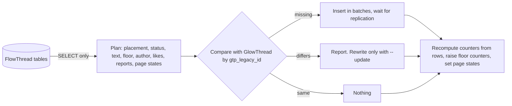

English | [简体中文](zh-CN/migration-data.md)

# FlowThread data mapping

How the importer (`maintenance/importFlowThread.php`) turns FlowThread's three tables into GlowThread rows, which choices it offers, and what its report prints. The step-by-step runbook is [Migrating from FlowThread](migrating-from-flowthread.md).

## Summary

- Every FlowThread row that can be imported has a place in GlowThread. Rows that cannot (a malformed ID, a like or report by an anonymous or deleted user, or on a missing comment) are skipped and counted. Exact duplicate likes and reports are imported once.
- Comment text is converted from FlowThread's stored HTML to GlowThread's plain text. Most comments convert without any change in what readers see. Comments that lose something (an image, a revealed spoiler, formatting) are listed in the report for review.
- The importer only reads FlowThread's tables. It never writes to them.
- A run is safe to repeat. The FlowThread ID is the key, so a second run over the same data writes nothing.
- Each decision that has more than one reasonable answer is an [import choice](#import-choices) with a recommended default.

## Building blocks

| Piece | Job |
|---|---|
| `maintenance/importFlowThread.php` | The command. Modes: `--dry-run` (plan and report, write nothing), the default (write), `--verify` (write nothing, compare, exit with status 1 on any mismatch) |
| `Import\FlowThreadImporter` | Plans the target state from the FlowThread rows, compares it with GlowThread, and writes what is missing in batches of `--batch-size` comments (default 200), waiting for replication after each batch |
| `Import\LegacySource` | Reads FlowThread's tables `FlowThread`, `FlowThreadAttitude` and `FlowThreadControl` (or their lower-case spelling). It only runs `SELECT` |
| `Import\ImportOptions` | The choices of one run (see [Import choices](#import-choices)) |
| `Import\ImportReport` | Counts, FlowThread IDs to review, mismatches and timings. It holds no comment text, user names or IP addresses |
| `Import\LegacyId` | Decodes the 11-byte FlowThread ID into a time, and compares IDs in creation order |
| `Import\LegacyHtmlConverter`, `Import\ConversionResult` | Turn stored HTML into GlowThread's plain text, with warnings, feature counts and the user names that its user links name, which become mentions |

## Command options

| Option | Meaning |
|---|---|
| `--dry-run` | Plan and report, write nothing |
| `--verify` | Write nothing, compare GlowThread with FlowThread, exit with status 1 on any mismatch |
| `--page <id>` | Only this page ID |
| `--update` | Also rewrite imported comments, report resolutions and page states that differ from FlowThread now, and remove imported likes and reports that FlowThread no longer has. Without it, only missing comments are added, each with its likes and reports. Decisions made in GlowThread are kept even with it, see [How a run decides what to write](#how-a-run-decides-what-to-write) |
| `--server <url>` | Server for absolute links to wiki pages in converted text. Default `$wgCanonicalServer` |
| `--user <name>` | Performer of the import log entry and of reports the import resolves. Must be an existing user. Default "Maintenance script" |
| `--no-log` | Do not write the `glowthread/import` log entry |
| `--report-file <path>` | Also write the full report, with every listed FlowThread ID, as JSON |
| `--batch-size <n>` | Comments per write batch. Default 200 |
| `--spam`, `--reports-on-deleted`, `--empty`, `--images`, `--spoilers`, `--hidden`, `--self-attitudes`, `--disabled-pages`, `--opted-out`, `--missing-user-prefix` | The [import choices](#import-choices) |

`--dry-run` and `--verify` cannot be combined.

## How a run decides what to write

- The FlowThread ID (`gtp_legacy_id`) is the key. A second run over the same source writes nothing.
- Without `--update`, an imported comment that no longer matches FlowThread is listed, never overwritten.
- No run undoes a decision made in GlowThread, `--update` included. An erased comment is not touched at all. A comment that GlowThread moved to a new page ID, when an undelete gave its page one, stays there. A comment whose status GlowThread changed keeps its status, hold reason and text: a moderator's action, the author's own deletion and an automatic hold all set `gtp_status_timestamp`, which the importer never writes. The reports of such a comment, and a report a moderator dismissed ("Dismiss reports"), keep their resolution and are not removed. A page keeps a state a moderator set (see [Page settings](#page-settings)). Every mode counts these as `changed in GlowThread, kept`, so the dry run shows what a run will keep, and `--verify` does not count them as mismatches.
- Imported likes are the likes with no timestamp, and imported reports have the reason `legacy`. Only those are removed, and only with `--update`, when FlowThread no longer has them. Comments that disappeared from FlowThread are listed and kept.
- Likes and reports are added only together with their comment, in the same transaction. A comment imported earlier never gets a like or report added, so one that was taken back in GlowThread (a like its user removed, a report dropped by a user merge) stays gone, and a run that stopped continues without losing any. Every mode counts the ones FlowThread has on such comments as `not added: comment imported earlier`, and `--verify` does not count them as mismatches. To add likes or reports to comments imported earlier, for example after changing `--self-attitudes`, empty GlowThread's tables and import again. Merge user accounts (Extension:UserMerge) only after your last importer run: a later `--update` removes imported likes and reports that a merge moved to another account.
- Use the same choices for the dry run, the import and the verification. The import records them in its log entry. A run with other choices reports that first, and `--verify` counts it as a mismatch.

The importer writes straight to the tables. It runs no hooks, so it sends no Echo notification, records no CheckUser event, purges nothing from the CDN and writes no log entry per comment. It writes one `glowthread/import` log entry (in Special:Log/glowthread) with the total number of imported comments (`4::count`, all runs together) and the choices (`5::options`), when a run added comments, when an earlier run added them but stopped before its entry, or when `--update` applied new choices. `--no-log` skips it. The entry goes to the `logging` table only, not to recent changes. The report's `run` section counts it as `glowthread/import log entries written`. To tell whether an earlier run wrote its entry, and to compare the choices with the last import, the importer reads only `glowthread/import` entries. FlowThread's own `import` entries (log type `comments`, written by Special:FlowThreadImport) are ignored, so they cannot make a resumed run skip its entry.

## Comments: `flowthread` to `glowthread_post`

| FlowThread column | GlowThread column | Rule |
|---|---|---|
| `flowthread_id` | `gtp_legacy_id` | `LegacyId::getHex()`, 22 lowercase hex digits. The unique key that makes the import repeatable |
| `flowthread_id` | `gtp_created` | `LegacyId::getTimestamp()`, UTC. See [Time and order](#time-and-order) |
| none | `gtp_id` | Auto increment. Rows are inserted in legacy ID order (a parent always before its replies), so `gtp_id` order is creation order |
| `flowthread_pageid` | `gtp_page` | Same page ID. A later run keeps the page ID that GlowThread moved a comment to when an undelete gave its page a new ID |
| `flowthread_userid`, `flowthread_username` | `gtp_actor` | See [Authors](#authors) |
| `flowthread_text` | `gtp_text` | `LegacyHtmlConverter::convert()->text`. See [Text](#text) |
| `flowthread_parentid` | `gtp_reply_to`, `gtp_parent`, `gtp_thread`, `gtp_depth` | See [Threads](#threads) |
| `flowthread_status` | `gtp_status`, `gtp_hold_reason` | See [Status](#status) |
| `flowthread_like` | `gtp_like_count` | Counted from the rows in `glowthread_reaction`. FlowThread's counter is only compared, and comments where it differs are listed |
| `flowthread_report` | `gtp_open_report_count` | Counted from the open rows in `glowthread_report`. FlowThread's counter is only compared |
| none | `gtp_seq` | Floor number. See [Floors](#floors) |
| none | `gtp_reply_count` | Visible comments whose `gtp_parent` is this one, counted once all rows are in |
| none | `gtp_edited`, `gtp_pinned`, `gtp_status_actor`, `gtp_status_timestamp` | Null. FlowThread has no edits or pins and does not record who deleted a comment or when. Its log entries name only the page and the comment's author, so a row cannot be matched to its log entry reliably |

## Time and order

FlowThread has no timestamp column. The time is part of the ID, which MediaWiki's `GlobalIdGenerator::newTimestampedUID88()` made: 46 bits of milliseconds since 1970, a 10-bit counter, then a 32-bit host ID, big-endian. `LegacyId::getTimestamp()` gives the same second as FlowThread's own `UID::getTimestamp()`.

- Sort by legacy ID, never by `gtp_created` alone. The ID keeps the order to the millisecond. Inside one millisecond, MediaWiki's counter starts at a random offset and wraps at 1024, so two comments from the same millisecond could swap.
- `LegacyId::getProblem()` returns `before-2016` or `future` for IDs that cannot be real. Such IDs can come from Special:FlowThreadImport, which keeps the ID of its JSON input. The importer imports such a comment with its decoded time and lists it.

## Text

### Stored formats

FlowThread stored comments as HTML, in three shapes:

| Format | Shape |
|---|---|
| Plain text | No tags at all. Plain-text posts were saved inside `<nowiki>`, so the stored value is escaped text (`&amp;`, `&quot;`, `&lt;`) with the author's line breaks as raw newlines. FlowThread stripped the wrapper and the single outer paragraph |
| Inline HTML | FlowThread's reply prefix (`@<a href=".../User:Name">Name</a> `) and posts written in wikitext mode: `
`, `<a>`, ` `, `<b>`, `<i>`, `<del>`, ``, spoiler spans |
| Full parser output | `

…\n

`. On newer MediaWiki versions, FlowThread's pattern for removing the wrapper no longer matches, so the whole parser output is stored |

### Rules

The examples are made up and show the shape of real rows. `wiki.example.org` stands for the `--server` value.

| Stored | Converted | Why |
|---|---|---|
| `

Have a nice weekend\n

` | `Have a nice weekend` | Wrappers of every MediaWiki version are removed |
| `
First paragraph\n

Second paragraph\n
` | `First paragraph`, a blank line, `Second paragraph` | A paragraph boundary is a blank line |
| `One line \nTwo lines` | `One line`, a newline, `Two lines` | ` ` is a line break. The newline MediaWiki writes after it does not double it |
| `First line\nSecond line` (plain text) | the same | Newlines inside text are the author's own line breaks. At most one blank line in a row is kept |
| `Note  as   follows\n   indented` | `Note as follows`, a newline, `indented` | Runs of spaces and tabs become one space and lines are trimmed, which is what readers saw in HTML. Ideographic spaces (U+3000) inside a line stay |
| `A&amp;B &lt;3 &amp;lt;` | `A&B <3 &lt;` | Entities are decoded exactly once, so an entity the author typed stays an entity |
| `<a class="external free" href="U">U</a>` | `U` | A bare link becomes its URL, with non-ASCII characters percent-encoded, because GlowThread ends a URL at the first CJK letter ([api.md](api.md#segment)). One exception: when the URL holds full-width punctuation, quotes or spaces, MediaWiki had swallowed the author's next words into the link. The text then stays as written, GlowThread links only the real URL, and the comment gets a `link-changed` warning |
| `<a class="external autonumber" href="U">[1]</a>` | `U` | A numbered link becomes its URL, encoded the same way |
| `<a class="external text" href="U">the site</a>` | `the site (U)` | The words and the target both survive. In `U`, non-ASCII characters, quotes, angle brackets and punctuation at the very end are percent-encoded, so the whole target stays one link |
| `@<a href="/index.php?title=User:Kim&action=edit&redlink=1">Kim</a> hello` | `<@42> hello`, when Kim is user 42 | Links to user pages (any alias of the User namespace in the content language, existing or not, relative or absolute) become the mention token `<@ID>` of the user they name, found by that exact name. The `@` of FlowThread's reply prefix merges into the mention. A name that is no user stays text (`@Kim hello`), and a user hidden by a hideuser block becomes `@…`, so that the name is not stored |
| `ask<a href="/wiki/User:Kim">Kim</a>today` | `ask<@42>today` | A token needs no space on either side. Readers see the mention as `@` and the user's current name |
| `<a href="/wiki/User:Kim">Old Kim</a>` | `Old Kim (<@42>)` | Link text that is not the name is kept, followed by the mention |
| `see <a href="/wiki/Test_page">Test page</a> first` | `see Test page (https://wiki.example.org/wiki/Test_page) first` | Other wiki links, links to missing articles included, become `text (URL)` with an absolute URL to the page view. A link that carries more than a title, such as an old revision (`oldid`), a diff or `action=history`, keeps its full URL |
| `<a href="/wiki/Bread_(sourdough)">Bread</a>` | `Bread (https://wiki.example.org/wiki/Bread_%28sourdough%29)` | The title is percent-encoded except ASCII letters, digits, `-_.~`, `:` and `/`. A `.` or `:` at the very end is encoded too, because GlowThread trims it from a URL |
| `secret`, `<b>`, `<i>`, `<del>` | the text | Formatting has no plain-text form. Each case is recorded. `heimu` is the black-bar spoiler style used on many Chinese wikis |
| ``, `<script>`, `<style>`, `<iframe>` and other embeds | nothing | Dropped and recorded, an image with its `src`. An image inside a link to its file page (`[[File:X.png]]`) leaves that link's URL. With `--images link`, each image becomes its URL instead |

Why `text (URL)` for wiki links: it can be reversed (the URL maps back to exactly one title), the words stay readable in front of the URL, and GlowThread turns the URL into a working link. The alternatives lose something. The text alone drops the target, and Markdown `[text](URL)` would show its brackets, because GlowThread does not render Markdown.

After the conversion the text goes through `TextProcessor::normalize()`, so it is byte for byte what GlowThread stores for a new comment. This removes invisible format characters, such as a zero-width space or a bidi embedding, and applies NFC normalisation. It also removes hidden tag characters, and a text in which nothing would show becomes empty. A user link is matched by the name it links to at import time, so a user renamed since then is not found and the name stays text. A mention token shows the user's current name, so it follows later renames.

Imported comments skip the posting rules. `maxLength`, `maxMentions` and the word filter apply to new comments only: FlowThread already published these, and the import keeps them as readers saw them. A long imported comment can therefore hold more mentions than a new one may, and the import sends no mention notification. Only the size of the text column limits an imported comment.

Converted text can be longer than the stored HTML, because link targets are percent-encoded and links become `text (URL)`. Text longer than 65,530 bytes, the size of `gtp_text`, is cut after the last whole character that fits and ends with `…`. The report lists such comments under `shortened to fit the text column`, with their converted size. Without the cut, MySQL and MariaDB would cut the value inside a character, or refuse the row in strict mode.

### Parsing safety

- `DOMDocument::loadHTML()` reads input as ISO-8859-1 unless the document declares its encoding. The converter wraps each value in a document with a UTF-8 `<meta>`. A unit test shows that the undeclared form mangles non-Latin text and emoji.
- Only `LIBXML_NONET` is passed: no network, no DTD loading, no entity substitution. A test shows that a declared external entity stays literal text.
- libxml errors are collected internally, only the errors of the current parse are read, and the caller's libxml error mode and pending errors are left as they were.
- Markup nested deeper than libxml's limit of 256 elements is converted again with its elements flattened, so its text and links are kept, though line breaks between blocks may differ slightly. If even that fails, only the text is kept, and the detail `tags stripped, links lost` is added.
- The output is plain text, never markup. Text that only looks like a tag because the author typed it (` ` in a plain-text post) stays text and is flagged.

### Warnings

| Code | Meaning | Recommended handling |
|---|---|---|
| `link-changed` | A bare URL that GlowThread will link differently from FlowThread, because it stops at full-width punctuation or trims punctuation at the end. Detail: the part GlowThread links | Accept. GlowThread's shorter link is usually what the author meant |
| `question-marks` | A run of 4 or more `?`. Databases with 3-byte `utf8` tables replaced each byte of an emoji with `?` in some setups, so `????` can be one lost emoji | Import as stored. The emoji cannot be recovered. A `????` typed by an author looks the same |
| `truncated` | The stored HTML ends inside a tag or opens elements it never closes. MySQL and MariaDB with 3-byte `utf8` columns can cut a value at the first 4-byte character (an emoji). The converter closes what is open and keeps the surviving text. Detail: what was missing | Import the surviving text as is. Truncation of plain-text rows, which carry no closing tags, cannot be detected |
| `empty` | Nothing is left | See `--empty` |
| `image-dropped` | An image was removed. Detail: its `src` | See `--images` |
| `spoiler-revealed` | Text hidden behind the `heimu` spoiler style is now plain | See `--spoilers` |
| `formatting-dropped` | Bold, italic, strike, a styled span, list or table markup reduced to text. Detail: the tag | Accept |
| `literal-markup` | The text contains something that looks like an HTML tag, typed by the author and shown as text before too | Accept |
| `element-dropped` | A script, style, iframe or other embed was removed. Detail: the tag | Review |
| `unparseable` | libxml reported mis-nested or invalid markup. Detail: its message. A stray `&` or an unknown HTML5 tag does not count | Review |
| `invalid-utf8` | The stored bytes were not valid UTF-8. Bad sequences became U+FFFD | Review |

The report also counts features per comment, which need no action: wrappers removed, comments with more than one paragraph, line breaks, external links, wiki page links, user links.

## Status

| FlowThread status | GlowThread | Notes |
|---|---|---|
| 0, normal | `visible`, or `deleted` (see notes) | FlowThread hides a comment from readers when any ancestor is deleted. GlowThread checks only the display parent and the top-level comment ([api.md](api.md#comment)). Where both give the same result, the comment stays `visible` and stays hidden, and comes back if the ancestor is restored. A reply at depth 3 or deeper whose own parent is deleted would be shown again by GlowThread, under its depth-1 ancestor. Such comments follow `--hidden`, by default `deleted` |
| 1, deleted | `deleted` | Restorable, as before. Who deleted it and when stays empty |
| 2, spam | `held` with hold reason `filter` (default), or `deleted` | FlowThread set this status when its blacklist matched. `held` keeps the meaning "a filter caught it, a moderator decides" and puts the comment in the held queue. `deleted` would hide it as if a moderator had already judged it. See `--spam` |

FlowThread's erase removed rows from the table, so erased comments do not exist to import.

## Threads

FlowThread nests up to 3 levels and keeps the real parent. GlowThread shows 2 levels and keeps the real parent in `gtp_reply_to`.

| FlowThread depth | `gtp_depth` | `gtp_parent` | `gtp_reply_to` | `gtp_thread` |
|---|---|---|---|---|
| 0 (top level) | 0 | null | null | null |
| 1 | 1 | parent | parent | top-level ancestor |
| 2 | 2 | parent | parent | top-level ancestor |
| 3 and deeper | 2 | ancestor at depth 1 | parent | top-level ancestor |

- Comments are inserted in legacy ID order, and parents are looked up in a map from legacy ID to `gtp_id`. A parent is normally older than its replies. Should one be newer, it is inserted first.
- Parent missing, parent on another page, or a loop in the parent chain: the comment is imported at top level with `gtp_reply_to` null, and listed. FlowThread did not show such a comment, so `--hidden` applies: by default it is imported as `deleted`.
- `gtp_reply_count` counts visible comments whose `gtp_parent` is this comment, after the import.

## Floors

`gtp_seq` numbers the comments of each page 1, 2, 3 and so on in legacy ID order. It counts every imported row, deleted ones included, so a deleted comment keeps its floor and floors are never reused. Readers see gaps in the floor numbers where comments were deleted. `glowthread_page.gtpg_seq` is set to the page's last floor.

- A floor is handed out once and never changes, so a repeated run does not compare it. `--verify` checks instead that the imported comments of each page climb in creation order.
- If a GlowThread comment already holds the planned floor (only possible when importing into a wiki that already has GlowThread comments), the imported comment gets the next free floor above everything on the page, and the report lists it.
- The same rows always get the same floors. Floors from a rehearsal on a copy can differ from the real migration if a FlowThread comment is erased in between. That is harmless, because the real migration runs on the live tables.
- New GlowThread comments take floors after the imported ones. A full re-import after GlowThread accepts comments would have to put old rows after them, so the import belongs in the migration window only.

## Authors

**Registered authors.** `flowthread_userid` is mapped to its actor (`actor_user`), never by the stored name. The current name then shows, so renames need nothing. The report prints how many stored names differ from the current name.

**Rows from Special:FlowThreadImport.** FlowThread's import page stored the user ID and the name its JSON file gave, without checking that they belong together. FlowThread showed the stored name. GlowThread shows the current name of the user ID, so such a comment can appear under an account that never wrote it. If you used Special:FlowThreadImport, check the comments on the pages named by FlowThread's `import` log entries (log type `comments`) before the import. The report's count of stored names that differ from the current name can include such rows.

**A user ID that no longer exists** (possible after a user merge): the default is an external actor named `imported>Name`, the convention MediaWiki's own `importDump.php` uses. `ActorStore` creates such actors, they cannot log in, they show the original name, and nobody who later registers `Name` inherits the comments. Reusing an actor found by name would hand the comments to whoever holds that name now. See `--missing-user-prefix`.

**Anonymous authors.** FlowThread stores `flowthread_userid` 0 and the IP address as `flowthread_username`. Such comments get an IP actor (`ActorStore::acquireActorId( new UserIdentityValue( 0, $ip ) )`), created if the address has none yet. The IP address stays visible as the author name, as it was in FlowThread. An anonymous name that is not a valid IP address gets an external actor like a missing user, and is listed.

- `ActorStore` refuses to create IP actors while temporary accounts (`$wgAutoCreateTempUser`) are enabled. The importer checks this first: if an anonymous author has no actor yet and temporary accounts are on, it reports a mismatch and writes nothing.
- FlowThread's reply prefix for answers to anonymous comments is `@` plus the IP address as plain text. Such texts keep the address as text.

**Mentions in text.** User links become mention tokens (see [Rules](#rules)), with all names looked up together. Names typed as `@name` in plain-text posts stay plain text, as FlowThread showed them: GlowThread mentions only tokens. A token typed as text, such as `<@42>`, was plain text in FlowThread and is a mention of that user after the import, as one typed in GlowThread is. The report counts user links, distinct names, names of users (now mentions), names of hidden users (now `@…`), names that are no user (kept as text) and distinct users mentioned. The import sends no notifications.

## Likes and reports

`flowthreadattitude` has no primary key and no timestamp. FlowThread keeps at most one attitude per user and comment: reporting a comment replaces an earlier like.

| `flowthread_att_type` | GlowThread |
|---|---|
| 1, like | A row in `glowthread_reaction` (comment, actor, `like`, no timestamp). The primary key drops exact duplicates. Likes on deleted comments are kept, so a restore brings them back. Likes on one's own comment follow `--self-attitudes` |
| 2, report | A row in `glowthread_report` with the reason `legacy`, and no note and no creation time. FlowThread's "mark checked" action deleted report rows, so every remaining row is unreviewed. Reports on visible comments are imported as open. Reports on deleted comments follow `--reports-on-deleted`, and reports on a comment erased in GlowThread are always imported resolved. Reports on one's own comment follow `--self-attitudes` |

- Anonymous attitudes, attitudes on missing comments and attitudes by missing users are skipped and counted. Likes and reports by a user ID that no longer exists are always skipped, also when that user's comments are kept under an `imported>Name` actor.
- `gtp_like_count` is the number of imported likes, and `gtp_open_report_count` the number of imported open reports. Both are compared with FlowThread's counters, and differences are listed.
- The importer runs none of the side effects of posting: no automatic hold by reports, no Echo notification, no CheckUser event, no CDN purge. Import before GlowThread serves pages, so nothing stale is cached.
- Imported reports (reason `legacy`) reach the moderation queue but do not count toward the automatic hold. When a user who reported a comment in FlowThread reports it again in GlowThread, the imported report becomes that new report and counts.

## Page settings

| `flowthreadcontrol` status | `glowthread_page.gtpg_state` |
|---|---|
| 2, comments disabled by an administrator | `locked` ("Locked" in the interface) by default, or `disabled` ("Closed") with `--disabled-pages disabled` |
| 1, opted out by the page owner | `locked` by default, or `disabled` or `open` with `--opted-out` |
| no row, page has comments | `open`, with the floor counter raised to the page's last floor |

FlowThread kept showing the existing comments of a page in status 1 or 2, and only refused new ones. `locked` does the same: readers still see the comments, and nobody can post or reply. `disabled` hides the comments from readers. The `visibility` counts of the report take page states into account, so with `disabled` the planned count is lower than FlowThread's by the comments on those pages.

The importer writes no log entry for a page state. Who set it and when come from FlowThread's latest `disable` entry for that page (log type `comments`), or for an open page its latest `enable` entry, otherwise they stay empty.

A page whose state a moderator already changed in GlowThread keeps that state, also with `--update`. A page that GlowThread still has locked or closed but FlowThread no longer lists (comments enabled again in FlowThread after an earlier run) is reopened the same way, attributed to FlowThread's latest `enable` entry.

Comments on pages that are now redirects stay on their page ID. Readers see them only by opening the redirect itself, as with FlowThread. The report counts comments on redirects. Comments on pages that no longer exist are imported too, as FlowThread kept them, and readers do not see them. They show again if the page is undeleted, as for a page deleted while GlowThread runs. The report lists them under `on a page that does not exist`, so you can review them before the switch.

## What the import report prints

The console report has these sections. `--report-file` adds every listed FlowThread ID. The report never contains comment text, user names or IP addresses.

| Section | Counts |
|---|---|
| header | the choices of the run, the server for page links, the first and last comment time, a warning when the choices differ from the last import |
| comments | read, by FlowThread status, by GlowThread status, inserted (or "would insert", or "missing in GlowThread" for `--verify`), already imported and unchanged, already imported but different, changed in GlowThread and kept, updated, hidden by a removed ancestor, hidden in FlowThread but shown by GlowThread's rule, imported earlier but no longer in FlowThread, skipped with a bad ID |
| time | implausible IDs by problem |
| threads | per FlowThread depth, shown at depth 2 under their depth-1 ancestor, placed at top level by reason |
| text | per stored format, converted with no warning, comments and occurrences per warning code and per feature, comments shortened to fit the text column |
| mentions | user links, distinct linked names, names of users (now mentions), names of hidden users (now `@…`), names that are no user (kept as text), distinct users mentioned |
| floors | pages with comments, highest stored floor, floors moved because a GlowThread comment held them, imported floors not above the previous one |
| authors | comments by registered and anonymous authors, distinct users and addresses, actors created (or to create), missing users with external actors, stored names that differ from the current name, anonymous names that are not IP addresses |
| likes, reports | rows read, on one's own comment, exact duplicates, skipped (anonymous, comment missing, user missing, own comment dropped), to import (reports split into open and resolved), inserted, already there, not added (comment imported earlier), changed in GlowThread and kept (reports), imported earlier but no longer in FlowThread, removed, comments whose FlowThread counter differs |
| counters | comments whose counters were set (or differ, for `--dry-run` and `--verify`) |
| pages | comments on missing pages (listed) and on redirects, floor counters raised, by control status, states set or kept |
| visibility | comments readers see in FlowThread, in GlowThread as planned, and in GlowThread counted from the stored rows (not in `--dry-run`). Both GlowThread counts leave out comments on closed (`disabled`) pages |
| run | `glowthread/import log entries written`: 1 when this run wrote the import log entry |
| for review | FlowThread IDs per warning code and per special case (the first 20 on the console) |
| timings | seconds per phase |
| mismatches | `--verify`: every difference, except what was changed in GlowThread and is kept. The command exits with status 1 if there is any |

## Import choices

Each default is the recommendation. The importer applies the defaults unless an option is given. The values are checked: any other value stops the run before it starts.

| Option | Question | Default | Other value |
|---|---|---|---|
| `--spam` | FlowThread's spam status (2) | `held`: held for review with the reason `filter`. A filter caught it, a moderator decides | `deleted` |
| `--reports-on-deleted` | Unreviewed reports on deleted comments | `resolved`: closed as upheld, by the import's performer at import time. Open reports would put already deleted comments into the Reported queue | `open` |
| `--empty` | A comment that is empty after conversion | `keep`: kept, so its likes, replies and floor survive | `delete` |
| `--images` | Images in comments | `drop`: removed and listed | `link`: replaced by their URL |
| `--spoilers` | Text revealed from a `heimu` spoiler | `keep`: visible | `hold`: the comment is held for review |
| `--hidden` | Normal comments that FlowThread did not show but GlowThread would | `deleted`, so nothing hidden reappears. A moderator can restore one | `visible` |
| `--self-attitudes` | Likes and reports on one's own comment | `keep`, so like counts stay what readers saw | `drop` |
| `--disabled-pages` | Pages where an administrator turned comments off (control status 2) | `locked`: readers see the comments as in FlowThread, nobody can post or reply | `disabled`: the page is closed, and readers no longer see its comments |
| `--opted-out` | Pages whose owner turned comments off (control status 1) | `locked`, as for `--disabled-pages` | `disabled`, or `open`: comments open again |
| `--missing-user-prefix` | Authors whose user ID no longer exists | `imported`, giving the external actor `imported>Name` | another plain word |

Text cut off at an emoji, and `????` from lost emoji, have no option: they are imported as stored, with no marker, and listed in the report.

## How this is tested

- Unit tests in `tests/phpunit/unit/Import/` cover the ID and the converter with made-up examples of every pattern above.
- Integration tests in `tests/phpunit/integration/Import/` create FlowThread's tables in the test database, fill them with made-up rows, and cover every mapping rule above, every option, a second run that changes nothing, `--dry-run` writing nothing, `--verify` finding differences, `--update` repairing them while keeping what was decided in GlowThread, likes and reports taken back staying gone, a stopped run continuing, `--page`, a floor already taken, text shortened to fit its column, a deep reply chain planned in linear memory, and FlowThread's tables staying untouched.
- Both run on MediaWiki 1.43 and 1.46 through `scripts/php-test.sh` (see [CONTRIBUTING.md](../CONTRIBUTING.md)).
