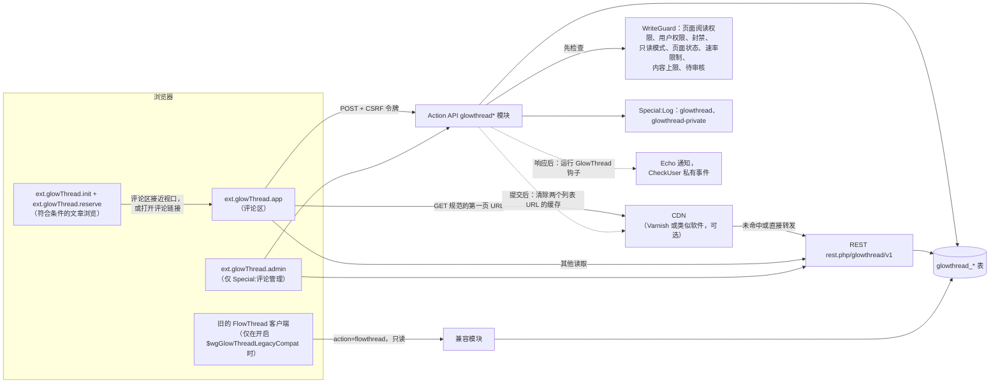
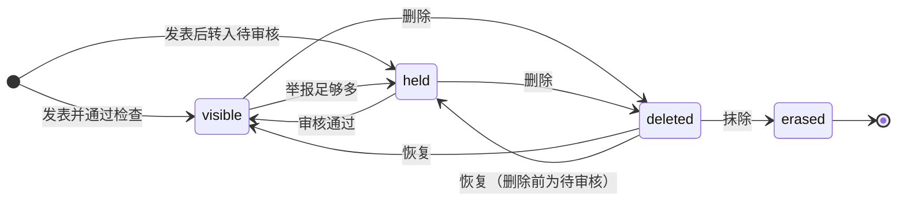
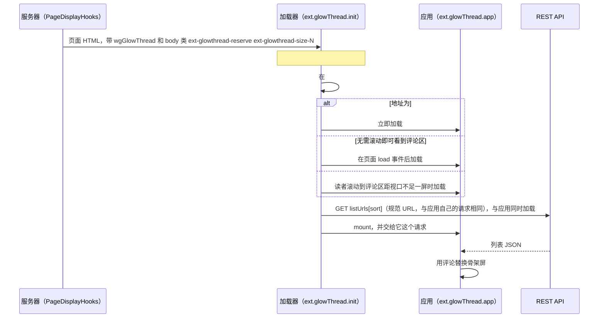

[English](../architecture.md) | 简体中文

# GlowThread 架构

GlowThread 是一个在维基文章下方提供评论的 MediaWiki 扩展。它可以替代 FlowThread，并能导入 FlowThread 的数据。本页说明各部分如何配合：PHP 端、浏览器端应用、CDN 和导入工具。请求和响应的格式见 [api.md](api.md)，设置见 [configuration.md](configuration.md)，CDN 配置见 [caching.md](caching.md)，产品的目的和原则见 [PRODUCT.md](../../PRODUCT.zh-CN.md)。

目标版本：MediaWiki 1.43 LTS 及之后的版本，无需修改代码。CI 在 MediaWiki 1.43 和 1.46 上运行 PHP 测试。PHP 命名空间为 `MediaWiki\Extension\GlowThread`。

读取通过 REST API 进行，返回纯数据。写入通过 Action API 模块进行，这些模块先在一处（`WriteGuard`）完成全部检查，再由服务在同一个事务中写入数据行和日志记录。提交后，GlowThread 清除列表的缓存，并在响应发送后运行通知和 CheckUser 所用的钩子。

## 存储

抽象数据库结构是 `sql/tables.json`，生成的 SQL 位于 `sql/{mysql,sqlite,postgres}/tables-generated.sql`。`update.php` 创建数据表（`includes/Hooks/SchemaHooks.php`）。文本与核心一样存放在 `blob` 和 `binary` 列中，因此即使数据表默认使用 `utf8mb3`，4 字节字符（表情符号）也不会丢失。时间戳为 `mwtimestamp`。用户以 actor ID 存储。枚举值以短字符串存储（常量位于 `includes/Model/`）。

| 表 | 用途 | 列（省略前缀） |
|---|---|---|
| `glowthread_post` (`gtp_`) | 每条评论一行。从不硬删除 | `id`、`page`、`actor`、`parent`（显示上的父评论，顶层评论为 null）、`reply_to`（作者实际回复的评论：除回复深度 2 评论的情况外都等于 `parent`，这类回复显示在深度 2）、`thread`（顶层祖先，顶层评论为 null）、`depth`（0、1 或 2）、`seq`（按页面计的楼层号，永不重复使用）、`text`（纯文本原文）、`created`、`edited`（目前始终为 null，尚未实现编辑功能）、`status`、`hold_reason`（逗号分隔）、`hold_detail`（命中的敏感词规则行，JSON 格式）、`status_actor` 和 `status_timestamp`（最后一次更改状态的人和时间）、`like_count`、`reply_count`、`open_report_count`、`pinned`（时间戳或 null）、`legacy_id`（FlowThread ID，22 位十六进制数字，唯一） |
| `glowthread_reaction` (`gtr_`) | 目前用于点赞，以后还会用于其他回应类型 | `post`、`actor`、`type`（`like`）、`timestamp`（导入的点赞为 null）。主键为 (post, actor, type) |
| `glowthread_report` (`gtrp_`) | 举报，每个用户对每条评论一条 | `id`、`post`、`actor`、`reason`、`note`、`created`（导入的举报为 null）、`resolved_actor`、`resolved_at`、`outcome`（`upheld`、`dismissed`，未处理时为 null） |
| `glowthread_page` (`gtpg_`) | 每个页面的状态和楼层计数器 | `page`、`state`（`open`、`locked`、`disabled`）、`actor`、`timestamp`、`seq`（最后分配的楼层号） |
| `glowthread_setting` (`gts_`) | 在维基上覆盖的策略设置 | `name`、`value`（JSON）、`actor`、`timestamp` |

取值：

- `gtp_status`：`visible`、`held`、`deleted`、`erased`。
- `gtp_hold_reason`：`filter`、`filter-error`（某条规则在运行时出错）、`spamblacklist`、`newaccount`、`reports`、`parentheld`。
- `gtrp_reason`：`spam`、`abuse`、`offtopic`、`spoiler`、`misinfo`、`other`，以及导入的举报所用的 `legacy`。

计数器（`like_count`、`reply_count`、`open_report_count`、`gtpg_seq`）在写入事务中用相对更新的 SQL 修改，从不先读出再写回。从 FlowThread 导入的匿名评论存放在 IP actor 名下，因此作者仍显示为 IP 地址。

### 评论状态

- `visible`：所有人可见。
- `held`：只有作者（附带“等待审核”提示）和管理员可见。转入待审核的原因有：敏感词过滤、SpamBlacklist、新账号审核、父评论待审核，或足够多不同的合格举报人举报。转入待审核从不等于拒绝。每位作者最多有 `$wgGlowThreadMaxHeldPerUser` 条评论等待审核。只有发表评论时才检查这个上限，所以管理员恢复一条在待审核状态下被删除的评论时，可能使作者超出上限（撤销审核通过或删除，以及因举报转入待审核，也可能如此）。
- `deleted`：读者看不到，管理员可见，可以恢复。作者可以删除自己的评论。
- `erased`：只能从 `deleted` 转入。文本被清空，作者被隐藏。数据行作为墓碑保留，使回复和日志仍能找到它。不可逆，需要 `glowthread-erase`。
- 只有当一条回复本身、它显示上的父评论和它的顶层评论都可见时，读者才能看到它。
- 删除维基页面会隐藏其评论，因为页面已不存在。恢复页面时，恢复操作所恢复的页面 ID 下的评论会重新显示。不会自动抹除任何内容。

除 `erase` 外，对评论的每个管理操作都可以根据其日志记录精确撤销（`do=undo`，见 [api.md](api.md#actionglowthreadmoderate)）。页面状态和设置的更改不能这样撤销：由管理员重新设置。

## 读取路径（REST）

路由位于 `rest.php/glowthread/v1/` 下，全部为 `GET`，全部需要 `read` 权限。评论文本以**片段**（文本、链接、提及）的形式返回，从不返回 HTML，因此浏览器用文本绑定渲染，评论内容从不使用 `v-html`。

| 路由 | 谁可以访问 | 处理程序 |
|---|---|---|
| `/page/{pageId}/comments?sort=hot\|new&cursor=&limit=` | 该页面的读者 | `ListHandler` |
| `/page/{pageId}/floor/{seq}` | 读者（视评论状态而定） | `FloorHandler` |
| `/comment/{id}` | 读者（视评论状态而定） | `CommentHandler` |
| `/comment/{id}/thread` | 读者，固定链接或热门评论所在的对话（最多 500 条回复） | `ThreadHandler` |
| `/comment/{id}/replies?cursor=&limit=` | 读者，“再显示 N 条回复”（每次 50 条） | `RepliesHandler` |
| `/moderation/queue?tab=&sort=&pageid=&user=&reporter=&q=&cursor=&limit=` | `glowthread-moderate` | `QueueHandler` |
| `/moderation/user/{name}`、`/moderation/page/{pageId}` | `glowthread-moderate` | `UserHistoryHandler`、`PageHistoryHandler` |
| `/settings` | `glowthread-moderate` 或 `glowthread-configure` | `SettingsHandler` |

列表包含页面状态、读者可执行的操作（对匿名读者只按权限计算，因此缓存的副本对所有人都相同）、可见评论数、置顶评论、热门评论区块（按时间衰减的点赞分数）、顶层评论及其两层可见回复和回复预览，以及一个 `next` 游标。热门排序按 `(likes + 1) × 0.5^(age / half-life)` 排名。最新排序按时间从新到旧排列。

### 缓存与清除

GlowThread 不依赖 CDN 也能工作。有 CDN 时，访问量大的页面的匿名读者由缓存提供服务。完整配置见 [caching.md](caching.md)。

- **可缓存的响应：** 只有匿名读者在两个规范 URL 之一请求的第一页，即 `{wgRestPath}/glowthread/v1/page/{id}/comments?sort=hot` 和 `?sort=new`，且必须逐字节一致（`CdnPurger::getListPath`）。页面配置把这两个 URL 交给浏览器（`wgGlowThread.listUrls`）。响应为 `public, s-maxage=$wgGlowThreadCdnMaxAge, max-age=0`，不设置 cookie，也没有 `Vary: Cookie`。其他所有响应都是 `private`：已登录读者、带会话的请求、带游标的请求、其他参数或其他写法、`$wgUseCdn` 关闭，以及 `$wgGlowThreadCdnMaxAge` 为 0。
- **主机检查：** 只有当请求的 `Host` 等于清除请求所带的主机时，响应才是 public。这个主机取自 `$wgInternalServer`，未设置内部服务器时取自 `$wgServer`，URL 带端口时还包括端口。CDN 按主机区分缓存对象，所以其他主机名下的副本永远不会被清除。
- **清除：** 数据库提交后，只要匿名读者看到的内容发生变化，MediaWiki 的 `CdnCacheUpdate` 就会清除该页面的两个规范 URL：新的可见评论、删除、恢复、审核通过、转入待审核、置顶或取消置顶、撤销、页面状态更改、删除或恢复维基页面，以及施加、更改或解除 hideuser 封禁（该用户最多 500 个页面）。页面状态更改还会清除文章的缓存，因为文章 HTML 中带有该状态。GlowThread 从不发送 ban。
- **点赞不清除 CDN：** 否则一次点赞加一次取消点赞就是两次清除。CDN 缓存的匿名列表中的点赞数最多滞后 `$wgGlowThreadCdnMaxAge` 秒。维基的对象缓存（见下文）会被清除。
- **在 CDN 上使用规范 URL：** CDN 可以在查找缓存前把匿名列表请求改写为规范 URL，使各种变体共用一个缓存对象。[caching.md](caching.md#cdn-需要做什么) 中有 Varnish 示例。

无论有没有 CDN，`ListCache` 都会把列表保存在 WAN 对象缓存中（[caching.md](caching.md#维基的对象缓存)）：

- **匿名读者的第一页：** 每种排序第一页的 JSON 正文，缓存键包含答案所依赖的其他一切：页面、排序、数量、资格、匿名读者的权限、页面标题、`$wgGlowThread*` 设置和 `$wgCacheEpoch`。从缓存返回的答案完全不需要查询服务（`ListHandler` 按需获取它）。热门排序的 `next` 游标使用本次请求的时间。可以管理评论的读者不使用缓存。
- **页面摘要：** 列表对所有人显示的内容，对每位读者都相同：可见评论数、可见的置顶评论、按热门排序的候选顶层评论（ID、点赞数、时间，以紧凑格式保存）和热门评论。没有最新的摘要时，列表像以前一样读取数据库，并由已登录读者的请求在响应发出之后生成摘要。之后每个列表都使用它。读者自己的待审核顶层评论来自一个小查询，并按数据库查询的排序方式合并进来。管理员的置顶评论和主列表从数据库读取。如果按 ID 读取的评论与摘要不再相符（两者之间发生了写入），列表不使用它（见下文过期的摘要）。
- **为什么缓存的热门排序是精确的：** 两个热度分数之比不含时间，所以一次算出的顺序之后仍然成立。有三种情况排名会不同：日期晚于排序时间的评论（在那之前它算作刚刚发表）；超过 1000 个半衰期、分数失去精度的评论（`HotRanker::getStableUntil()`）；以及点赞数和时间不同、分数却相等的相邻两条评论（点赞数或点赞数加 1 相差 2 的幂，时间相差同样多个半衰期），它们的顺序取决于每个时间的舍入（`HotRanker::mayTie()`）。出现这些情况时，会按所请求的时间重新排序候选评论，匿名第一页也只在这些情况都与它无关时才保存。热门评论遵循同样的规则。
- **清除：** 每个页面一个检查键（由 `CdnPurger::purgePage()` 和点赞触发），所有页面共用一个（hideuser 封禁、改名、账号合并、设置更改、导入）。每次触发都在更改提交时执行：提交之前的副本要么在提交后 7 秒内保存，要么根本不保存，所以它落在这次触发的等待期之内。所有内容最多一小时后过期。每次从缓存返回时，都会用一个查询检查它所依赖的用户：提到的用户保持这些名称且未被隐藏，显示为隐藏的作者仍然被隐藏，原本不指向任何人的提及（两者都由 `CommentSerializer` 报告）仍然不指向任何人。这涵盖了不经过钩子写入的封禁和新账号。不使用锁等待，所以没有读者会得到清除之前的副本。
- **未命中的开销不超过没有缓存时：** 一次小的 `getMulti()` 读取响应和检查键。上次清除的等待期（`WANObjectCache::HOLDOFF_TTL`，11 秒）过后，匿名读者未命中时还会读取摘要，并在它是最新时使用它；等待期内没有任何副本是最新的，所以不读取摘要。否则列表像以前一样读取数据库。等待期内不保存任何内容。
- **缓存帮不上忙时没有往返：** 每台 Web 服务器在本机服务器缓存中记下一些记录，每条都有时间上限，在此期间它不读取对象缓存，列表像以前一样来自数据库：它看到的清除的等待期（从它看到时起最多 11 秒，不论发出清除的服务器时钟如何）；匿名读者发现没有摘要的页面（一分钟，直到这台服务器保存了摘要）；摘要无法保存的页面（一分钟）；以及无法保存的匿名第一页（最多一分钟，直到日期在未来的评论到期）。这些记录只会把请求交给数据库。摘要的生成和副本的保存都在响应发出之后进行（`DeferredUpdates::POSTSEND`），每个请求最多一次。数据可能落后主数据库超过 7 秒（复制延迟加上读取的时间）的副本不会被保存，所以等待期能覆盖它可能漏掉的每次写入。
- **刚刚写入的读者：** 最近写入过的客户端（ChronologyProtector）不使用任何一个缓存，所以在有副本的维基上，它会像以前一样读取已等待其写入的副本。
- **过期的摘要：** 如果按 ID 读取的评论或热门评论与摘要不符，说明错过了一次清除。列表会读取数据库并清除该页面的列表（`ListCache::purgeMissed()`），使摘要在等待期过后重新生成。
- **文章浏览：** 页面状态和楼层计数器来自同一个缓存值（`PageStateStore::getViewFacts()`），状态更改和 `CdnPurger::purgePage()` 都会清除它。

## 写入路径（Action API）

每个模块都需要 CSRF 令牌，必须用 POST 发送，并且是写入模块。浏览器使用 `mw.Api().postWithToken( 'csrf', ... )`。`WriteGuard` 只做检查。服务（`includes/Service/`）写入数据行，`ModerationLogger` 在同一事务中写入日志记录。

| 模块 | 作用 | 权限（速率限制键） |
|---|---|---|
| `glowthreadpost` | 发表新评论或回复（父评论必须在同一页面上） | `glowthread-post` |
| `glowthreadreact` | 设置或取消点赞（`value=1\|0`，幂等，不是切换） | `glowthread-react` |
| `glowthreadreport` | 附理由和可选说明举报评论，每个用户对每条评论只能举报一次 | `glowthread-report` |
| `glowthreaddelete` | 作者删除自己的评论 | 作者本人，以及 `glowthread-post` |
| `glowthreadmoderate` | 最多 50 个 ID：`approve`、`delete`、`restore`、`erase`、`pin`、`unpin`、`dismiss`（关闭举报）、`undo`（精确撤销之前的日志记录） | `glowthread-moderate`。`erase` 还需要 `glowthread-erase`，按每条被抹除的评论计入限制 |
| `glowthreadpage` | 页面状态 `open`、`locked` 或 `disabled` | `glowthread-moderate` |
| `glowthreadfiltertest` | 用示例文本测试敏感词规则，不保存 | `glowthread-configure` |
| `glowthreadsettings` | 更改维基上的设置，记录旧值和新值 | `glowthread-configure` |

`WriteGuard` 按以下顺序检查读者写入（`glowthreadpost`、`glowthreadreact`、`glowthreadreport`、`glowthreaddelete`）。发表评论时，在第 1 步之前先检查文本的原始大小。

1. 页面阅读权限，然后是用户权限和封禁。读者写入对评论所在的页面使用 `Authority::authorizeWrite`，因此部分封禁只对其覆盖的页面生效。
2. 只读模式。
3. 页面是否符合条件，以及页面状态。`locked` 只拒绝新评论和回复。点赞、举报和删除自己的评论仍然可用。`disabled` 隐藏评论区并拒绝读者写入。
4. 速率限制，使用以权限命名的 `$wgRateLimits` 键。
5. 内容：长度上限、提及上限、同一用户在同一页面上的重复文本、回复目标。
6. 待审核：`MediaWiki:GlowThread-filter` 上的敏感词过滤、对 URL 的 SpamBlacklist 检查、新账号审核、待审核的父评论。然后检查每位作者的待审核评论上限。

对于管理和配置模块（`glowthreadmoderate`、`glowthreadpage`、`glowthreadfiltertest`），`WriteGuard` 先检查权限并拒绝任何封禁（包括部分封禁），然后检查只读模式，最后检查速率限制。`glowthread-erase` 和 `glowthread-configure` 的速率限制不能用 `noratelimit` 绕过。这些模块不检查页面状态，因此管理员可以在评论已锁定或已关闭的页面上操作。

`glowthreadsettings` 通过 `SettingsService::update` 处理，由它自己检查 `glowthread-configure`（通过 `authorizeAction`，包括封禁和速率限制）以及只读模式。

## 权限

| 权限 | 默认用户组 | OAuth 和机器人密码授权 |
|---|---|---|
| `glowthread-post`、`glowthread-react`、`glowthread-report` | `user` | `editpage` |
| `glowthread-trusted`（免于新账号审核，从不因举报转入待审核） | `sysop`、`bot` | 无 |
| `glowthread-moderate` | `sysop` | `delete` |
| `glowthread-erase`（还可以查看 `Special:Log/glowthread-private`） | `sysop` | `oversight` |
| `glowthread-configure` | `sysop` | `editsiteconfig` |
| `glowthread-viewlog`（查看 `glowthread` 日志，见[日志](#日志)） | 无：`publicLog` 开启时 `LogVisibilityHooks` 把它给所有人，否则只给拥有 `glowthread-moderate`、`glowthread-erase` 或 `glowthread-configure` 的用户 | `basic` |

`Special:GlowThread` 需要 `glowthread-moderate`。管理员如何使用它见 [moderation.md](moderation.md)。

## 日志

- `glowthread`：`delete`、`recover`、`approve`、`markchecked`、`pin`、`unpin`、`erase`、`autohold`、`enable`、`lock`、`disable`、`undo`、`settings`、`import`。仅限拥有 `glowthread-viewlog` 的用户查看（`$wgLogRestrictions`），`LogVisibilityHooks` 按 `publicLog` 设置授予这项权限。核心不会把受限类型放进最近更改，所以 `publicLog` 开启时，`ModerationLogger` 自己插入它们在最近更改中的行，CheckUser 再从那里记录它们。`import` 是例外：导入工具只把它写入 `logging` 表。`publicLog` 关闭期间，记录不生成行，而是直接交给 CheckUser 的 `CheckUserInsert` 服务：保存一行会发送监视列表邮件、移动监视列表标记，并通知 Echo 等 `RecentChange_save` 监听者，而它们都不检查日志限制。`autohold` 的操作者是系统用户“GlowThread”，CheckUser 把它记录为由软件执行（IP 127.0.0.1，没有 XFF 和用户代理），而不是记录触发它的举报人的 IP。它在最近更改中的行（如果有）也是 127.0.0.1（`SoftwareLogEntry`）。默认不在“主要公开日志”中显示（`$wgFilterLogTypes`）。
- `glowthread-private`：每条被抹除评论的作者。仅限拥有 `glowthread-erase` 的用户查看（`$wgLogRestrictions`），从不进入最近更改。
- `comments`：FlowThread 的日志类型。GlowThread 从不写入该类型。只有在 `$wgGlowThreadLegacyCompat` 开启，且没有其他扩展（FlowThread 本身或 Extension:Comments）使用这个名称时，`LegacyLogType` 才注册它，使 FlowThread 的旧记录继续在 Special:Log/comments 和管理中心的页面历史中正常显示，读者与 `glowthread` 相同（`glowthread-viewlog`）。设置关闭时，这些记录会被隐藏（`$wgLogRestrictions`：`glowthread-legacy-log`），最近更改中的对应行也不显示 `logparams`。
- `CommentsLogFormatter` 渲染这三种类型，并隐藏被抹除评论的作者和被 hideuser 封禁隐藏的用户。

## 钩子

GlowThread 运行 `GlowThreadPostSaved`、`GlowThreadPostApproved`、`GlowThreadPostModerated` 和 `GlowThreadReportFiled`（接口位于 `includes/Hook/`，运行器为 `HookRunner`）。它们在**响应发送之后**运行（作为 POSTSEND 延迟更新，写入回滚时取消），仍处于执行操作的用户的请求中。所有钩子都不能中止操作。签名见 [api.md](api.md#供其他扩展使用的钩子)。

GlowThread 自己的处理程序：

| 钩子 | 处理程序 | 作用 |
|---|---|---|
| `GlowThreadPostSaved` | `CheckUserHooks`、`NotificationHooks` | 为每条新评论记录 CheckUser 私有事件。为可见评论发送 Echo 通知：`glowthread-reply`、`glowthread-mention` 和 `glowthread-userpage`（发表在接收者用户页上的评论） |
| `GlowThreadReportFiled` | `CheckUserHooks` | 为每条举报记录 CheckUser 私有事件 |
| `GlowThreadPostApproved`、`GlowThreadPostModerated` | `NotificationHooks` | 发送在审核通过前暂缓的通知，以及给作者的管理结果通知（`glowthread-moderation`：删除、恢复为可见、审核通过）。抹除评论或作者自行删除评论时，会隐藏该评论引起的通知 |
| `CheckUserInsertLogEventRow`、`CheckUserInsertPrivateEventRow` | `CheckUserHooks` | 把自动转入待审核记录为由软件执行（IP 127.0.0.1，没有 XFF 和用户代理），而不是记录举报人的 IP |
| `BeforeCreateEchoEvent`、`EchoGetBundleRules` | `EchoSetupHooks` | 注册 `glowthread` 类别和通知类型，按页面合并回复通知，并在开启 `$wgGlowThreadLegacyCompat` 时让 FlowThread 的旧通知类型继续正常显示 |
| `BeforePageDisplay` | `PageDisplayHooks` | 在符合条件的浏览中添加加载器、预留样式、`wgGlowThread` 配置和 `<noscript>` 提示 |
| `PageDeleteComplete`、`PageUndelete`、`PageUndeleteComplete` | `PageLifecycleHooks` | 随页面隐藏和恢复评论。恢复页面后，再次隐藏被抹除评论的 Echo 通知（当恢复操作创建了页面时，Echo 会重新显示其恢复的页面 ID 下的所有通知） |
| `PageMoveComplete` | `PageLifecycleHooks` | 清除该页面评论列表的缓存 |
| `BlockIpComplete`、`UnblockUserComplete` | `PageLifecycleHooks` | 用户被 hideuser 封禁隐藏或取消隐藏时，清除相关列表的缓存 |
| `RenameUserComplete` | `PageLifecycleHooks` | 清除对象缓存中的列表，因为列表显示当前的名称 |
| `UserMergeAccountFields`、`MergeAccountFromTo` | `UserMergeHooks` | 迁移 actor 列，重复的点赞和举报各保留一条，改写提及，清除列表缓存 |
| `UserGetRights`、`ChangesListSpecialPageQuery`、`ApiQueryBaseBeforeQuery`、`WatchedItemQueryServiceExtensions` | `LogVisibilityHooks` | `publicLog` 设置开启时把 `glowthread-viewlog` 给所有人，否则只给拥有 `glowthread-moderate`、`glowthread-erase` 或 `glowthread-configure` 的用户。对没有这项权限的用户，在 Special:RecentChanges、Special:RecentChangesLinked、Special:Watchlist、`list=recentchanges` 和 `list=watchlist` 中隐藏受它限制的日志类型在最近更改中的行 |
| `UserGetReservedNames` | `ReservedNamesHooks` | 保留记录自动转入待审核的系统用户“GlowThread”的用户名 |
| `ApiMain::moduleManager` | `CompatHooks` | 开启 `$wgGlowThreadLegacyCompat` 时添加兼容模块 |
| `SpecialPage_initList` | `CompatHooks` | 把 `Special:FlowThreadManage` 注册为到管理队列的重定向，除非已有其他扩展（FlowThread）注册了这个名称 |
| `LoadExtensionSchemaUpdates` | `SchemaHooks` | 数据表，以及记录自动转入待审核的系统用户 |

Echo、CheckUser 和 SpamBlacklist 都是可选的。每个扩展只在已加载时才会被使用。

## 浏览器端

符合条件的浏览是指：页面存在，位于 `$wgGlowThreadNamespaces` 中，不是讨论页或首页，并且是当前修订版本的 `action=view`。在这样的浏览中，`PageDisplayHooks` 会添加加载器、预留样式、页面配置 `wgGlowThread`（[api.md](api.md#页面配置wgglowthread)），并在该页面没有关闭评论时添加一个 `<noscript>` 提示。

| 模块 | 文件 | 加载时机 |
|---|---|---|
| `ext.glowThread.reserve` | `resources/init/reserve.css`（仅样式，约 1 kB） | 每次符合条件的浏览，在首次绘制之前 |
| `ext.glowThread.init` | `resources/init/index.js`（手写的 ES2017，无构建步骤） | 每次符合条件的浏览 |
| `ext.glowThread.app` | `resources/dist/app.js`、`app.css` | 需要评论区时（见下文） |
| `ext.glowThread.app.menu` | `resources/dist/app-menu.js` | 读者指向、聚焦或打开 ⋯ 菜单时，或者在手机上触摸评论区时，也随 extras 模块一起加载 |
| `ext.glowThread.app.extras` | `resources/dist/app-extras.js` | 对已登录读者，与应用一起请求。否则在可以发表或举报的读者需要它时加载 |
| `ext.glowThread.admin` | `resources/dist/admin.js`、`admin.css` | 仅用于 Special:评论管理，读者永远不会下载它 |

页面浏览加载评论的过程：

- **预留空间。** `PageDisplayHooks` 添加 body 类 `ext-glowthread-reserve` 和 `ext-glowthread-size-N`，其中 N 随页面的楼层计数器分档（0、1、2、3、5、8、13、21），在关闭了评论的页面上为 `off`（即那一行提示的高度）。样式只在 `.client-js` 下给 `#bodyContent::after` 设置这个高度。因此评论加载出来时，文章下方的内容不会移动。
- **容器。** 加载器找到皮肤的 `#bodyContent`（或 `#mw-content-text`），忽略页面正文、标题或指示器中带有这些 ID 的元素。它在锚点之后紧接着创建 `
`。在 Minerva 和 Vector 2022 上，以及锚点的父元素是没有为容器留出行的网格时（如 Citizen，其页面网格先是内容行，然后是页脚），则把容器创建为锚点的最后一个子元素，使评论区保持在文章下方、页脚上方。如果站点 CSS 给 `#glowthread` 指定了网格行，容器就作为网格项留在锚点之后。只有当已有的 `#glowthread` 正好位于加载器本来要放置容器的位置时，加载器才会沿用它，因此页面正文无法劫持或隐藏评论区。站点 CSS 可以把 `#glowthread` 放到其他位置（[theming.md](theming.md#放置评论区)）。
- **骨架屏。** 在同一帧内，加载器用一个与预留空间等高的静态骨架屏填充容器，并移除预留类。应用在列表绘制完成前保持这个高度（`data-gt-reserve`）。如果应用加载失败，加载器会移除骨架屏。
- **延迟加载。** 当地址为 `#gt-<id>`、`#glowthread` 或 `#flowthread`（维基从 FlowThread 迁移前生成的链接）时，应用立即加载。当无需滚动就能看到评论区时，应用在页面 `load` 事件之后加载。其他情况下，只有在读者滚动、评论区距视口不足一屏之后才加载。在手机上，MobileFrontend 会折叠文章，所以在没人看评论的浏览中，评论区也常常就在第一屏下方，这些浏览不必为应用付出加载开销。
- **应用。** `ext.glowThread.app` 就是评论区：Vue 3.5（打包了自己的运行时，MediaWiki 1.43 自带的是 Vue 3.4）、Reka UI 配合从 shadcn-vue 移植的组件，以及带 `gt:` 前缀的 Tailwind CSS，由 Vite 从 `client/` 构建并提交到 `resources/dist/`。它挂载到 `#glowthread` 的一个子元素（`div.gt-scope.gt-root`）中，所以容器保持站点 CSS 给它的位置。每条规则都在 `all: revert` 重置之后限定在 `.gt-scope` 内，所以皮肤和站点 CSS 不会影响内部，应用也不会改变页面的样式。浮层（菜单、面板、轻提示）渲染到 `<body>` 末尾的 `#glowthread-portal` 中。固定链接 `#gt-<id>` 会滚动到并高亮该评论。如果它不在列表中，它所在的对话会就地显示：对话在列表中时在列表中展开，否则显示在列表上方的“对话”框中。对话从不在面板中打开。应用分为三个模块。`ext.glowThread.app` 绘制评论区，`ext.glowThread.app.menu` 包含 ⋯ 菜单的菜单项以及 Reka UI 的菜单和 Floating UI，`ext.glowThread.app.extras` 包含评论输入框、举报表单和管理工具。应用通过 `mw.loader.using()` 加载后两个模块，所以未登录读者只有在指向、聚焦或点按 ⋯ 按钮，或者触摸评论区之后才会下载菜单模块，只有在可以发表或举报时才会下载 extras 模块。对已登录或可以发表评论的读者，列表会等待 extras 模块（列表到达后最多 5 秒），这样评论输入框会和第一条评论一起绘制。菜单模块和 extras 模块会检查应用的构建 ID，与另一次构建的应用一起时会拒绝运行。
- **管理中心。** `ext.glowThread.admin` 挂载到 `#ext-glowthread-admin`（位于 Special:评论管理），并替换服务器输出的无 JavaScript 提示。它是一个单独的包，使用相同的设计系统。
- **从右到左。** 对于从右到左的界面语言，ResourceLoader 用 CSSJanus 翻转两个应用的样式表（模块没有设置 `noflip`），所以左右互换，侧边面板从左侧打开。指向阅读方向的图标带有 `gt-flip-rtl`，因为 CSSJanus 无法处理 SVG 内部。Reka UI 和应用自己的方向键处理从 `<html dir>` 获取方向。评论正文、用户名和说明使用 `dir="auto"`，评论正文只占其文本所需的宽度。`pnpm check` 会对打包结果运行 CSSJanus，如果某个选择器或动画名称会被改变就报告失败。
- **消息。** 界面消息位于 `i18n/ui/`（`glowthread-ui-*`），通过 `UiMessagesModule` 随打包代码一起发送。评论区不包含 `glowthread-ui-admin-*` 键。服务器消息位于 `i18n/` 和 `i18n/api/`。GlowThread 提供英文、简体中文和繁体中文。消息把可变部分作为参数接收（`Held for review: $1`），而不是在模板中与其他文本拼接。有一个单元测试会拒绝以空格开头或结尾、或以冒号结尾的界面消息（`i18n/ui/`），只有一条列明的例外，即后面紧跟列表的那条消息。一周以内的时间显示为相对时间（“3天前”）。更早的日期以用户语言的短日期格式显示，使用公历，并使用 MediaWiki 为该语言设定的数字。
- **浏览器下限。** Chrome 和 Android WebView 87、Safari 和 iOS 14、Firefox 78。`pnpm check` 会在打包结果上强制执行这一下限（[client/README.md](../../client/README.zh-CN.md#浏览器下限)）。
- **设计。** 设计令牌、组件和规则见 [DESIGN.md](../../DESIGN.zh-CN.md)。字体栈先列出系统界面字体，然后是根据 `<html lang>` 选择的 CJK 字体（`--glowthread-font-cjk`：日文、韩文、繁体中文（含香港），其余为简体中文）。站点管理员可以通过公开的自定义属性重新设置评论区的样式（[theming.md](theming.md)）。

## 兼容与迁移

这些部分只对从 FlowThread 迁移过来的维基有意义。步骤见 [migrating-from-flowthread.md](migrating-from-flowthread.md)。

- `maintenance/importFlowThread.php`（以 `GlowThread:importFlowThread` 运行）只用 SELECT 读取 FlowThread 的三张表，并写入 GlowThread 的数据行。它以 `gtp_legacy_id` 保证幂等，支持 `--dry-run` 和 `--verify`。它从每个 FlowThread ID 中解码出时间，把存储的 HTML 转为纯文本（保留链接目标，把用户链接转为 `@Name`），把用户映射到 actor、把匿名作者映射到 IP actor，并迁移点赞、举报、状态和页面状态。它不运行任何钩子，不清除 CDN 中的任何缓存，只写入一条 `glowthread/import` 日志记录。会写入数据的导入在每批写入之后和结束时清除维基对象缓存中的列表（`ListCache`）。详见 [migration-data.md](migration-data.md)。
- 开启 `$wgGlowThreadLegacyCompat`（默认为 `false`）时，`api.php?action=flowthread` 用 GlowThread 的数据，以 FlowThread 的响应格式只读地响应 `type=list`（读者）和 `type=listall`（管理员）（`includes/Compat/`）。写入类型返回错误 `glowthread-legacy-readonly`。只有在 FlowThread 本身未加载时才添加这个模块。它的响应始终是 private，因为这些 URL 的缓存无法清除。同一设置还让 FlowThread 存储的 Echo 通知和旧日志记录继续正常显示。
- `Special:GlowThreadLink/<id>` 接受 GlowThread ID、FlowThread 十六进制 ID 和 `<title>/<floor>`。FlowThread 的链接页面名称 `Special:FlowThreadLink` 仍然可用，`Special:FlowThreadManage` 会重定向到 `Special:GlowThread/queue`。
- 在 `$wgGlowThreadLegacyCompat` 开启期间，FlowThread 的日志记录继续在 Special:Log/comments 中正常显示，除非其他扩展使用了 `comments` 日志类型（见[日志](#日志)）。
- 容器是 `#glowthread`。为 FlowThread 的 `#flowthread` 编写的站点 CSS 必须改为 `#glowthread`。以 `#flowthread` 结尾的旧链接仍会打开评论区。
