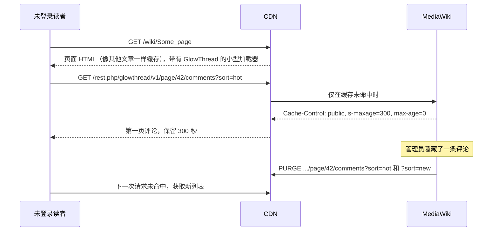

[English](../caching.md) | 简体中文

# 部署在 CDN 之后

GlowThread 不需要 CDN 也能工作。使用 Varnish 或其他接受 MediaWiki `PURGE` 请求的缓存时，未登录读者可以从缓存获取第一页评论。每当未登录读者看到的内容发生变化，MediaWiki 都会清除这份缓存。

本页介绍 GlowThread 缓存和清除哪些内容、CDN 需要做什么、一个 Varnish 示例，以及在代理后面还需要注意的事项：Cookie、客户端 IP 地址、作业队列和 Echo。无论有没有 CDN，GlowThread 还会把评论列表保存在维基的对象缓存中，见[维基的对象缓存](#维基的对象缓存)。

## 检查清单

| 事项 | 原因 | 章节 |
|---|---|---|
| CDN 为未登录读者查找评论列表的缓存，每个页面和排序方式对应一个规范 URL | 否则每次请求评论列表都要由 PHP 处理 | [CDN 需要做什么](#cdn-需要做什么) |
| 读者的请求和 MediaWiki 的清除请求使用相同的主机名 | GlowThread 只在清除请求能到达的主机名下缓存列表 | [主机名](#主机名) |
| MediaWiki 能看到每个读者的真实 IP 地址 | 按 IP 的速率限制、IP 封禁和 CheckUser 都依赖它 | [客户端 IP 地址](#客户端-ip-地址) |
| 没有其他共享缓存存储 `/rest.php/glowthread/` | 清除请求只会到达 `$wgCdnServers` 中的 CDN | [CDN 前面的缓存](#cdn-前面的缓存) |
| 其他软件设置的 Cookie 不会被当成登录 | 否则这些读者会绕过缓存 | [Cookie](#cookie) |

## 工作原理



文章 HTML 不包含评论。它带有一个小型加载器和几项页面信息（评论是否开放、需要预留多少空间）。评论区接近屏幕时，加载器才获取评论。

## GlowThread 缓存什么

每个页面恰好有两个可缓存的 URL，即每种排序方式的第一页：

```text
{$wgRestPath}/glowthread/v1/page/{page ID}/comments?sort=hot
{$wgRestPath}/glowthread/v1/page/{page ID}/comments?sort=new
```

`$wgRestPath` 默认为 `$wgScriptPath/rest.php`，例如 `/w/rest.php`。本页的示例使用 `/rest.php`。请根据你的路径调整这些模式。

只有当以下条件**全部**满足时，列表响应才是 `Cache-Control: public, s-maxage=$wgGlowThreadCdnMaxAge, max-age=0`：

- 读者未登录，并且没有会话，
- 请求的是第一页（没有 `cursor` 参数），
- URL 与两个规范 URL 之一逐字节相同（`?sort=hot` 或 `?sort=new`，没有其他内容），
- `Host` 头与清除请求携带的主机完全相同（见[主机名](#主机名)），
- `$wgUseCdn` 为 `true`，与 MediaWiki 自身的 `s-maxage` 头一样，
- `$wgGlowThreadCdnMaxAge` 大于 0（默认 300 秒）。

GlowThread 路由的其他所有响应都是 `private, must-revalidate, max-age=0, s-maxage=0`：后续页、单条评论、对话、已登录读者、管理和设置路由，以及 GlowThread 自己的错误。MediaWiki 自身的 REST 错误不带 `Cache-Control`：参数未通过校验、路径不匹配任何路由、私有 wiki 上的 `rest-read-denied`。CDN 也不能存储它们，下面的第 6 步保证了这一点。`max-age=0` 表示浏览器不保留列表，所以读者总是向 CDN 请求。

`api.php?action=flowthread` 总是返回 `private`：它的 URL 无法被清除。

## GlowThread 清除哪些缓存

| 事件 | 从 CDN 清除的内容 | 从维基的对象缓存清除的内容 |
|---|---|---|
| 未登录读者看到的内容发生变化：新的公开评论、通过审核、公开评论被管理员隐藏或被作者删除、让评论重新公开的恢复、置顶或取消置顶、对上述操作的撤销、因举报自动转入待审核 | 该页面的两个列表 URL | 该页面的列表 |
| 读者看不到的评论发生变化：发表了一条待审核的评论、已删除的评论被抹除、举报被忽略 | 无 | 无 |
| 页面的评论被开放、锁定或关闭 | 两个列表 URL 和文章本身（文章的 HTML 说明评论是否开放） | 该页面的列表 |
| 页面被删除、恢复或合并 | 相关页面的两个列表 URL | 相关页面的列表 |
| 页面被移动 | 该页面的两个列表 URL | 该页面的列表 |
| 通过 Special:Block、Special:Unblock 或 API 施加、修改或解除 `hideuser` 封禁 | 该用户最近评论过的最多 500 个页面的两个列表 URL | 所有列表 |
| 用 Extension:UserMerge 合并两个账号 | 与 `hideuser` 封禁相同，针对保留的账号 | 所有列表 |
| 用户改名 | 无 | 所有列表 |
| 点赞或取消点赞 | 无 | 该页面的列表 |
| 维基内设置更改 | 无 | 所有列表 |
| 会写入数据的 FlowThread 导入（不是 `--dry-run` 或 `--verify`） | 无 | 所有列表，在每批写入之后和导入结束时 |

点赞有意不向 CDN 发送清除请求。否则每次点赞和取消点赞都会产生两次清除，一个按点赞速率上限操作的账号每分钟就能发送数百次清除。所以对由 CDN 服务的未登录读者来说，点赞数以及按点赞排名的热门评论区块，最多可能滞后 `$wgGlowThreadCdnMaxAge` 秒。设置更改，以及热门排序随时间的缓慢变化，也会在同样的时间内显示出来。已登录读者，以及没有 CDN 的维基上的所有读者，总是获取最新数据。

清除请求的发送方式：

- 由 MediaWiki 核心（`HTMLCacheUpdater` 和 `CdnCacheUpdate`）发送到 `$wgCdnServers` 中的每台服务器，形式是针对确切 URL 的 HTTP `PURGE` 请求。GlowThread 从不发送 ban。
- 它们在数据库事务提交之后、响应返回之前，在同一个 PHP 进程中执行。它们不等待作业队列。
- 失败的清除请求（CDN 宕机或响应慢）不会重试。这时读者会一直看到旧列表，直到它过期（最迟在缓存后 `$wgGlowThreadCdnMaxAge` 秒）。
- 设置了 `$wgInternalServer` 时，URL 用它展开，否则用 `$wgServer` 展开。
- 与核心在编辑之后的做法一样，每次清除都会请求一次回弹清除。`$wgCdnReboundPurgeDelay` 大于 0 时，MediaWiki 会在这段延迟之后再次清除这些 URL，每个请求使用一个延迟作业。这样可以纠正更改之后立即由滞后的副本数据库返回的列表。默认值为 0 时，不会有第二次清除，也没有作业。

## 维基的对象缓存

GlowThread 把每个页面评论的两样东西保存在 MediaWiki 的主对象缓存中（`$wgMainCacheType`：按维基的配置，可以是 memcached、Redis 或 APCu）。有没有 CDN 都是如此。

- **给未登录读者的第一页**，每种排序各一份，保存的是完整的响应。与 CDN 不同，它服务所有 URL 和主机名：也包括 `?limit=`、其他写法，以及有会话的读者。从缓存返回的响应不需要任何评论查询。
- **页面摘要**，对所有读者都相同：评论数、置顶评论、顶层评论的热门排序和热门评论区块。更改之后，下一位已登录读者的请求会在响应发出之后重新生成它。之后每个列表都使用它。每位读者自己的待审核评论通过一个小查询加入。管理员的列表从数据库读取。

读者看到的内容发生的变化（上表最后一列）一提交，两者就会被清除。根据提交之前的数据算出的副本，要么在清除后 7 秒内保存，要么根本不保存，所以它落在清除后 MediaWiki 把所有副本都视为过期的 11 秒之内，永远不会被使用。每份副本最多一小时后过期，这限制了绕过 MediaWiki 钩子的更改（例如直接在数据库中修改）的影响时间。每次从缓存返回时，还会用一个小查询检查它所依赖的用户：其中提到的用户仍以这些名称存在且未被隐藏，显示为隐藏的作者仍然被隐藏，原本不指向任何人的提及仍然不指向任何人。所以不经过钩子写入或删除的封禁（CentralAuth 的全域监督、脚本），以及被较早的提及所指向的新账号，也会立即在缓存的列表中体现出来。

这意味着：

- 更改一提交，读者就能看到，与没有缓存时相同。不使用任何锁等待：更改之后，在列表重新计算期间到达的每个请求都会自己计算。所以 CDN 在清除后重新获取列表时，总能得到新的列表。
- 缓存没有命中的列表，开销不超过没有缓存时。未命中时读取一次对象缓存，上次清除的等待期过后再为摘要读取一次；摘要的生成和副本的保存都在响应发出之后进行。未登录读者从不生成摘要。
- 在缓存一段时间内帮不上忙的地方，Web 服务器会停止读取它，像以前一样从数据库提供列表。它把这一点记在本机缓存中（安装了 APCu 时就是 APCu）：在它看到的清除之后的 11 秒内（这段时间 MediaWiki 把所有副本都视为过期，也不保存任何内容）；在未登录读者发现某个页面没有摘要、或摘要无法保存之后的一分钟内；以及在某个第一页无法保存（它的顺序只在那一刻成立）之后最多一分钟内。这些记录只会影响速度，从不影响内容是否最新。
- 在有数据库副本的维基上，从落后主数据库超过 7 秒的副本读取的列表不会被保存。
- 在最近几秒内写入过的读者不从缓存获取列表。在有数据库副本的维基上，MediaWiki 这时会从已经包含该读者写入的副本读取（ChronologyProtector），所以他们能像以前一样看到自己的评论。
- 超过 1000 个半衰期（`$wgGlowThreadHotHalfLife`，默认 90 天）的评论，与以前一样按每次请求的时间排序：它们的分数会失去精度，所以顺序会随时间变化。缓存的列表只保留到其中最早的评论达到这个年龄为止。
- 点赞数和时间不同、但分数恰好相等的两条评论，也与以前一样按每次请求的时间排序：舍入误差会让它们在不同时间的顺序不同。包含这种情况的列表不会被保存。
- `LocalSettings.php` 中修改的 `$wgGlowThread*` 设置会立即生效，因为这些设置是缓存键的一部分。其他更改（例如新的名字空间名称）之后，如需丢弃所有已缓存的列表，请调高 `$wgCacheEpoch`。
- 拥有 `glowthread-moderate` 权限的未登录读者（只有当你把它授予所有人时才会出现）不从缓存获取列表。
- 没有对象缓存时（`$wgMainCacheType = CACHE_NONE`），不会保存任何内容，每个列表都会重新计算，与以前一样。

文章浏览从同一个缓存值读取页面的评论状态和楼层数，上述事件也会清除它。

## MediaWiki 设置

```php
// Page views get s-maxage, so the CDN may cache article HTML for logged-out readers.
// GlowThread's lists are cacheable only while this is on.
$wgUseCdn = true;
// Where purges go. One entry per CDN server, as an address or host name, with a port if needed.
$wgCdnServers = [ '10.0.0.5:80' ];
// Proxies in front of MediaWiki whose X-Forwarded-For MediaWiki should trust, as addresses
// or CIDR ranges. See "Client IP addresses".
$wgCdnServersNoPurge = [ '10.0.0.0/24' ];
```

- `$wgGlowThreadCdnMaxAge`（默认 300）设置 CDN 可以保留列表多长时间。时间越短，点赞数的延迟，以及[已知限制](#已知限制)中描述的清除竞态窗口就越短。`0` 关闭列表缓存。其他功能照常工作。
- `$wgCdnMaxAge`（MediaWiki 默认为 18000 秒，即五小时）是 CDN 保留文章 HTML 的时间。GlowThread 的加载器就在这段 HTML 中。安装 GlowThread 后，此前缓存的文章在过期或被清除缓存之前，仍然不会显示评论区。要立即显示，请清除评论命名空间中页面的缓存，例如 `php maintenance/run.php purgeList --namespace 0`。
- 没有设置 `$wgCdnServers` 时，清除请求无处可发。这种情况下如果开启了 `$wgUseCdn`，请设置 `$wgGlowThreadCdnMaxAge = 0;`，或者让所有共享缓存放行（pass）`/rest.php/glowthread/`。

### 主机名

Varnish 和大多数 CDN 按 `Host` 和 URL 存储对象。清除请求只会清除以它自己的 `Host` 存储的副本。所以只有当请求的 `Host` 头与 `$wgInternalServer` 的主机完全相同时（没有设置内部服务器时则为 `$wgServer` 的主机），GlowThread 才会返回 `public`。以其他主机名（IP 地址、第二个域名、带 `www.` 和不带 `www.`）存储的副本永远不会被清除，所以永远不会被标为 public。

- `$wgServer` 必须是 `LocalSettings.php` 中的固定 URL，否则必须设置 `$wgInternalServer`。如果 wiki 根据每个请求计算 `$wgServer`（例如为多个域名使用 `WebRequest::detectServer()`），它会与任何 `Host` 相符，于是以其他主机名缓存的列表会被标为 public，并且永远不会被清除。这种情况下请把 `$wgInternalServer` 设置为唯一的规范 URL。
- 如果你设置了 `$wgInternalServer`，它必须使用公开的主机名，例如 `http://wiki.example.org`，而不是 IP 地址。
- 读者请求到达 CDN 时携带的 `Host` 必须是同一个名称。改写 `Host` 的前端代理必须把它改写为这个名称。
- 让 CDN 放行带有其他 `Host` 的列表请求。GlowThread 无论如何都会对它们返回 `private`。

要同时查看这两者，可以在编辑页面并打开文章时观察 CDN 的日志。使用 Varnish 时：

```sh
varnishlog -g request -q 'ReqMethod eq "PURGE" or ReqURL ~ "^/wiki/"' -i ReqMethod,ReqURL,RespStatus -I 'ReqHeader:^Host:'
```

`PURGE` 请求必须得到 `200` 响应，而不是 `405`，并且它们的 `Host` 必须与页面浏览请求的 `Host` 相同。如果不同，请先解决这个问题，否则什么都不会被缓存。

## CDN 需要做什么

典型的 MediaWiki VCL 会放行 `/rest.php` 和 `/api.php` 下的所有请求。GlowThread 需要在这条规则之上添加一条例外规则。对 `/rest.php/glowthread/v1/` 下的匿名 `GET` 和 `HEAD` 请求：

1. **只查找列表路由的缓存。** 路径必须是 `/rest.php/glowthread/v1/page/<page ID>/comments`，其中页面 ID 是不带前导零的普通十进制数。放行所有其他路径：其他路由，以及列表路径的其他写法（前导零、末尾斜杠、点路径段、百分号编码）。
2. **只缓存规范主机。** 放行其他 `Host` 值。
3. **已登录读者放行。** 放行带有 `Authorization` 头或 MediaWiki 会话或令牌 Cookie 的请求，URL 保持原样。
4. **后续页放行。** 放行最后一个 `cursor` 参数带有值的请求。空的或没有值的 `cursor` 并不指向后续页（MediaWiki 对它返回 400 `bad-cursor`），所以把它当作没有 `cursor`，在第 5 步中改写。
5. **查找之前把 URL 改写为规范 URL。** 只保留 `sort`：`new` 保持为 `new`，其他任何值（缺失、为空、未知）都变为 MediaWiki 的默认值 `hot`。丢弃其他所有参数。这样无用参数和防缓存参数会命中已缓存的对象，而不会在 PHP 中执行列表查询。
6. **只存储带 `s-maxage` 的响应。** 这个路由的其他响应都不存储，并保留一个短时的 hit-for-miss 对象，这样针对私有响应的并发请求不会互相排队。
7. **发给客户端的响应标为私有。** 清除请求只会到达这个 CDN。第 5 步改写过的 URL 永远不会被清除，而前面的共享缓存即使对规范 URL 也会按它的 `s-maxage` 保留副本。对每个查找过缓存的请求都用 `Cache-Control: private` 响应，使前面的缓存和浏览器都不会保留副本。
8. **只接受来自应用服务器的 `PURGE`。** 列出它们的地址，不要列出整个私有地址段或 `localhost`：CDN 前面的 TLS 代理、负载均衡器或 ingress 会以这样的地址转发每个读者的请求，这样每个读者都能清空缓存。在例外规则之前处理 `PURGE`。不要改写清除请求：MediaWiki 清除的是规范 URL，也只有规范 URL 会被存储。
9. **很长的 URL 放行。** 放行超过 2000 个字符的列表 URL。对很长的 URL 运行正则表达式可能超出 Varnish 的 PCRE 限制并返回 503。客户端使用的列表 URL 都短于 100 个字符。

如果你的 VCL 为页面浏览在哈希中加入了移动端标记或其他内容，请在这个路由中清除它。列表对每种皮肤和设备都是一样的，所以每个规范 URL 只需要一个缓存对象。MediaWiki 还会给每个 REST 响应加上 `Vary: x-restbase-compat`，所以也要清除这个请求头。否则这个头的每个新值都会再存储一份列表副本。如果同时开启了 `$wgAllowCrossOrigin` 和 `$wgRestAllowCrossOriginCookieAuth`（两者默认都关闭），MediaWiki 还会加上 `Vary: Origin`。这时也要在例外规则中清除 `Origin`，除非其他网站上的脚本需要读取这些列表。

### 宽限期（grace）

如果你的 VCL 为每个对象设置了较长的 `beresp.grace`，过期的列表可能会在 Varnish 获取新列表时再被返回一次。被清除的列表永远不会以这种方式返回，因为清除会移除它们。但不发送清除请求的变化（点赞、设置）就会比 `$wgGlowThreadCdnMaxAge` 更晚才显示。请为这个路由限制 grace，例如限制为 10 秒。

## Varnish 示例

开发用维基的 [`dev/varnish/default.vcl`](../../dev/varnish/default.vcl) 是一份完整、带注释的 MediaWiki VCL，包含 GlowThread 例外规则，`dev/varnish/test.sh` 在 Varnish 9.0 上用 `varnishtest` 检查它。其中标有 `[GlowThread]` 的规则就是需要复制的部分。它们需要在文件开头加上 `import std;`。把 `wiki.example.org` 替换为你的小写主机名，把 `/rest.php` 替换为你的 `$wgRestPath`。

**`vcl_recv` 开头。** 只有 Varnish 可以设置这个辅助头：

```vcl
	# [GlowThread] Only Varnish sets this (see part 1).
	unset req.http.x-glowthread-url;
```

**在 `vcl_recv` 中，位于 `PURGE` 处理和“只有 GET 和 HEAD 继续”之后、放行 `rest.php` 的规则之上。** 这是 `dev/varnish/default.vcl` 中的第 1 部分。只有主机检查不同：开发文件从环境变量读取主机，它的注释给出了其他维基使用的写法。

```vcl
	# [GlowThread] carve-out, part 1 of 4: anonymous GET and HEAD of the comment list are looked
	# up in the cache under one canonical URL per page and sort order. GlowThread purges exactly
	# /rest.php/glowthread/v1/page/{id}/comments?sort=hot and ?sort=new on the Host of $wgServer,
	# so only those URLs on that Host may be cached. Only responses with an explicit s-maxage are
	# stored (part 3). Everything else under the route is passed.
	if (req.url ~ "^/rest\.php/glowthread/v1/") {
		# The list route only: a page ID in plain decimal without leading zeros, then the end
		# or a query string. Other routes (comment, thread, replies, floor, moderation,
		# settings) and other spellings of the list path (leading zeros, a trailing slash, dot
		# segments, percent-encoding) are passed. MediaWiki answers them private, and a dot
		# segment ("/." or "%2e") could make the web server run another script, such as api.php.
		if (req.url !~ "^/rest\.php/glowthread/v1/page/[1-9][0-9]{0,9}/comments(\?|$)") {
			return (pass);
		}
		# URLs over 2000 characters are passed. The sort regex below backtracks over the whole
		# URL and fails with a 503 beyond Varnish's pcre2_match_limit (about 10000 characters).
		# The list URLs that clients use are under 100 characters.
		if (req.url ~ "^.{2001}") {
			return (pass);
		}
		# CANONICAL HOST: the host of $wgServer, which is also the Host of GlowThread's purges.
		# Any other Host (127.0.0.1:8150, another name for the same site) would get its own
		# cached copy that purges never reach, so it is passed. The Host is compared in lower
		# case. In your own VCL compare it with your host as a string:
		#     std.tolower(req.http.host) != "wiki.example.org"
		if (std.tolower(req.http.host) != "wiki.example.org") {
			return (pass);
		}
		set req.http.host = std.tolower(req.http.host);
		# Requests with Authorization or a session or Token cookie are passed with the URL as
		# sent, exactly like page views.
		if (req.http.Authorization || req.http.Cookie ~ "([sS]ession|Token)=") {
			return (pass);
		}
		# A cursor asks for a later page, which is never cached. Only a parameter named exactly
		# "cursor" counts, and only with a value: an empty one names no later page (MediaWiki
		# refuses it), so "cursor=" or a bare "cursor" is dropped below like junk. When cursor
		# appears more than once, the last one decides, as for sort. Other spellings
		# (%63ursor, cursor[]) are dropped below like any unknown parameter, so such a request
		# gets the first page. Neither pattern repeats a group: on a long URL that would exhaust
		# PCRE's JIT stack and answer 503.
		if (req.url ~ "^[^?]*\?(.*&)?cursor=[^&]" &&
			regsub(req.url, "^[^?]*\?(?:.*&)?cursor(?:=|(?=&|$))([^&]*).*$", "\1") != "") {
			return (pass);
		}
		# Rewrite the URL to the canonical one before hashing, so MediaWiki receives and the
		# cache stores exactly the URL that purges reach, and junk parameters hit the cached
		# object instead of running the list query in PHP. Only sort is kept: "new" stays,
		# any other value (absent, empty, unknown, percent-encoded) becomes "hot", GlowThread's
		# default. Every other parameter is dropped (limit, cache busters, duplicates). When
		# sort appears more than once, the last one wins, which is PHP's rule for repeated keys.
		# PURGE is not rewritten: GlowThread purges the canonical URLs, the only ones stored.
		set req.http.x-glowthread-url = req.url;
		if (regsub(req.url, "^.*[?&]sort=([^&]*).*$", "\1") == "new") {
			set req.url = regsub(req.url, "\?.*$", "") + "?sort=new";
		} else {
			set req.url = regsub(req.url, "\?.*$", "") + "?sort=hot";
		}
		# The other cookies are dropped and the mobile flag is cleared, so each canonical URL
		# has one cached object. MediaWiki adds "Vary: x-restbase-compat" to every REST
		# response, but for this route the header only changes the format of errors. It is
		# dropped too, or each new value would miss and store one more copy of the list.
		unset req.http.Cookie;
		unset req.http.x-subdomain;
		unset req.http.x-restbase-compat;
		return (hash);
	}
```

**`vcl_backend_fetch`。** MediaWiki 只收到规范 URL：

```vcl
sub vcl_backend_fetch {
	# [GlowThread] MediaWiki gets the canonical URL only (see part 1).
	unset bereq.http.x-glowthread-url;
}
```

**`vcl_backend_response`，位于处理服务器错误的规则之后、任何按 `max-age` 或默认 TTL 缓存的规则之前：**

```vcl
	# [GlowThread] carve-out, part 3 of 4: store a response of the read route only when it
	# has an explicit s-maxage (GlowThread sends "public, s-maxage=N" to anonymous readers).
	# Otherwise Varnish would use max-age, or its 2-minute default TTL when there is no
	# Cache-Control at all (a REST 404, for example). The response leaves a 2-minute
	# hit-for-miss object, even when MediaWiki answers private with max-age=0: part 1 sends every
	# anonymous variant of a list to one URL, and without that object concurrent requests for it
	# would wait for each other. A later response with s-maxage replaces it and is stored.
	if (bereq.url ~ "^/rest\.php/glowthread/v1/" && beresp.http.Cache-Control !~ "s-maxage=[1-9]") {
		set beresp.ttl = 120s;
		set beresp.uncacheable = true;
		return (deliver);
	}
```

**`vcl_deliver`，位于任何 `return` 之前：**

```vcl
	# [GlowThread] carve-out, part 4 of 4: purges reach only this Varnish, so the client gets
	# every response of part 1 marked private, as MediaWiki does for every other URL. No cache in
	# front of Varnish and no browser keeps a copy that purges cannot reach: not of a URL that
	# part 1 rewrote, which is never purged, and not of the canonical URL, which a shared cache
	# in front would otherwise keep for its s-maxage.
	if (req.http.x-glowthread-url) {
		set resp.http.Cache-Control = "private, must-revalidate, max-age=0, s-maxage=0";
	}
```

开发文件中的第 2 部分接受用于开发的 `BAN` 请求。GlowThread 本身只发送 `PURGE`，所以你的 VCL 不需要它。

**`PURGE`。** 如果你的 VCL 为一个 URL 保留多个副本，例如通过 `vcl_hash` 为手机单独保留一份，`return (purge)` 可能无法清除所有副本。开发文件把每个 `PURGE` 转换为针对确切 Host 和 URL 的 ban，可以清除所有副本。

注意事项：

- `x-subdomain` 是开发文件的移动端标记，开发文件的 `vcl_hash` 会把它加入缓存键。请改为在这里清除你自己的标记，如果没有就删掉这一行。
- 重复的 `sort` 参数：与 PHP 一样，最后一个生效。无论如何，MediaWiki 只会收到改写后的 URL。
- 无效的 `sort`（例如 `HOT`）会变为 `hot`。只有 MediaWiki 时会返回 400。经过 Varnish 时，读者会得到热门列表。
- 拼写不同的 `cursor`（`%63ursor`）会像其他未知参数一样被丢弃，所以请求会得到第一页。空的或没有值的 `cursor` 也同样被丢弃。

### 安全加载

Varnish 在加载 VCL 时编译它，并且只在执行 `vcl.use` 时才切换过去。编译出错不会改变任何东西。

```sh
cp -p default.vcl default.vcl.before-glowthread
# edit default.vcl
varnishadm vcl.list                      # note the active VCL name
varnishadm vcl.load glowthread_1 /etc/varnish/default.vcl
varnishadm vcl.use glowthread_1
```

不需要重启，也不需要清空缓存。已缓存的页面仍然保留在缓存中。

要回滚，运行 `varnishadm vcl.use <previous name>`，并用备份覆盖 `default.vcl`。在此期间存储的列表永远不会被旧 VCL 返回，因为旧 VCL 会放行整个 `/rest.php`，这些列表会自行过期。

如果出现已登录请求命中缓存、`PURGE` 请求缺失或返回 405，或者 5xx 响应增多，请回滚。

## 验证是否生效

使用一个有评论、并且最近几分钟内没有人请求过其列表的页面。把请求直接发送到 CDN，并带上规范的 `Host`：

```sh
V=http://127.0.0.1:6081/rest.php/glowthread/v1/page/42/comments
H='Host: wiki.example.org'
c() { curl -s -o /dev/null -D - -H "$H" "$@" | grep -iE '^(HTTP|x-cache|cache-control|age)'; }
c "$V?sort=hot"; c "$V?sort=hot"
c "$V?sort=hot&junk=$RANDOM"
c "$V?sort=new"; c "$V?sort=new"
c -H 'Cookie: wikidb_session=probe' "$V?sort=hot"
c "$V?sort=hot&cursor=probe"
```

| 请求 | 预期结果 |
|---|---|
| `?sort=hot`，两次 | 先未命中，然后命中（`Age` 大于 0），两次都带有 `Cache-Control: private, must-revalidate, max-age=0, s-maxage=0` |
| `?sort=hot&junk=…` | 命中，带有 `Cache-Control: private, must-revalidate, max-age=0, s-maxage=0` |
| `?sort=new`，两次 | 先未命中，然后命中（它自己的对象） |
| 会话 Cookie | 每次都放行 |
| `cursor=probe` | 放行。MediaWiki 返回 400 `bad-cursor` |

然后端到端测试清除：以管理员身份隐藏一条测试评论。CDN 日志会显示两个 `PURGE` 请求（`?sort=hot` 和 `?sort=new`），带有规范主机，状态为 200。下一次匿名请求未命中，并且列表中没有这条评论。

许多 VCL 在 `X-Cache` 中把放行（pass）报告为未命中（miss）。`varnishlog` 可以区分它们：查找显示 `VCL_return hash`，放行显示 `VCL_return pass`。

```sh
varnishlog -g request -q 'ReqURL ~ "^/rest.php/glowthread/"' -i ReqURL,VCL_return,BereqURL,RespStatus
```

## Cookie

VCL 判断读者是否已登录的常见方法，是检查名称以 `session=` 或 `Token=` 结尾的 Cookie。MediaWiki 自己的 Cookie 是 `<prefix>_session`、`<prefix>UserID`、`<prefix>UserName` 和 `<prefix>Token`。GlowThread 不设置自己的 Cookie。

其他软件可能会设置符合这项检查的 Cookie，例如 Web 应用防火墙的质询 Cookie，或名称中含有 `session` 的统计分析 Cookie。携带这类 Cookie 的读者在每个页面都会绕过缓存，包括评论列表。请在 VCL 的登录检查之前删除这些 Cookie，在例外规则中和页面浏览中都要处理，或者让登录检查精确匹配 MediaWiki 的 Cookie 名称。例如，在例外规则的登录检查之前：

```vcl
        if (req.http.Cookie) {
            # Example: a firewall's cookies whose names start with "waf_"
            set req.http.Cookie = regsuball(req.http.Cookie, "(^|;\s*)waf_[^=;]*=[^;]*", "");
            set req.http.Cookie = regsub(req.http.Cookie, "^[\s;]+", "");
        }
```

## 客户端 IP 地址

GlowThread 的速率限制包含 `ip-all` 和 `subnet-all` 条件，它们统计同一 IP 地址或同一子网后面的所有人（[configuration.md](configuration.md#速率限制)）。IP 封禁和 CheckUser 记录也需要真实地址。在代理后面，MediaWiki 从 `X-Forwarded-For` 获取客户端地址，但只采信它所信任的代理。

**检查：** 从你的网络外部，在未登录状态下打开 `api.php?action=query&meta=userinfo&format=json`。`query.userinfo.name` 就是 MediaWiki 看到的你的地址，它必须是你自己的公网地址。如果它是 CDN 或其他代理的地址，所有读者都共用这个地址，`ip-all` 就变成整个维基共用的一个限制：所有人合计每分钟 12 条评论、120 次点赞，每天 30 次举报。

**修复：**

- 把 MediaWiki 前面的每个代理都列为可信代理：`$wgCdnServers`（同时接收清除请求）或 `$wgCdnServersNoPurge`（只信任，不接收清除请求）。
- MediaWiki 把这些条目作为 IP 地址与连接地址比较，`$wgCdnServersNoPurge` 还接受 CIDR 范围。它不会解析主机名，带端口的条目（`10.0.0.5:80`）也不会匹配地址 `10.0.0.5`。所以 `$wgCdnServers` 中的主机名或 `address:port` 可以用来发送清除请求，但不会让这个代理成为可信代理。请把它的地址或地址范围加入 `$wgCdnServersNoPurge`。
- 代理使用私有地址时（例如 Docker 网络），`$wgUsePrivateIPs = true;` 让 MediaWiki 把 `X-Forwarded-For` 中的私有地址用作客户端地址。
- 最外层的代理必须**替换**客户端发来的 `X-Forwarded-For`，而不是在后面追加。否则客户端可以自己选择地址。Varnish 默认是追加。如果读者直接连接 Varnish，请在 `vcl_recv` 的开头加上 `set req.http.X-Forwarded-For = client.ip;`。

运营商级 NAT 会让许多读者共用一个公网 IPv4 地址。默认的 `ip-all` 和 `subnet-all` 限制设得远高于同一地址后面一群正常读者的操作量。

## CDN 前面的缓存

MediaWiki 的清除请求只会到达 `$wgCdnServers` 中的服务器。位于它们前面的第二层共享缓存（例如云 CDN）永远收不到清除请求。这样的缓存不能存储 `/rest.php/glowthread/`，否则已删除的评论在它的副本过期之前仍然可见。请让边缘层不缓存这个路由，大多数部署对 `api.php` 和 `rest.php` 已经是这样做的。[CDN 需要做什么](#cdn-需要做什么)的第 7 步出于同样的原因把列表响应标为私有。

## 作业队列和 Echo

- GlowThread 不推送自己的作业。它的清除请求由做出更改的那个请求发送，回弹清除除外。核心在作业中删除一个有大量修订的页面时，该页面列表的清除在那个作业中执行。
- 长期运行的作业执行进程（`runJobs --wait`）会保留启动时的设置。为 GlowThread 修改 `LocalSettings.php` 后，请重启它。
- 除非 `$wgEchoUseJobQueue` 为 `true`，Echo 会在请求内发送通知。设为 `true` 时，必须有作业执行进程在运行，通知才能送达。
- `$wgCdnReboundPurgeDelay` 需要支持延迟作业的作业队列。

## 已知限制

- **清除可能与获取发生竞态。** 如果一个列表请求在管理员的更改提交之前开始，而它的响应在清除请求到达之后才被存储，旧列表会在缓存中保留完整的 `$wgGlowThreadCdnMaxAge`。这时被隐藏的评论可能对未登录读者继续可见，最长达这段时间。缩短 `$wgGlowThreadCdnMaxAge` 可以缩短这个窗口。如果回弹清除的延迟比竞态更长，它会关闭这个窗口。
- **客户端仍然可以有意访问 PHP。** 类似会话的 Cookie、非空的 `cursor`、其他 `Host`、路径的其他写法，或超过 2000 个字符的 URL，都会被放行。请在前端代理上使用按 IP 的速率限制来应对请求洪泛。
- **用户改名。** 用户改名后，CDN 缓存的列表在过期之前仍然显示旧名称。维基的对象缓存会被清除。
- **不经过封禁钩子写入的封禁。** 由 CentralAuth 的全域监督或脚本施加的 `hideuser` 封禁不会发送清除请求。CDN 缓存的列表在过期之前仍会显示该名称。维基的对象缓存每次返回时都会检查名称，会立即体现这一变化。
- **使用 APCu 时的脚本和作业执行器。** 当 `$wgMainCacheType = CACHE_ACCEL` 时，命令行脚本和作业执行器无法访问 Web 服务器的缓存，所以它们的清除请求不会到达那里（例如 FlowThread 导入、在作业中删除的大页面）。这些列表最长可能滞后一小时。请在这类操作之后调高 `$wgCacheEpoch`，或者使用 memcached 或 Redis。
