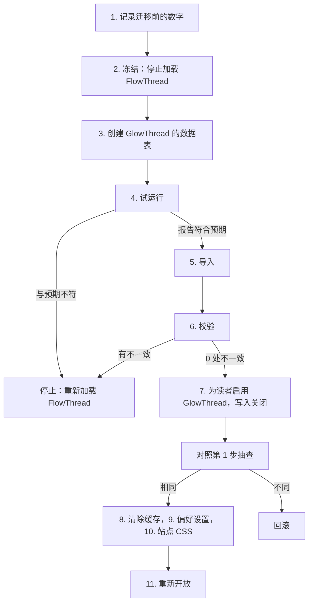

[English](../migrating-from-flowthread.md) | 简体中文

# 从 FlowThread 迁移

本操作手册把维基从 FlowThread 1.3.x 迁移到 GlowThread。GlowThread 的导入程序把 FlowThread 的评论、点赞、举报和页面设置复制到 GlowThread 的数据表中。它只读取 FlowThread 的数据表，从不写入，所以你随时可以回到 FlowThread。

评论会在一个短暂的窗口期内不可用。读者和编辑者可以照常使用维基。

导入程序如何处理每一行数据、提供哪些选项，见 [FlowThread 数据映射](migration-data.md)。

## 概览

| 阶段 | 读者看到 | 谁能评论 | 耗时 |
|---|---|---|---|
| 迁移日之前：安装 GlowThread 但不加载，在副本上演练，备份 | FlowThread | FlowThread | 提前几天 |
| 窗口期：关闭 FlowThread，创建数据表，导入，校验，为读者加载 GlowThread（只读），检查 | 没有评论，然后是 GlowThread | 没有人 | 预留约半小时。演练会告诉你导入需要多长时间 |
| 重新开放：开启 GlowThread 的写入 | GlowThread | GlowThread | 一分钟 |
| 之后：只要还可能回滚，就保留 FlowThread（不加载） | GlowThread | GlowThread | 几周 |



## 有哪些变化

| | FlowThread | GlowThread |
|---|---|---|
| 评论容器 | `<div id="flowthread">` | `<div id="glowthread">`。指向 `#flowthread` 的链接仍会打开评论区 |
| 站点 CSS 和脚本 | `#flowthread` 和 FlowThread 的内部 class | 把 `#flowthread` 改为 `#glowthread`（[第 10 步](#10-切换站点-css-和脚本)）。请改用[主题定制](theming.md)中的自定义属性和部件钩子来定制 GlowThread 的样式，而不是 FlowThread 的内部 class |
| 谁能发表评论 | `comment` 权限（FlowThread 界面中为“评论”），默认授予所有人（`*`） | 已登录用户拥有 `glowthread-post`。不支持匿名发表评论 |
| 管理权限 | `commentadmin`（“评论管理”）、`commentadmin-restricted`（“受限的评论管理”） | `glowthread-moderate`、`glowthread-erase`、`glowthread-configure`（[权限](configuration.md#权限)） |
| 文本 | 纯文本或维基文本，以 HTML 存储 | 纯文本，支持链接、提及和表情。导入的 HTML 会被转换（[映射](migration-data.md#文本)） |
| 嵌套 | 最多 3 层 | 显示 2 层。更深的回复显示在其第 1 层祖先评论下面，并保留真实的父评论 |
| 命名空间 | 除 MediaWiki、Template、Category、File 和 Module 外的所有非讨论命名空间 | 仅 `$wgGlowThreadNamespaces` 中的命名空间，默认为主命名空间 |
| 垃圾评论过滤 | `MediaWiki:Flowthread-blacklist`（“屏蔽列表”）把命中的评论标记为垃圾评论 | `MediaWiki:GlowThread-filter` 把命中的评论转入待审核（[敏感词过滤](configuration.md#敏感词过滤)） |
| 删除页面 | 抹除（“永久删除”）其评论 | 隐藏其评论。恢复页面后评论会回来 |
| 日志 | Special:Log/comments | Special:Log/glowthread（“评论日志”）和 Special:Log/glowthread-private（“评论抹除日志”）。FlowThread 的旧记录留在 Special:Log/comments 中，在 `$wgGlowThreadLegacyCompat` 开启且没有其他扩展使用该日志名称时显示 |
| 通知 | Echo 类别 `flowthread` | Echo 类别 `glowthread`（“评论”）。`$wgGlowThreadLegacyCompat` 开启时，旧通知仍会显示 |
| 永久链接 | Special:FlowThreadLink | Special:评论链接。旧的 Special:FlowThreadLink 链接仍然有效 |
| 管理页面 | Special:FlowThreadManage（“管理FlowThread评论”） | Special:评论管理。Special:FlowThreadManage 会转到这里 |
| 页面开关 | Special:FlowThreadControl（“评论控制”） | 评论区中的“页面：”菜单（[管理指南](moderation.md#页面状态)） |
| 关闭了评论的页面 | 已有评论仍然显示，只是不能再发表 | 默认导入为“锁定”：评论仍可阅读，但任何人都不能发表或回复。`--disabled-pages` 和 `--opted-out` 可以改变这一点（[导入选项](migration-data.md#导入选项)） |
| 导出和导入页面 | Special:FlowThreadExport、Special:FlowThreadImport | 无 |
| API | `api.php?action=flowthread` | REST 接口和 API 模块（[api.md](api.md)）。`$wgGlowThreadLegacyCompat` 开启时，提供 `action=flowthread` 的只读替代 |

FlowThread 的 `$wgFlowThreadConfig` 中有两项设置在 GlowThread 中有对应项：`PopularPostCount` 对应 `$wgGlowThreadPopularCount`，`PopularPostThreshold` 对应 `$wgGlowThreadPopularMinLikes`。`Avatar` 和 `AnonymousAvatar` 没有对应项：GlowThread 根据用户名生成头像，不从其他网站加载任何内容。`MaxNestLevel` 没有对应项：GlowThread 始终显示 2 层。

## 迁移日之前

### 检查环境要求

- GlowThread 的[环境要求](../../README.zh-CN.md#环境要求)：MediaWiki 1.43 或更高版本，以及支持窗口函数的数据库（MariaDB 10.2 或更高、MySQL 8.0 或更高、SQLite 3.25 或更高，或 PostgreSQL）。
- FlowThread 的三张表位于维基自己的数据库中，带有维基的表前缀。FlowThread 创建的表名为 `FlowThread`、`FlowThreadAttitude` 和 `FlowThreadControl`。在以小写存储表名的服务器上（`lower_case_table_names=1`），表名为 `flowthread`、`flowthreadattitude` 和 `flowthreadcontrol`。导入程序两种拼写都能找到。下面的 SQL 示例使用 FlowThread 的拼写：请使用你的服务器显示的拼写（`SHOW TABLES LIKE '%hread%';`）。

### 必须关闭临时账号

导入程序把旧的匿名评论存放在 IP 执行者（actor）名下（作者名为 IP 地址，与 FlowThread 显示的一样）。启用临时账号（`$wgAutoCreateTempUser`）时，MediaWiki 无法创建 IP 执行者。如果临时账号已启用，而某个 IP 执行者还不存在，导入程序会报告不一致，并且不写入任何数据。

检查：

```sh
echo 'var_dump( MediaWiki\MediaWikiServices::getInstance()->getTempUserConfig()->isEnabled() );' \
  | php maintenance/run.php eval
```

预期结果：`bool(false)`。MediaWiki 1.43 默认关闭临时账号。导入完成后再开启没有问题。

### 确定命名空间

FlowThread 显示评论的命名空间比 GlowThread 默认的多。其他命名空间中的评论无论如何都会导入，但只有开启这些命名空间后读者才能看到。统计一下（MySQL 或 MariaDB，请在表名前加上你的 `$wgDBprefix`）：

```sql
SELECT page_namespace, COUNT(DISTINCT flowthread_pageid) AS pages,
       SUM(flowthread_status = 0) AS visible
  FROM FlowThread JOIN page ON page_id = flowthread_pageid
  GROUP BY page_namespace;
```

例如，要保留用户页上的评论，请在[第 7 步](#7-为读者加载-glowthread写入仍关闭)中加入 `$wgGlowThreadNamespaces[NS_USER] = true;`。

### 确定导入选项

导入程序为每个选项采用推荐的默认值，例如如何处理 FlowThread 的“垃圾评论”（spam）状态，或者评论中的图片。各选项及其默认值见[导入选项](migration-data.md#导入选项)。

把商定的选项写进一个 shell 变量，在试运行、导入和校验中原样使用：

```sh
OPTS=''                                      # the defaults
# OPTS='--spoilers hold --images link'       # an example with two options changed
```

导入会把所选的选项记录在它的日志记录中。用其他选项运行 `--verify` 会把这一点报告为不一致。

下面的命令展开 `$OPTS` 时不加引号，这样在 bash 和 sh 中它会被拆分成多个选项。zsh 不会拆分它：在 zsh 中请写 `${=OPTS}`。

导入程序会在转换后的评论中写入指向维基页面的绝对链接。它使用 `$wgCanonicalServer`。如果这不是读者使用的地址，请指定 `--server https://wiki.example.org`。

### 安装 GlowThread 但先不加载

把 GlowThread 放到 `extensions/GlowThread`。暂时不要添加 `wfLoadExtension( 'GlowThread' );`。检查每个 PHP 文件都能解析（全部通过时不输出任何内容）：

```sh
find extensions/GlowThread/includes extensions/GlowThread/maintenance -name '*.php' \
  -exec php -l {} \; | grep -v '^No syntax errors'
```

### 在副本上演练

在维基数据库的副本上，用与生产环境相近的硬件、相同的 GlowThread 版本和相同的 `$OPTS`，完整执行一遍本手册。这可以让你了解：

- 对你的数据来说报告是什么样子，以及会出现哪些警告，
- 每一步需要多长时间。报告末尾有按阶段统计的 `Timings` 部分，
- `--verify` 没有发现不一致，并且第二次导入不会改变任何内容。

导入程序每批写入 200 条评论（`--batch-size`），每批之后等待数据库复制。大多数行都用单独的语句写入，因此导入时间随行数以及与数据库服务器之间的往返时间增长。笔记本电脑上的副本比通过网络访问的数据库更快。

### 备份 FlowThread 的数据表

用于回滚，也作为导入内容的记录（以 MySQL 或 MariaDB 为例，请加上你的表前缀）：

```sh
mysqldump --single-transaction --no-tablespaces -h DBHOST -u DBUSER -p DBNAME \
  FlowThread FlowThreadAttitude FlowThreadControl \
  | gzip > flowthread-$(date +%Y%m%d).sql.gz
```

请把这个文件和其他备份放在一起保管：它包含 IP 地址和评论文本。以后在 GlowThread 中抹除的评论仍留在其中，见[迁移之后](#迁移之后)。转储文件在每张表之前都有 `DROP TABLE IF EXISTS`，因此把它载入维基的数据库会替换正在使用的表。要查看其内容，请把它载入一个单独的数据库。如果你的服务器使用 GTID，请加上 `--set-gtid-purged=OFF`，以免在同一台服务器上恢复时失败。

### 准备其余事项

- **站点 CSS 和脚本。** 找出 MediaWiki 命名空间中所有用到 `flowthread` 的地方：MediaWiki:Common.css、皮肤 CSS（例如 MediaWiki:Vector.css 或 MediaWiki:Mobile.css）以及小工具。在 Special:Search 中选中 MediaWiki 命名空间即可找到它们。为[第 10 步](#10-切换站点-css-和脚本)准备好新的内容。
- **敏感词过滤。** 如果你用过 `MediaWiki:Flowthread-blacklist`（FlowThread 的“屏蔽列表”），请为 `MediaWiki:GlowThread-filter` 准备好对应的规则。FlowThread 的每一行是不带分隔符的正则表达式，匹配时不区分大小写。请把每一行写成 `/regex/i`。去掉行尾的 `<...>` 选项：GlowThread 没有替换功能，也不能按用户组豁免。命中规则的评论会转入待审核。见[敏感词过滤](configuration.md#敏感词过滤)。
- **权限。** 如果你在 `LocalSettings.php` 中改过 FlowThread 的权限，请规划好 GlowThread 中的对应设置。拥有 `commentadmin` 的用户组需要 `glowthread-moderate`，如果他们应能抹除评论，还需要 `glowthread-erase`。删除 `comment`、`commentadmin` 和 `commentadmin-restricted` 相关的行。
- **Echo。** 如果加载了 Echo，计划在第 7 步一起设置 `$wgEchoPerUserBlacklist = true;`，让读者可以屏蔽某一个用户的通知。
- **CDN。** 如果有 CDN 缓存你的页面，请阅读[部署在 CDN 之后](caching.md)。该文为 GlowThread 评论列表描述的缓存规则（[CDN 需要做什么](caching.md#cdn-需要做什么)）可以在切换之前加载：在加载 GlowThread 之前，该路由并不存在，它返回的错误也不会被缓存。
- 在维基上**公告**窗口期。

### 窗口期内如何修改 LocalSettings.php

- PHP 的 opcache 可能在最长 `opcache.revalidate_freq` 秒内继续使用旧文件。如果设置了 `opcache.validate_timestamps=0`，它永远不会重新读取文件：每次修改后请重新加载 PHP-FPM。
- 如果 `LocalSettings.php` 是以单个文件的形式绑定挂载到 Docker 容器中的，请覆盖写入现有文件（`cat new.php > LocalSettings.php`）。通过重命名来保存的编辑器或 `sed -i` 会让容器继续使用旧文件。
- 长时间运行的作业运行器（`runJobs --wait`）会保留它启动时的设置。下面每次修改之后都要重启它。

## 窗口期

### 1. 记录“迁移前”的数字

在 FlowThread 仍处于加载状态时，保存以下语句的输出（请加上你的表前缀）：

```sql
SELECT COUNT(*) FROM FlowThread;
SELECT flowthread_status, COUNT(*) FROM FlowThread GROUP BY flowthread_status;
SELECT flowthread_att_type, COUNT(*) FROM FlowThreadAttitude GROUP BY flowthread_att_type;
SELECT COUNT(*) FROM FlowThreadControl;
```

状态 0 表示正常，1 表示已删除，2 表示垃圾评论。态度类型 1 是点赞，2 是举报。

挑几个页面供稍后抽查：评论最多的几个页面，以及一个最近有评论被删除的页面。统计 FlowThread 显示的可见评论数：

```sh
for p in 101 202; do   # page IDs
  curl -s "https://wiki.example.org/api.php?action=flowthread&type=list&pageid=$p&limit=500&format=json" \
    | jq '.flowthread.posts | length'
done
```

### 2. 冻结 FlowThread

在 `LocalSettings.php` 中，把 `wfLoadExtension( 'FlowThread' );` 替换为：

```php
// Migration window: FlowThread off for everyone, GlowThread for maintenance scripts only
if ( PHP_SAPI === 'cli' ) {
	wfLoadExtension( 'GlowThread' );
}
```

然后重启作业运行器。要停止加载 FlowThread，而不是只收回它的权限，这样在导入期间没有任何东西能改动它的数据表。FlowThread 的页面删除钩子会抹除评论，所以仍加载着 FlowThread 的作业运行器在完成页面删除时可能会抹除评论。

检查：`api.php?action=flowthread&type=list&pageid=101&format=json` 返回错误 `badvalue`（无法识别的 `action` 值）。从此刻起，没有任何东西能写入 FlowThread 的数据表。再次运行第 1 步的 SQL，从现在起使用这些数字，这样最后几秒内发表的评论就不会显示为差异。

如果网站出现错误，请停止。恢复 FlowThread 那一行即可撤销。

### 3. 创建 GlowThread 的数据表

```sh
php maintenance/run.php sql extensions/GlowThread/sql/mysql/tables-generated.sql
```

请使用与你的数据库类型对应的目录：`mysql`、`sqlite` 或 `postgres`。这一步用你的表前缀创建六张 `glowthread_*` 表，不做其他任何事。`php maintenance/run.php update` 也会创建这些表，但它还会执行核心和其他扩展所有待执行的更新，这不适合放在短暂的窗口期内。之后运行 `update` 时，它会发现这些表已存在并跳过。

如果之前的尝试已经创建了这些表，这一步会以“table already exists”失败。这时跳过这一步，并阅读[回滚后重试](#回滚后重试)。

遇到其他任何错误时停止。

### 4. 试运行

```sh
php maintenance/run.php GlowThread:importFlowThread --dry-run $OPTS --report-file dry-run.json
```

试运行会读取并转换所有数据，不写入任何内容，然后打印报告。将它与第 1 步（冻结后取得的数字）比较：

- `comments`：`read` 等于评论数，`would insert` 也等于评论数。`FlowThread status` 各行与各状态的计数一致。
- `likes` 和 `reports`：`rows read` 与各态度类型的计数一致。
- `visibility`：使用默认选项时，`comments readers see in FlowThread` 等于 `comments readers see in GlowThread (planned)`。`--spoilers hold`、`--empty delete` 和 `--hidden visible` 会有意改变计划数：差值必须等于报告中统计的、受这些选项影响的评论数。`--disabled-pages disabled` 和 `--opted-out disabled` 会使计划数减少，减少的数量等于它们关闭的页面上的评论数。
- 开头部分显示你的选项，以及用于维基页面链接的 `server`。
- `Mismatches: 0`。
- 警告：`question-marks`、`truncated`、`empty`、`image-dropped`、`spoiler-revealed`、`formatting-dropped`、`literal-markup` 和 `link-changed` 是已知的类型。如果出现 `unparseable`、`invalid-utf8` 或 `element-dropped`，请先查看列出的评论。[警告](migration-data.md#警告)一节逐一解释了这些类型。

`--report-file` 以 JSON 格式写入完整报告，包含所有列出的 FlowThread ID。它不包含评论文本、用户名或 IP 地址，但可能包含评论中的 URL。请把它和备份放在一起。

如果以上任何一项不一致，请停止，并撤销第 2 步。

### 5. 导入

```sh
php maintenance/run.php GlowThread:importFlowThread $OPTS --report-file import.json
```

遇到异常，或者遇到诸如“Temporary accounts are enabled”这样的不一致时停止，后者会在写入任何数据之前检查。已经写入的行都是完整的批次。用相同的 `$OPTS` 再次运行，会从第一次停止的地方继续。修复原因后重新执行第 5 步，或者回滚。完成后，检查报告的 `run` 部分显示了 `glowthread/import log entries written`。Special:Log/glowthread 要到第 7 步网页端的维基加载 GlowThread 之后，才会显示这条记录。

### 6. 校验

```sh
php maintenance/run.php GlowThread:importFlowThread --verify $OPTS
echo $?
```

预期结果：`Mismatches: 0`，退出状态为 0，`already imported, unchanged` 等于评论数。`comments readers see` 下的两行 GlowThread 数字相等，FlowThread 那一行与它们的差别仅限于第 4 步所述的情况。

可选的 SQL 交叉检查（请加上你的表前缀）：

```sql
SELECT COUNT(*) FROM glowthread_post WHERE gtp_legacy_id IS NOT NULL;    -- = comments in step 1
SELECT gtp_status, COUNT(*) FROM glowthread_post GROUP BY gtp_status;
SELECT COUNT(*) FROM glowthread_reaction WHERE gtr_timestamp IS NULL;     -- imported likes
SELECT COUNT(*), SUM(gtrp_resolved_at IS NULL) FROM glowthread_report;    -- reports, open ones
SELECT gtpg_state, COUNT(*) FROM glowthread_page GROUP BY gtpg_state;
```

遇到不一致时停止。回滚（撤销第 2 步），然后查看报告文件。

### 7. 为读者加载 GlowThread，写入仍关闭

把第 2 步的代码块替换为：

```php
wfLoadExtension( 'GlowThread' );
// FlowThread compatibility: old notifications, old log entries, FlowThread's API read-only. Keep it on.
$wgGlowThreadLegacyCompat = true;
// Migration window: reading only until the checks pass
$wgGroupPermissions['user']['glowthread-post'] = false;
$wgGroupPermissions['user']['glowthread-react'] = false;
$wgGroupPermissions['user']['glowthread-report'] = false;
```

同时在这里加入你在[迁移日之前](#迁移日之前)准备的命名空间、权限和 Echo 设置。重启作业运行器。

当 PHP 使用新文件后，列表路由会返回 200 而不是 404。然后比较第 1 步中的页面（对 `rest.php` 的请求不算页面浏览，所以会立即显示新的状态）：

```sh
for p in 101 202; do
  curl -s "https://wiki.example.org/rest.php/glowthread/v1/page/$p/comments?sort=hot" | jq .count
done
```

预期结果：与第 1 步的数字相同。如果你选择了 `--disabled-pages disabled` 或 `--opted-out disabled`，这些页面处于“关闭”状态并返回 `0`，所以请另选页面做这项检查。还要在**登录状态**下，分别用桌面设备和手机打开这些页面。检查评论、点赞数和楼层号都能显示，并且 Special:Log/glowthread 显示了导入记录。

未登录时，在这一步之前被缓存的页面在第 8 步完成之前仍不显示评论。这不是回滚的理由。

如果某个计数不同，或者已登录读者的评论区加载失败，请停止并回滚。

### 8. 清除页面缓存

仅在 CDN 或文件缓存为未登录读者保存页面 HTML 时需要（`$wgUseCdn`、`$wgUseFileCache`）。第 7 步之前缓存的页面加载的是已不存在的 FlowThread 脚本，而不是 GlowThread 的加载器。在缓存副本过期之前（`$wgCdnMaxAge`，默认 5 小时），未登录读者在这些页面上看不到评论。

在小型维基上，清除评论所在命名空间中所有页面的缓存：

```sh
php maintenance/run.php purgeList --namespace 0
```

在大型维基上，只清除有评论的页面的缓存。先列出它们的标题，再清除缓存：

```sh
php maintenance/run.php eval > glowthread-pages.txt <<'PHP'
$s = MediaWiki\MediaWikiServices::getInstance();
$ids = $s->getConnectionProvider()->getReplicaDatabase()->newSelectQueryBuilder()->select( 'gtp_page' )->distinct()->from( 'glowthread_post' )->caller( 'migration' )->fetchFieldValues();
foreach ( $s->getPageStore()->newSelectQueryBuilder()->wherePageIds( $ids )->fetchPageRecords() as $p ) { echo MediaWiki\Title\Title::newFromPageIdentity( $p )->getPrefixedText(), "\n"; }
PHP
grep -c . glowthread-pages.txt
php maintenance/run.php purgeList < glowthread-pages.txt > glowthread-purge.txt
tail -2 glowthread-purge.txt
```

`eval` 逐行执行输入，所以每条语句都写在一行内。保留 `glowthread-pages.txt` 以备回滚。`purgeList` 会打印每个 URL，所以把输出写入文件。不要加 `--delay`：它只接受整秒，并且每个 URL 之后都会暂停。

然后在未登录状态下打开一个已清除缓存的页面：它必须显示 GlowThread 的评论区。使用第二种方法时，没有评论的页面要等缓存副本过期后，才会向未登录读者显示评论区。已登录读者看到的页面从不来自缓存。

### 9. 迁移通知偏好设置

仅在加载了 Echo 时需要。GlowThread 在自己的 Echo 类别 `glowthread` 中发送通知。修改过 FlowThread 类别（`flowthread`，网页或电子邮件）的用户，其选择只对 FlowThread 的旧通知有效。在重新开放写入、发出第一条 GlowThread 通知之前，把这些选择复制一次。先计数，再复制，然后再次计数（MySQL 或 MariaDB，请加上你的表前缀）：

```sql
SELECT up_property, COUNT(*) FROM user_properties
  WHERE up_property IN ('echo-subscriptions-web-flowthread', 'echo-subscriptions-email-flowthread')
  GROUP BY up_property;
INSERT IGNORE INTO user_properties (up_user, up_property, up_value)
  SELECT up_user, REPLACE(up_property, 'flowthread', 'glowthread'), up_value
  FROM user_properties
  WHERE up_property IN ('echo-subscriptions-web-flowthread', 'echo-subscriptions-email-flowthread');
SELECT up_property, COUNT(*) FROM user_properties
  WHERE up_property IN ('echo-subscriptions-web-glowthread', 'echo-subscriptions-email-glowthread')
  GROUP BY up_property;
```

在 SQLite 上写 `INSERT OR IGNORE`。在 PostgreSQL 上写 `INSERT ... ON CONFLICT DO NOTHING`。忽略重复项可以保留用户已经设置的 GlowThread 偏好，因此这一步可以重复运行。

前后两次计数必须相等。如果不相等，请在重新开放之前查明原因。复制只改变通知的发送方式，不影响评论。

管理员在第 7 步期间保留其权限，他们的操作已经会通知作者。如果允许管理员在窗口期内操作，请在第 6 步之后立即执行这一步。

### 10. 切换站点 CSS 和脚本

编辑迁移日之前找到的页面，把 `#flowthread` 替换为 `#glowthread`。例如：

```css
/* before */
#flowthread { margin-top: 2em; }
/* after */
#glowthread { margin-top: 2em; }
```

GlowThread 把容器放在 FlowThread 原来的位置，即紧接在页面内容之后，所以用于定位容器或设置其间距的规则仍然有效。针对 FlowThread 内部 class（`.comment-container`、`.post-content` 等）的规则不再起作用，可以删除。请用[主题定制](theming.md)中的自定义属性改变评论的外观。

ResourceLoader 会在几分钟内向读者提供新的站点 CSS。

### 11. 重新开放

删除第 7 步中的三行 `$wgGroupPermissions`。当 PHP 使用新文件后，进行测试：

1. 以管理员身份在测试页面上发表一条测试评论。
2. 用第二个账号给它点赞，再取消点赞。任何人都不能给自己的评论点赞。
3. 删除这条测试评论。

未登录时，页面的评论列表会立即显示新评论，删除后它也会随即消失，因为这两次写入都会清除列表的缓存。公告评论功能已恢复。

## 回滚

导入程序从不写入 FlowThread 的数据表，所以随时可以恢复 FlowThread。

1. 在 `LocalSettings.php` 中，用 `wfLoadExtension( 'FlowThread' );` 替换 GlowThread 的那几行，然后重启作业运行器。
2. 如果你在第 8 步清除过页面缓存：等所有 PHP 工作进程都使用新设置后，用同一份标题列表再清除一次缓存。GlowThread 不再加载后，它的列表路由返回 404：`rest.php/glowthread/v1/page/101/comments?sort=hot`。（FlowThread 的 API 不适合用来做这项检查：GlowThread 的兼容 API 以相同的名称响应。）如果在此之前清除缓存，仍使用旧设置的 PHP 工作进程会再次缓存 GlowThread 页面。
3. 如果执行过第 10 步，把站点 CSS 改回 `#flowthread`。

| 时间点 | 会丢失什么 |
|---|---|
| 第 11 步之前 | 没有 |
| 第 11 步之后 | 在 GlowThread 中发表的评论、点赞和举报。请先统计数量：`SELECT gtp_status, COUNT(*) FROM glowthread_post WHERE gtp_legacy_id IS NULL GROUP BY gtp_status;`。第 11 步的测试评论是一条 `deleted` 行。请在迁移之前决定是否要导出它们 |

第 7 步之后被缓存的、没有评论的页面会保留 GlowThread 的加载器，直到缓存过期。

### 回滚后重试

回滚后，FlowThread 完全恢复运行。从第 1 步重新开始（第 2 步会再次冻结 FlowThread），并跳过第 3 步，因为数据表已经存在。在保留的数据表上执行第 4 步的试运行，就能知道该怎么做：

- 如果它只列出要插入的评论、点赞和举报，没有 `already imported, differs from FlowThread now`、`imported earlier, no longer in FlowThread` 或 `not added: comment imported earlier` 行，说明 FlowThread 中没有发生需要关注的变化。保留 GlowThread 的数据表。导入只会补上缺少的内容。此时 `would insert` 加上 `already imported, unchanged` 等于评论数。
- 否则（FlowThread 中有评论被删除、抹除或修改，或者有点赞和举报被撤回，或已导入的评论上新增了点赞和举报），清空 GlowThread 的数据表，然后重新执行第 4 步。增量运行会保留在 FlowThread 中已被抹除的评论，保留旧的状态，不会给已导入的评论添加点赞或举报，楼层号也不再按创建顺序排列。

只有当 GlowThread 中除了测试评论外还没有自己的评论时，才能清空 GlowThread 的数据表（统计方法见[回滚](#回滚)）：

```sql
DELETE FROM glowthread_post;
DELETE FROM glowthread_reaction;
DELETE FROM glowthread_report;
DELETE FROM glowthread_page;
DELETE FROM logging WHERE log_type = 'glowthread' AND log_action = 'import';
```

请使用 `DELETE`，不要使用 `TRUNCATE`。`TRUNCATE` 会重置 ID 计数器，但第一次尝试留下的日志记录、Echo 通知和 CheckUser 记录仍然引用那次尝试的评论 ID。这样新评论可能会得到一个旧记录所指向的 ID。`DELETE` 保留计数器，新 ID 会在旧 ID 之上继续增加。

导入创建的 IP 执行者会保留下来。下一次运行会重复使用它们。

## 迁移之后

- **保持 `$wgGlowThreadLegacyCompat = true;`。** 它会显示 FlowThread 保存的通知和日志记录，并让读取 FlowThread API 的应用、小工具和其他客户端继续显示评论。关闭它会隐藏这些通知和日志记录（它们不会被删除）。API 的响应是私有的，因此不会被任何缓存保留。见 [FlowThread 兼容](configuration.md#flowthread-兼容)。
- **FlowThread。** 只要还可能回滚，就保留它的数据表和目录（不加载）。之后做最后一次备份，再删除这些表。切勿同时加载 FlowThread 和 GlowThread。在 GlowThread 中抹除导入的评论不会影响 FlowThread 的数据表及其备份：文本仍留在那里，回滚或重新导入会把它带回来。请像对待这些备份一样对待这些表，适用相同的保留期限和访问规则。一旦不再需要回滚，或者某次抹除（例如出于法律原因）也必须在那里生效，就删除这些表（`DROP TABLE FlowThread, FlowThreadAttitude, FlowThreadControl;`，加上你的表前缀），或者把它们移到存放备份的归档中。
- **导入程序。** GlowThread 开始接收评论后，只能以 `--verify` 运行导入程序。任何运行都不会撤销切换后在 GlowThread 中发生的事情，加了 `--update` 也一样：已抹除的评论、在那里设置的状态、举报处理结果和页面状态，以及撤销删除后被移到新页面 ID 的评论，都会保留。点赞和举报只会与它们的评论一起添加，因此用户取消的点赞不会回来。请在最后一次运行导入程序之后再合并用户账号（Extension:UserMerge）：之后再运行 `--update` 会删除被合并移到另一个账号名下的导入点赞和举报。`--verify` 把这些列为 `changed in GlowThread, kept` 或 `not added: comment imported earlier`，不算作不一致。
- **仍然有效的功能。** Special:FlowThreadLink 永久链接和指向 `#flowthread` 的链接，以及在 `$wgGlowThreadLegacyCompat` 开启时，FlowThread 保存的通知和它在 Special:Log/comments 中的记录。
- **临时账号**现在可以开启了，如果你需要的话。GlowThread 自己从不创建 IP 执行者。
