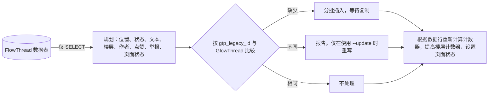

[English](../migration-data.md) | 简体中文

# FlowThread 数据映射

本文说明导入程序（`maintenance/importFlowThread.php`）如何把 FlowThread 的三张表转换为 GlowThread 的数据行，它提供哪些选项，以及它的报告会打印什么。分步操作手册见[从 FlowThread 迁移](migrating-from-flowthread.md)。

## 摘要

- FlowThread 中每一条可以导入的行在 GlowThread 中都有对应的位置。无法导入的行（ID 格式错误，点赞或举报来自匿名用户或已删除的用户，或者针对的评论不存在）会被跳过并计数。完全重复的点赞和举报只导入一次。
- 评论文本会从 FlowThread 存储的 HTML 转换为 GlowThread 的纯文本。大多数评论转换后，读者看到的内容没有任何变化。丢失了某些内容（图片、被揭开的黑幕、格式）的评论会在报告中列出，供人工检查。
- 导入程序只读取 FlowThread 的数据表，从不写入。
- 运行可以安全地重复。FlowThread ID 是键，所以对同一批数据再次运行不会写入任何内容。
- 每个有不止一种合理答案的决定都是一个[导入选项](#导入选项)，并带有推荐的默认值。

## 组成部分

| 组件 | 职责 |
|---|---|
| `maintenance/importFlowThread.php` | 命令本身。模式：`--dry-run`（规划并报告，不写入）、默认模式（写入）、`--verify`（不写入，进行比较，有任何不一致时以状态 1 退出） |
| `Import\FlowThreadImporter` | 根据 FlowThread 的行规划目标状态，与 GlowThread 比较，并按每批 `--batch-size` 条评论（默认 200）写入缺少的内容，每批之后等待复制 |
| `Import\LegacySource` | 读取 FlowThread 的 `FlowThread`、`FlowThreadAttitude` 和 `FlowThreadControl` 表（或它们的小写拼写）。它只执行 `SELECT` |
| `Import\ImportOptions` | 一次运行的选项（见[导入选项](#导入选项)） |
| `Import\ImportReport` | 计数、需要检查的 FlowThread ID、不一致和耗时。它不包含评论文本、用户名或 IP 地址 |
| `Import\LegacyId` | 把 11 字节的 FlowThread ID 解码为时间，并按创建顺序比较 ID |
| `Import\LegacyHtmlConverter`、`Import\ConversionResult` | 把存储的 HTML 转换为 GlowThread 的纯文本，并给出警告、特征计数，以及其用户链接所指的用户名（这些链接会变成提及） |

## 命令选项

| 选项 | 含义 |
|---|---|
| `--dry-run` | 规划并报告，不写入 |
| `--verify` | 不写入，比较 GlowThread 与 FlowThread，有任何不一致时以状态 1 退出 |
| `--page <id>` | 只处理这个页面 ID |
| `--update` | 同时重写与 FlowThread 当前数据不同的已导入评论、举报处理结果和页面状态，并删除 FlowThread 中已不存在的导入点赞和举报。不加此选项时，只补上缺少的评论，每条评论连同它的点赞和举报一起添加。即使加了此选项，在 GlowThread 中做出的决定也会保留，见[一次运行如何决定写入什么](#一次运行如何决定写入什么) |
| `--server <url>` | 转换后文本中指向维基页面的绝对链接所用的服务器地址。默认为 `$wgCanonicalServer` |
| `--user <name>` | 导入日志记录的执行人，也是导入时处理的举报的执行人。必须是已存在的用户。默认为“Maintenance script” |
| `--no-log` | 不写入 `glowthread/import` 日志记录 |
| `--report-file <path>` | 另外以 JSON 格式写入完整报告，包含所有列出的 FlowThread ID |
| `--batch-size <n>` | 每个写入批次的评论数。默认为 200 |
| `--spam`、`--reports-on-deleted`、`--empty`、`--images`、`--spoilers`、`--hidden`、`--self-attitudes`、`--disabled-pages`、`--opted-out`、`--missing-user-prefix` | [导入选项](#导入选项) |

`--dry-run` 和 `--verify` 不能同时使用。

## 一次运行如何决定写入什么

- FlowThread ID（`gtp_legacy_id`）是键。对同一来源再次运行不会写入任何内容。
- 不加 `--update` 时，与 FlowThread 不再一致的已导入评论只会被列出，绝不会被覆盖。
- 任何运行都不会撤销在 GlowThread 中做出的决定，加了 `--update` 也一样。已抹除的评论完全不会被改动。撤销删除让页面获得新 ID 时，GlowThread 移到新页面 ID 上的评论会留在那里。状态在 GlowThread 中被更改过的评论会保留其状态、待审核原因和文本：管理员的操作、作者自己删除和自动转入待审核都会设置 `gtp_status_timestamp`，而导入程序从不写入该列。这类评论的举报，以及管理员忽略的举报（“忽略举报”），都保留其处理结果，也不会被删除。管理员设置的页面状态会被保留（见[页面设置](#页面设置)）。每种模式都把这些计为 `changed in GlowThread, kept`，因此试运行会显示一次运行将保留什么，`--verify` 也不会把它们算作不一致。
- 导入的点赞是没有时间戳的点赞，导入的举报的理由为 `legacy`。只有这些会被删除，而且只在使用 `--update`、FlowThread 中已不存在它们时才删除。从 FlowThread 中消失的评论会被列出并保留。
- 点赞和举报只会与它们的评论一起添加，并在同一个事务中写入。之前导入的评论永远不会被添加点赞或举报，因此在 GlowThread 中被撤回的点赞或举报（用户取消的点赞、用户合并时删除的举报）不会回来，中途停止的运行继续时也不会丢失任何点赞或举报。每种模式都把 FlowThread 在这类评论上的点赞和举报计为 `not added: comment imported earlier`，`--verify` 不会把它们算作不一致。要给之前导入的评论添加点赞或举报（例如更改 `--self-attitudes` 之后），请清空 GlowThread 的数据表并重新导入。请在最后一次运行导入程序之后再合并用户账号（Extension:UserMerge）：之后再运行 `--update` 会删除被合并移到另一个账号名下的导入点赞和举报。
- 试运行、导入和校验请使用相同的选项。导入会把选项记录在它的日志记录中。使用其他选项的运行会首先报告这一点，`--verify` 会把它算作不一致。

导入程序直接写入数据表。它不运行任何钩子，所以不发送 Echo 通知，不记录 CheckUser 事件，不清除 CDN 缓存，也不为每条评论写日志记录。它会写入一条 `glowthread/import` 日志记录（在 Special:Log/glowthread 中），其中包含导入的评论总数（`4::count`，所有运行合计）和所选的选项（`5::options`）。写入的时机是：本次运行添加了评论，或者之前的运行添加了评论但在写入日志记录之前停止，或者 `--update` 应用了新的选项。`--no-log` 会跳过这条记录。该记录只写入 `logging` 表，不出现在最近更改中。报告的 `run` 部分把它计为 `glowthread/import log entries written`。为了判断之前的运行是否写入了日志记录，以及把选项与上一次导入比较，导入程序只读取 `glowthread/import` 记录。FlowThread 自己的 `import` 记录（日志类型 `comments`，由 Special:FlowThreadImport 写入）会被忽略，因此它们不会让继续执行的运行跳过写入日志记录。

## 评论：`flowthread` 到 `glowthread_post`

| FlowThread 列 | GlowThread 列 | 规则 |
|---|---|---|
| `flowthread_id` | `gtp_legacy_id` | `LegacyId::getHex()`，22 位小写十六进制数字。使导入可以重复执行的唯一键 |
| `flowthread_id` | `gtp_created` | `LegacyId::getTimestamp()`，UTC。见[时间和顺序](#时间和顺序) |
| 无 | `gtp_id` | 自增。行按旧 ID 的顺序插入（父评论总在其回复之前），所以 `gtp_id` 的顺序就是创建顺序 |
| `flowthread_pageid` | `gtp_page` | 相同的页面 ID。如果撤销删除让页面获得了新 ID，GlowThread 会把评论移到新 ID 上，之后的运行会保留这个页面 ID |
| `flowthread_userid`、`flowthread_username` | `gtp_actor` | 见[作者](#作者) |
| `flowthread_text` | `gtp_text` | `LegacyHtmlConverter::convert()->text`。见[文本](#文本) |
| `flowthread_parentid` | `gtp_reply_to`、`gtp_parent`、`gtp_thread`、`gtp_depth` | 见[回复层级](#回复层级) |
| `flowthread_status` | `gtp_status`、`gtp_hold_reason` | 见[状态](#状态) |
| `flowthread_like` | `gtp_like_count` | 根据 `glowthread_reaction` 中的行计数。FlowThread 的计数器只用于比较，计数不一致的评论会被列出 |
| `flowthread_report` | `gtp_open_report_count` | 根据 `glowthread_report` 中未处理的行计数。FlowThread 的计数器只用于比较 |
| 无 | `gtp_seq` | 楼层号。见[楼层](#楼层) |
| 无 | `gtp_reply_count` | `gtp_parent` 为这条评论的可见评论数，在所有行导入后统计 |
| 无 | `gtp_edited`、`gtp_pinned`、`gtp_status_actor`、`gtp_status_timestamp` | 为 null。FlowThread 没有编辑和置顶功能，也不记录是谁、在何时删除了评论。它的日志记录只写明页面和评论的作者，因此无法可靠地把某一行与其日志记录对应起来 |

## 时间和顺序

FlowThread 没有时间戳列。时间是 ID 的一部分，ID 由 MediaWiki 的 `GlobalIdGenerator::newTimestampedUID88()` 生成：46 位自 1970 年以来的毫秒数、10 位计数器，然后是 32 位主机 ID，按大端序排列。`LegacyId::getTimestamp()` 得到的秒数与 FlowThread 自己的 `UID::getTimestamp()` 相同。

- 按旧 ID 排序，不要只按 `gtp_created` 排序。ID 保留了精确到毫秒的顺序。在同一毫秒内，MediaWiki 的计数器从一个随机偏移开始，到 1024 时回绕，所以同一毫秒内的两条评论可能会互换顺序。
- 对于不可能真实存在的 ID，`LegacyId::getProblem()` 返回 `before-2016` 或 `future`。这类 ID 可能来自 Special:FlowThreadImport，它会保留 JSON 输入中的 ID。导入程序会以解码出的时间导入这样的评论，并将其列出。

## 文本

### 存储格式

FlowThread 以 HTML 存储评论，共有三种形式：

| 格式 | 形式 |
|---|---|
| 纯文本 | 完全没有标签。纯文本帖子保存时被包在 `<nowiki>` 中，所以存储的值是转义后的文本（`&amp;`、`&quot;`、`&lt;`），作者的换行以原始换行符保存。FlowThread 去掉了这层包装和外层的单个段落 |
| 内联 HTML | FlowThread 的回复前缀（`@<a href=".../User:Name">Name</a> `），以及以维基文本模式（FlowThread 的“使用维基文本”）写的帖子：`
`、`<a>`、` `、`<b>`、`<i>`、`<del>`、``、黑幕 span |
| 完整的解析器输出 | `

…\n

`。在较新的 MediaWiki 版本上，FlowThread 用于去掉这层包装的模式不再匹配，所以存储的是完整的解析器输出 |

### 规则

示例都是虚构的，展示的是真实数据行的形式。`wiki.example.org` 代表 `--server` 的值。

| 存储值 | 转换结果 | 原因 |
|---|---|---|
| `

Have a nice weekend\n

` | `Have a nice weekend` | 所有 MediaWiki 版本的包装都会被去掉 |
| `
First paragraph\n

Second paragraph\n
` | `First paragraph`，一个空行，`Second paragraph` | 段落边界是一个空行 |
| `One line \nTwo lines` | `One line`，一个换行，`Two lines` | ` ` 是换行。MediaWiki 在它后面写入的换行符不会让换行加倍 |
| `First line\nSecond line`（纯文本） | 相同 | 文本中的换行符是作者自己的换行。连续的空行最多保留一个 |
| `Note  as   follows\n   indented` | `Note as follows`，一个换行，`indented` | 连续的空格和制表符合并为一个空格，每行去掉首尾空白，这与读者在 HTML 中看到的一致。行内的全角空格（U+3000）保留 |
| `A&amp;B &lt;3 &amp;lt;` | `A&B <3 &lt;` | 实体只解码一次，所以作者输入的实体仍保留为实体 |
| `<a class="external free" href="U">U</a>` | `U` | 裸链接变为它的 URL，其中的非 ASCII 字符会被百分号编码，因为 GlowThread 在遇到第一个 CJK 字符时结束 URL（[api.md](api.md#片段)）。只有一个例外：当 URL 中含有全角标点、引号或空格时，说明 MediaWiki 曾把作者后面的文字一并吞进了链接。这时文本保持原样，GlowThread 只链接真正的 URL，并给该评论加上 `link-changed` 警告 |
| `<a class="external autonumber" href="U">[1]</a>` | `U` | 编号链接变为它的 URL，编码方式相同 |
| `<a class="external text" href="U">the site</a>` | `the site (U)` | 链接文字和目标都会保留。在 `U` 中，非 ASCII 字符、引号、尖括号以及最末尾的标点会被百分号编码，因此整个目标仍是一个链接 |
| `@<a href="/index.php?title=User:Kim&action=edit&redlink=1">Kim</a> hello` | `<@42> hello`（Kim 是用户 42） | 指向用户页的链接（内容语言中 User 命名空间的任何别名，无论页面是否存在，无论是相对链接还是绝对链接）会变成所指用户的提及标记 `<@ID>`，按链接中的确切用户名查找。FlowThread 回复前缀中的 `@` 会并入提及。不是用户的名字保留为文本（`@Kim hello`），被 hideuser 封禁隐藏的用户变成 `@…`，这样不会存储该用户名 |
| `ask<a href="/wiki/User:Kim">Kim</a>today` | `ask<@42>today` | 提及标记两侧都不需要空格。读者看到的提及是 `@` 加上该用户当前的用户名 |
| `<a href="/wiki/User:Kim">Old Kim</a>` | `Old Kim (<@42>)` | 不是用户名的链接文字会保留，后面跟着提及 |
| `see <a href="/wiki/Test_page">Test page</a> first` | `see Test page (https://wiki.example.org/wiki/Test_page) first` | 其他维基链接，包括指向不存在条目的链接，会变成 `text (URL)`，其中的 URL 是指向页面查看地址的绝对 URL。如果链接带有标题以外的内容，例如旧版本（`oldid`）、差异或 `action=history`，则保留完整的 URL |
| `<a href="/wiki/Bread_(sourdough)">Bread</a>` | `Bread (https://wiki.example.org/wiki/Bread_%28sourdough%29)` | 标题中除 ASCII 字母、数字、`-_.~`、`:` 和 `/` 以外的字符都会被百分号编码。最末尾的 `.` 或 `:` 也会被编码，因为 GlowThread 会把它从 URL 中去掉 |
| `secret`、`<b>`、`<i>`、`<del>` | 其中的文本 | 格式没有纯文本形式。每种情况都会被记录。`heimu` 是许多中文维基使用的黑幕剧透样式 |
| ``、`<script>`、`<style>`、`<iframe>` 和其他嵌入内容 | 无 | 删除并记录，图片会连同其 `src` 记录。位于指向其文件页面的链接中的图片（`[[File:X.png]]`）会留下该链接的 URL。使用 `--images link` 时，每张图片改为替换成它的 URL |

为什么维基链接使用 `text (URL)`：它可以还原（URL 只对应唯一的标题），文字仍在 URL 前面，便于阅读，而且 GlowThread 会把 URL 变成可用的链接。其他做法都会丢失一些东西。只保留文字会丢掉链接目标，而 Markdown 的 `[text](URL)` 会显示出方括号，因为 GlowThread 不渲染 Markdown。

转换后，文本会经过 `TextProcessor::normalize()`，因此与 GlowThread 为新评论存储的内容逐字节相同。这一步会去除不可见的格式字符（例如零宽空格或双向文本嵌入字符），并进行 NFC 规范化。它还会去除隐藏的标签字符，不会显示任何内容的文本会变为空。用户链接按导入时所指的用户名匹配，因此之后改过名的用户不会被找到，该名字保留为文本。提及标记显示用户当前的用户名，因此会跟随之后的改名。

导入的评论不受发表规则约束。`maxLength`、`maxMentions` 和敏感词过滤只适用于新评论：FlowThread 已经发布了这些评论，导入会保留读者当时看到的样子。因此一条很长的导入评论可能包含比新评论允许的更多的提及，导入也不会发送提及通知。只有文本列的大小会限制导入的评论。

转换后的文本可能比存储的 HTML 更长，因为链接目标会被百分号编码，链接也会变成 `text (URL)`。超过 65,530 字节（`gtp_text` 的大小）的文本会在能放下的最后一个完整字符之后截断，并以 `…` 结尾。报告在 `shortened to fit the text column` 下列出这类评论及其转换后的大小。如果不截断，MySQL 和 MariaDB 会在某个字符中间截断该值，或者在严格模式下拒绝这一行。

### 解析安全

- 除非文档声明了编码，`DOMDocument::loadHTML()` 会把输入当作 ISO-8859-1 读取。转换器把每个值包在一个带 UTF-8 `<meta>` 的文档中。一项单元测试表明，不声明编码的形式会弄乱非拉丁文字和表情符号。
- 只传入 `LIBXML_NONET`：不访问网络，不加载 DTD，不替换实体。一项测试表明，声明的外部实体会保留为字面文本。
- libxml 错误在内部收集，只读取当前解析产生的错误，调用方的 libxml 错误模式和尚未处理的错误保持原样。
- 嵌套深度超过 libxml 256 层元素限制的标记，会在展平其元素后重新转换，因此其中的文本和链接都会保留，但块之间的换行可能略有不同。如果这样仍然失败，就只保留文本，并加上详情 `tags stripped, links lost`。
- 输出是纯文本，绝不是标记。只是因为作者输入而看起来像标签的文本（纯文本帖子中的 ` `）仍然是文本，并会产生警告。

### 警告

| 代码 | 含义 | 建议处理方式 |
|---|---|---|
| `link-changed` | GlowThread 链接的范围与 FlowThread 不同的裸 URL，因为 GlowThread 会在全角标点处停止，或者去掉末尾的标点。详情：GlowThread 链接的部分 | 接受。GlowThread 较短的链接通常正是作者的本意 |
| `question-marks` | 连续 4 个或更多 `?`。在某些配置中，使用 3 字节 `utf8` 表的数据库会把表情符号的每个字节替换成 `?`，所以 `????` 可能是一个丢失的表情符号 | 按存储原样导入。表情符号无法恢复。作者自己输入的 `????` 看起来也一样 |
| `truncated` | 存储的 HTML 在标签内部结束，或者打开了从未关闭的元素。使用 3 字节 `utf8` 列的 MySQL 和 MariaDB 可能会在第一个 4 字节字符（表情符号）处截断值。转换器会关闭未关闭的元素，并保留剩下的文本。详情：缺少的部分 | 按原样导入剩下的文本。纯文本行没有闭合标签，因此无法检测其截断 |
| `empty` | 什么都没剩下 | 见 `--empty` |
| `image-dropped` | 删除了一张图片。详情：它的 `src` | 见 `--images` |
| `spoiler-revealed` | 原本被 `heimu` 黑幕样式隐藏的文本现在直接显示 | 见 `--spoilers` |
| `formatting-dropped` | 粗体、斜体、删除线、带样式的 span、列表或表格标记被简化为文本。详情：标签 | 接受 |
| `literal-markup` | 文本中有看起来像 HTML 标签的内容，它由作者输入，以前也显示为文本 | 接受 |
| `element-dropped` | 删除了脚本、样式、iframe 或其他嵌入内容。详情：标签 | 人工检查 |
| `unparseable` | libxml 报告了嵌套错误或无效的标记。详情：它的消息。单独的 `&` 或未知的 HTML5 标签不计在内 | 人工检查 |
| `invalid-utf8` | 存储的字节不是有效的 UTF-8。无效序列变为 U+FFFD | 人工检查 |

报告还会按评论统计各项特征，这些不需要处理：去掉的包装、包含多个段落的评论、换行、外部链接、维基页面链接、用户链接。

## 状态

| FlowThread 状态 | GlowThread | 说明 |
|---|---|---|
| 0，正常 | `visible`，或 `deleted`（见说明） | 只要任一祖先评论被删除，FlowThread 就会对读者隐藏该评论。GlowThread 只检查显示上的父评论和顶层评论（[api.md](api.md#评论)）。在两者结果相同的情况下，评论保持 `visible`，同时保持隐藏，祖先评论恢复后它也会重新出现。第 3 层或更深、自身的父评论已被删除的回复，会被 GlowThread 重新显示在其第 1 层祖先下面。这类评论遵循 `--hidden`，默认为 `deleted` |
| 1，已删除 | `deleted` | 和以前一样可以恢复。删除人和删除时间为空 |
| 2，垃圾评论 | `held`，待审核原因为 `filter`（默认），或者 `deleted` | FlowThread 在其屏蔽列表命中时设置这个状态。`held` 保留了“被过滤器拦下，由管理员决定”的含义，并把评论放进待审核队列。`deleted` 会把评论隐藏起来，就像管理员已经做出了判断。见 `--spam` |

FlowThread 的抹除（“永久删除”）会把行从表中删去，所以被抹除的评论已不存在，无从导入。

## 回复层级

FlowThread 最多嵌套 3 层，并保留真实的父评论。GlowThread 显示 2 层，并在 `gtp_reply_to` 中保留真实的父评论。

| FlowThread 深度 | `gtp_depth` | `gtp_parent` | `gtp_reply_to` | `gtp_thread` |
|---|---|---|---|---|
| 0（顶层） | 0 | null | null | null |
| 1 | 1 | 父评论 | 父评论 | 顶层祖先 |
| 2 | 2 | 父评论 | 父评论 | 顶层祖先 |
| 3 及更深 | 2 | 第 1 层的祖先 | 父评论 | 顶层祖先 |

- 评论按旧 ID 的顺序插入，父评论通过从旧 ID 到 `gtp_id` 的映射查找。父评论通常比它的回复早。如果某条父评论更晚，它会先被插入。
- 父评论不存在、父评论在另一个页面上，或者父评论链中有循环：该评论以顶层评论导入，`gtp_reply_to` 为 null，并会被列出。FlowThread 不显示这样的评论，所以适用 `--hidden`：默认导入为 `deleted`。
- `gtp_reply_count` 统计导入后 `gtp_parent` 为这条评论的可见评论数。

## 楼层

`gtp_seq` 按旧 ID 的顺序为每个页面的评论编号 1、2、3 等。它统计每一条导入的行，包括已删除的行，所以被删除的评论保留其楼层，楼层永远不会重复使用。在评论被删除的地方，读者会看到楼层号的间断。`glowthread_page.gtpg_seq` 设为该页面的最后一个楼层。

- 楼层只分配一次，之后不再改变，所以重复运行时不比较楼层。`--verify` 改为检查每个页面已导入评论的楼层是否按创建顺序递增。
- 如果某条 GlowThread 评论已经占用了计划的楼层（只有在导入到已有 GlowThread 评论的维基时才可能发生），导入的评论会得到高于该页面所有楼层的下一个空闲楼层，报告会列出它。
- 相同的行总是得到相同的楼层。如果在演练和正式迁移之间有 FlowThread 评论被抹除，在副本上演练得到的楼层可能与正式迁移不同。这没有影响，因为正式迁移是在正在使用的数据表上运行的。
- 新的 GlowThread 评论的楼层排在导入的评论之后。如果在 GlowThread 接收评论之后重新完整导入，就必须把旧的行排在新评论之后，所以导入只应在迁移窗口期内进行。

## 作者

**注册用户作者。** `flowthread_userid` 映射到它的执行者（`actor_user`），从不按存储的用户名映射。这样显示的是当前用户名，所以用户改名无需任何处理。报告会打印有多少存储的用户名与当前用户名不同。

**来自 Special:FlowThreadImport 的行。** FlowThread 的导入页面会原样存储 JSON 文件给出的用户 ID 和用户名，不检查两者是否对应。FlowThread 显示存储的用户名，GlowThread 显示该用户 ID 当前的用户名，因此这样的评论可能显示在一个从未写过它的账号名下。如果你用过 Special:FlowThreadImport，请在导入前检查 FlowThread 的 `import` 日志记录（日志类型 `comments`）所指页面上的评论。报告中存储的用户名与当前用户名不同的计数可能包含这样的行。

**已不存在的用户 ID**（用户合并后可能出现）：默认使用名为 `imported>Name` 的外部执行者，这是 MediaWiki 自己的 `importDump.php` 使用的约定。`ActorStore` 会创建这样的执行者，它们无法登录，显示原来的用户名，以后注册 `Name` 的人也不会继承这些评论。如果复用按用户名找到的执行者，评论就会交给现在持有该用户名的人。见 `--missing-user-prefix`。

**匿名作者。** FlowThread 把 `flowthread_userid` 存为 0，把 IP 地址存为 `flowthread_username`。这类评论会得到一个 IP 执行者（`ActorStore::acquireActorId( new UserIdentityValue( 0, $ip ) )`），如果该地址还没有执行者就会创建一个。IP 地址仍作为作者名显示，与 FlowThread 中一样。不是有效 IP 地址的匿名名称会像不存在的用户一样得到外部执行者，并会被列出。

- 启用临时账号（`$wgAutoCreateTempUser`）时，`ActorStore` 拒绝创建 IP 执行者。导入程序会首先检查这一点：如果某个匿名作者还没有执行者，而临时账号已开启，它会报告不一致，并且不写入任何数据。
- FlowThread 回复匿名评论时的回复前缀是 `@` 加上纯文本形式的 IP 地址。这类文本会把地址保留为文本。

**文本中的提及。** 用户链接会变成提及标记（见[规则](#规则)），所有名字一起查找。在纯文本帖子中以 `@name` 形式输入的名字仍是纯文本，与 FlowThread 中的显示一样：GlowThread 只把标记识别为提及。以文本形式输入的标记（例如 `<@42>`）在 FlowThread 中是纯文本，导入后会成为对该用户的提及，与在 GlowThread 中输入的标记一样。报告统计用户链接数、不同的名字数、用户的名字数（现为提及）、被隐藏用户的名字数（现为 `@…`）、不是用户的名字数（保留为文本），以及被提及的不同用户数。导入不发送任何通知。

## 点赞和举报

`flowthreadattitude` 没有主键，也没有时间戳。FlowThread 对每个用户和每条评论最多保留一个态度：举报一条评论会替换之前的点赞。

| `flowthread_att_type` | GlowThread |
|---|---|
| 1，点赞 | `glowthread_reaction` 中的一行（评论、执行者、`like`、无时间戳）。主键会去掉完全重复的行。已删除评论上的点赞会保留，所以恢复评论时点赞也会回来。对自己评论的点赞遵循 `--self-attitudes` |
| 2，举报 | `glowthread_report` 中的一行，理由为 `legacy`，没有备注，也没有创建时间。FlowThread 的“标记为已检查”（mark checked）操作会删除举报行，所以剩下的每一行都未经处理。可见评论上的举报导入为未处理。已删除评论上的举报遵循 `--reports-on-deleted`，在 GlowThread 中被抹除的评论上的举报总是导入为已处理。对自己评论的举报遵循 `--self-attitudes` |

- 匿名用户的态度、针对不存在评论的态度，以及不存在的用户的态度，会被跳过并计数。已不存在的用户 ID 做出的点赞和举报总会被跳过，即使该用户的评论以 `imported>Name` 执行者的名义保留了下来。
- `gtp_like_count` 是导入的点赞数，`gtp_open_report_count` 是导入的未处理举报数。两者都会与 FlowThread 的计数器比较，不一致之处会被列出。
- 导入程序不会运行发表评论时的任何副作用：不会因举报而自动转入待审核，不发送 Echo 通知，不记录 CheckUser 事件，不清除 CDN 缓存。请在 GlowThread 提供页面之前导入，这样就不会缓存过时的内容。
- 导入的举报（理由为 `legacy`）会进入管理队列，但不计入自动转入待审核。如果在 FlowThread 中举报过某条评论的用户在 GlowThread 中再次举报它，导入的举报会变成这次新的举报并被计入。

## 页面设置

| `flowthreadcontrol` 状态 | `glowthread_page.gtpg_state` |
|---|---|
| 2，管理员关闭了评论（FlowThread 的“禁止该页面上的评论”） | 默认为 `locked`（界面中为“锁定”），使用 `--disabled-pages disabled` 时为 `disabled`（“关闭”） |
| 1，页面所有者选择关闭评论（FlowThread 的“在我用户页上关闭评论功能”） | 默认为 `locked`，使用 `--opted-out` 时为 `disabled` 或 `open` |
| 无记录，页面有评论 | `open`，楼层计数器提高到该页面的最后一个楼层 |

FlowThread 对状态为 1 或 2 的页面仍显示已有评论，只是拒绝新评论。`locked` 的效果相同：读者仍能看到评论，但任何人都不能发表或回复。`disabled` 会对读者隐藏评论。报告的 `visibility` 计数考虑了页面状态，所以使用 `disabled` 时，计划数比 FlowThread 的少，少的数量等于这些页面上的评论数。

导入程序不为页面状态写日志记录。设置人和设置时间取自 FlowThread 中该页面最新的 `disable` 记录（日志类型 `comments`），开放的页面则取自其最新的 `enable` 记录。没有这样的记录时为空。

管理员已经在 GlowThread 中更改过状态的页面会保持该状态，使用 `--update` 时也一样。GlowThread 中仍处于锁定或关闭状态、但 FlowThread 已不再列出的页面（在之前的运行之后，又在 FlowThread 中重新开启了评论），会以同样的方式重新开放，并记在 FlowThread 最新的 `enable` 记录名下。

现在已是重定向的页面上的评论仍留在原来的页面 ID 上。读者只有打开重定向页面本身才能看到它们，与 FlowThread 中一样。报告会统计重定向页面上的评论数。已不存在的页面上的评论也会像 FlowThread 保留它们那样被导入，读者看不到它们。如果页面被恢复，它们会重新显示，这与 GlowThread 运行期间被删除的页面一样。报告在 `on a page that does not exist` 下列出它们，以便你在切换之前检查。

## 导入报告的内容

控制台报告包含以下部分。`--report-file` 会加上所有列出的 FlowThread ID。报告从不包含评论文本、用户名或 IP 地址。

| 部分 | 统计内容 |
|---|---|
| 开头 | 本次运行的选项、页面链接所用的服务器、最早和最晚的评论时间，以及选项与上次导入不同时的警告 |
| comments | 读取数，按 FlowThread 状态，按 GlowThread 状态，插入数（或“would insert”，`--verify` 时为“missing in GlowThread”），已导入且未变，已导入但不同，在 GlowThread 中被更改而保留，已更新，因祖先被删除而隐藏，在 FlowThread 中隐藏但按 GlowThread 的规则会显示，之前导入但已不在 FlowThread 中，因 ID 错误而跳过 |
| time | 按问题分类的不可信 ID |
| threads | 按 FlowThread 深度统计的评论、显示在第 1 层祖先下面的第 2 层评论、按原因统计的移到顶层的评论 |
| text | 按存储格式，无警告转换的，按警告代码和按特征分别统计的评论数和出现次数，为放入文本列而缩短的评论 |
| mentions | 用户链接、不同的链接名字、用户的名字（现为提及）、被隐藏用户的名字（现为 `@…`）、不是用户的名字（保留为文本）、被提及的不同用户 |
| floors | 有评论的页面、存储的最高楼层、因 GlowThread 评论占用而移动的楼层、不高于前一个楼层的导入楼层 |
| authors | 注册作者和匿名作者的评论数、不同的用户和地址数、已创建（或待创建）的执行者、使用外部执行者的不存在用户、与当前用户名不同的存储用户名、不是 IP 地址的匿名名称 |
| likes, reports | 读取的行数、针对自己评论的、完全重复的、跳过的（匿名、评论不存在、用户不存在、针对自己评论而被丢弃）、待导入的（举报分为未处理和已处理）、已插入、已存在、未添加（评论之前已导入）、在 GlowThread 中被更改而保留（举报）、之前导入但已不在 FlowThread 中、已删除、FlowThread 计数器不一致的评论 |
| counters | 设置了计数器的评论（`--dry-run` 和 `--verify` 时为计数器不一致的评论） |
| pages | 不存在的页面（会列出）和重定向页面上的评论、提高的楼层计数器、按控制状态、设置或保留的状态 |
| visibility | 读者在 FlowThread 中看到的评论、在 GlowThread 中按计划看到的评论，以及根据存储的行统计的、在 GlowThread 中看到的评论（`--dry-run` 时没有）。两个 GlowThread 计数都不包括关闭（`disabled`）页面上的评论 |
| run | `glowthread/import log entries written`：本次运行写入了导入日志记录时为 1 |
| for review | 按警告代码和特殊情况分类的 FlowThread ID（控制台上显示前 20 个） |
| timings | 每个阶段的秒数 |
| mismatches | `--verify`：每一处差异，在 GlowThread 中被更改而保留的除外。只要有任何差异，命令就以状态 1 退出 |

## 导入选项

每个默认值都是推荐值。除非指定了选项，导入程序都使用默认值。选项的值会被检查：任何其他值都会让运行在开始前停止。

| 选项 | 问题 | 默认值 | 其他值 |
|---|---|---|---|
| `--spam` | FlowThread 的垃圾评论状态（2） | `held`：转入待审核，原因为 `filter`。被过滤器拦下，由管理员决定 | `deleted` |
| `--reports-on-deleted` | 已删除评论上未经处理的举报 | `resolved`：由导入的执行人在导入时以“成立”结案。未处理的举报会把已经删除的评论放进“被举报”队列 | `open` |
| `--empty` | 转换后为空的评论 | `keep`：保留，这样它的点赞、回复和楼层都得以保留 | `delete` |
| `--images` | 评论中的图片 | `drop`：删除并列出 | `link`：替换为它的 URL |
| `--spoilers` | 从 `heimu` 黑幕中显露出来的文本 | `keep`：直接显示 | `hold`：该评论转入待审核 |
| `--hidden` | FlowThread 不显示、但 GlowThread 会显示的正常评论 | `deleted`，这样被隐藏的内容不会重新出现。管理员可以恢复其中某条 | `visible` |
| `--self-attitudes` | 对自己评论的点赞和举报 | `keep`，这样点赞数与读者之前看到的一致 | `drop` |
| `--disabled-pages` | 管理员关闭了评论的页面（控制状态 2） | `locked`：读者看到的评论与 FlowThread 中一样，任何人都不能发表或回复 | `disabled`：页面被关闭，读者不再能看到它的评论 |
| `--opted-out` | 所有者关闭了评论的页面（控制状态 1） | `locked`，与 `--disabled-pages` 相同 | `disabled`，或 `open`：重新开放评论 |
| `--missing-user-prefix` | 用户 ID 已不存在的作者 | `imported`，得到外部执行者 `imported>Name` | 其他普通单词 |

在表情符号处被截断的文本，以及因表情符号丢失而出现的 `????`，没有对应的选项：它们按存储原样导入，不加任何标记，并在报告中列出。

## 测试方式

- `tests/phpunit/unit/Import/` 中的单元测试用虚构的示例覆盖了 ID 和转换器，涵盖上面的每一种模式。
- `tests/phpunit/integration/Import/` 中的集成测试在测试数据库中创建 FlowThread 的表，填入虚构的行，并覆盖上面的每条映射规则、每个选项、不做任何改变的第二次运行、不写入任何内容的 `--dry-run`、发现差异的 `--verify`、修复差异但保留 GlowThread 中所做决定的 `--update`、被撤回的点赞和举报不再回来、中途停止的运行可以继续、`--page`、已被占用的楼层、为放入文本列而缩短的文本、以线性内存规划的深层回复链，以及 FlowThread 的表保持不变。
- 两者都通过 `scripts/php-test.sh` 在 MediaWiki 1.43 和 1.46 上运行（见[贡献指南](../../CONTRIBUTING.zh-CN.md)）。
